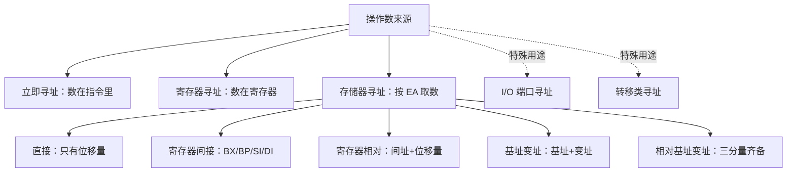

# 第03讲 8086 寻址方式及指令系统 · 逐考点详解

## 本讲是什么 & 为什么考

**先从一个问题说起**：一条 MOV 指令要写操作数，这个数可以写死、可以在寄存器里、
可以在内存某个角落——指令怎么知道去哪儿拿？

答案是**寻址方式**，它就是「**操作数的取法规则**」。推演下去：操作数的来源只有
三大类——**立即数**（写死在指令里）、**寄存器**（在 CPU 内部）、**内存**（在外面）。
内存这一类再按「有效地址 EA 由哪些分量组成」细分：只有位移量就是直接、一个间址
寄存器就是寄存器间接、再加位移量就是寄存器相对、基址加变址就是基址变址……
老师列的 12 类，本质上只是这三大来源的排列组合，再加上 I/O 端口与转移目标两个
特殊用途：



记住这张图的推导逻辑，12 类就不用死背——看到一条指令先问「数在哪」，
再问「EA 有哪些分量」，寻址方式自然落定。

**考试为什么考它？** 老师把本讲的寻址方式与常用指令**全部**标注
「**建议复习作业题**」——作业 15 题里的三道「指令判断对错」多选（Q6/Q7/Q8）、
寻址连线（Q14）、移位与标志计算，题型直接对应考卷。也就是说，
**指令辨析与寻址判定是必考**。

## 本讲学习目标

学完本讲，你应该能：

1. **认全 12 类寻址方式**：给任意一条指令，说出源操作数的寻址方式（条目 120~122）。
2. **判定指令合法性**：MOV 四禁令、两基址不组合、类型匹配、端口超 FFH 用 DX（条目 123、125）。
3. **用对隐含寄存器指令**：XLAT 查表、MUL/DIV 的 AX/DX:AX 与商余位置（条目 124、129）。
4. **算移位与循环移位结果**：SAL≡SHL、SAR 补符号位、次数 >1 必须用 CL（条目 132、133）。
5. **按数据性质选条件转移并判标志**：有符号 JG/JL、无符号 JA/JB；INC/DEC 不动 CF、
   逻辑运算清 CF/OF（条目 128、130、134、137、138）。

> 对应总清单第 **120~138** 条，覆盖本讲全部 19 个考点。
> 老师标注：**寻址方式、常用指令全部「建议复习作业题」**；**串操作指令不要求**。
> 作业映射：第3讲 15 题（已 100 分，是题量最大的讲）。
>
> 本讲三条作业铁律：
> ① 三道「指令判断对错」多选题（Q6/Q7/Q8）答案分别是 **ABCD / BCD / ACD**；
> ② 「OR AL,40H 检测位」是**错**的（Q11）；
> ③ SAL≡SHL 是**对**的（Q12）。
> 本文所有指令合法性判断均与作业标准答案逐条比对。

## 本讲条目索引

| # | 考点 | 层级 | 来源 | 作业题 | 正文锚点 |
|---|---|---|---|---|---|
| 120 | 寻址方式 12 类（立即/寄存器/直接/寄存器间接/寄存器相对/基址/变址/基址变址/相对基址变址/固定隐含/I-O 端口/转移） | 掌握·每题必考 | 师+章+题 | 第3讲Q14 | §8.1 |
| 121 | 寄存器间接只有 BX/BP/SI/DI 可加 []；BP 默认配 SS | 掌握 | 章+题 | 第3讲Q14 | §8.1 |
| 122 | I/O 端口寻址与转移类寻址 | 掌握 | 章+题 | 第3讲Q1/Q14 | §8.1 |
| 123 | MOV 四禁令：两操作数不同时为内存、立即数不进段寄存器、CS 不作目的、类型必须匹配 | 掌握 | 章+题 | 第3讲Q7 | §8.2 |
| 124 | XCHG（不能立即数/段寄存器）；XLAT：AL ← DS:[BX+AL] | 掌握 | 章+题 | 第3讲Q15 | §8.2 |
| 125 | IN/OUT：累加器只能 AL/AX | 掌握 | 章+题 | 第3讲Q6/Q7 | §8.2 |
| 126 | LEA 取偏移地址（≙ MOV BX,OFFSET TABLE），与 MOV 取内容对比 | 掌握 | 章+网 | — | §8.2 |
| 127 | PUSH/POP：8086 只压字；PUSH 先 SP−2 再存数、POP 先取数再 SP+2 | 掌握 | 章+题 | 第3讲Q5、第2讲Q8 | §8.2 |
| 128 | ADD/ADC/SUB/SBB/CMP/INC/DEC/NEG；INC/DEC 不影响 CF；NEG 影响 CF；CBW/CWD 不影响标志 | 掌握 | 章+网 | 第3讲Q2 | §8.2 |
| 129 | 乘除隐含寄存器：MUL r8→AX、MUL r16→DX:AX、DIV r8→商 AL 余 AH、DIV r16→商 AX 余 DX；除法前清 DX 或 CWD；商装不下触发 0 号中断 | 必背 | 章+网 | — | §8.2 |
| 130 | AND/OR/XOR/NOT/TEST：CF=OF=0；NOT 全不影响标志；TEST=不回写的 AND | 掌握 | 章+题 | 第3讲Q11 | §8.2 |
| 131 | "OR AL,40H 检测 AL 第 6 位"是错的——检测必须用 TEST/AND | 掌握·作业判断原题 | 题 | 第3讲Q11 | §8.2 |
| 132 | 移位：SAL≡SHL；SHR 补 0、SAR 补符号位；次数>1 必须用 CL；CF=最后移出的位 | 掌握 | 章+题 | 第3讲Q5/Q9/Q12 | §8.2 |
| 133 | 循环移位 ROL/ROR（不经过 CF）、RCL/RCR（带 CF）；不影响 SF/ZF/PF | 掌握 | 章+网 | — | §8.2 |
| 134 | 条件转移：有符号比大小 JG/JGE/JL/JLE，无符号 JA/JAE/JB/JBE（混用高频错） | 掌握 | 章+题 | 第3讲Q4 | §8.2 |
| 135 | 条件转移与 LOOP 系列都是短转移（±128 字节） | 理解 | 网 | — | §8.2 |
| 136 | 指令长度：最短 1 字节（NOP/HLT）、最长 6 字节 | 掌握 | 题 | 第3讲Q3 | §8.2 |
| 137 | 标志位速查表（哪些指令影响 CF/OF/其他） | 掌握·作业反复考 | 章+题 | 第3讲Q8~Q13 | §8.3 |
| 138 | 带符号加法 6 标志逐位计算（PF 只数结果低 8 位 1 的奇偶；OF 用双正得负/双负得正） | 掌握 | 题+师 | 第2讲Q5 | §8.3 |

## 阅读约定

每个考点固定四段：**① 机理详解** ｜ **② 例题** ｜ **③ 易错提示** ｜ **④ 横向辨析**。

---

## 120. 寻址方式 12 类

**层级** 掌握·每题必考 ｜ **来源** `师+章+题` ｜ **作业题** 第3讲Q14 ｜ **正文** §8.1

### ① 机理详解

「寻址方式」= **怎么找到操作数**。老师列了 12 类，作业 Q14 用连线题考。

| # | 类别 | 例子 | EA（有效地址）怎么算 |
|---|---|---|---|
| 1 | **立即寻址** | `MOV AX, 1234H` | 操作数就在指令里 |
| 2 | **寄存器寻址** | `MOV AX, BX` | 操作数在寄存器 |
| 3 | **直接寻址** | `MOV AX, [2000H]` | EA = 2000H，默认 DS |
| 4 | **寄存器间接** | `MOV AX, [SI]` | EA = SI（默认 DS） |
| 5 | **寄存器相对** | `MOV AX, 200[SI]` | EA = SI + 200H |
| 6 | **基址寻址** | `MOV AX, [BX]` | EA = BX（默认 DS） |
| 7 | **变址寻址** | `MOV AX, [DI]` | EA = DI（默认 DS） |
| 8 | **基址变址** | `MOV AX, [BX+DI]` | EA = BX + DI |
| 9 | **相对基址变址** | `MOV AX, 100[BX+SI]` | EA = BX + SI + 100H |
| 10 | **固定/隐含寻址** | `PUSH AX` | 操作数隐含在指令中 |
| 11 | **I/O 端口寻址** | `IN AL, 60H` / `IN AL, DX` | ≤FFH 立即、>FFH 用 DX |
| 12 | **转移类寻址** | `JNZ XXX` / `JMP BX` | 段内/段间、直接/间接 |

**分类的两条主线**：

```
按「操作数在哪」分：
  立即数（在指令里）→ 寄存器 → 存储器（8 种，差别只在 EA 怎么算）

按「指令用途」分：
  数据传送/运算 → 用前 10 类
  I/O 操作     → I/O 端口寻址
  控制转移     → 转移类寻址
```

**存储器 8 种的区别只在「EA 由哪些分量组成」**：

| 分量组合 | 名称 |
|---|---|
| 只有位移量 | 直接 |
| 只有一个间址寄存器 | 寄存器间接（或基址/变址） |
| 间址寄存器 + 位移量 | 寄存器相对 |
| 基址 + 变址 | 基址变址 |
| 基址 + 变址 + 位移量 | 相对基址变址 |

### ② 例题

**作业第3讲 Q14** 原题（连线题）：判断下列指令的源操作数寻址方式。

| 指令 | 答案 |
|---|---|
| `MOV AX, [SI]` | **寄存器间接寻址** |
| `MOV AX, 2408H` | **立即寻址** |
| `MOV AX, [BX+SI+10H]` | **相对基址加变址寻址** |
| `MOV AX, ES:[BX]` | 带**段超越**的寄存器间接 |

**逐条分析第 3 条**：

```
MOV AX, [BX+SI+10H]
       ↑ 基址    ↑ 变址  ↑ 位移量
  EA = BX + SI + 10H
  三个分量齐备 → 相对基址加变址寻址
```

### ③ 易错提示

- **12 类都要能认**：作业 Q14 是连线题，认错一个整题错。
- **「寄存器相对」与「基址/变址」的界限**：带位移量就是「相对」，
  不带就是单纯的间接。`[SI]` 是间接，`200[SI]` 是寄存器相对。
- **I/O 端口寻址是独立的一类**，别把它归进「立即寻址」（虽然 ≤FFH 时写法像）。
- **串操作指令不要求**（老师明确），省下时间。
- 「固定寻址」也叫「隐含寻址」，如 `PUSH AX` 的 AX、`XLAT` 的 AL 都是隐含的。

### ④ 横向辨析

| 问法 | 答案 |
|---|---|
| 操作数在指令里 | **立即寻址** |
| 只有位移量 | **直接寻址** |
| 一个间址寄存器 | **寄存器间接**（基址/变址） |
| 间址 + 位移 | **寄存器相对** |
| 基址 + 变址 | **基址变址** |
| 基址 + 变址 + 位移 | **相对基址变址** |
| 端口 ≤ FFH | **I/O 端口寻址**（立即） |
| 端口 > FFH | **I/O 端口寻址**（寄存器间接，DX） |
| JMP 的目的地 | **转移类寻址** |

---

## 121. 寄存器间接只有 BX/BP/SI/DI 可加 []；BP 默认配 SS

**层级** 掌握 ｜ **来源** `章+题` ｜ **作业题** 第3讲Q14 ｜ **正文** §8.1

### ① 机理详解

**能加 `[]` 的寄存器只有 4 个**：

```
BX  基址寄存器  → 默认配 DS
BP  基址指针    → 默认配 SS   ← 唯一默认 SS 的
SI  源变址      → 默认配 DS
DI  目的变址    → 默认配 DS
```

**不能加 `[]` 的**：AX、BX（可以）、CX、DX、SP、IP、段寄存器。
所以 `MOV AX, [CX]`、`MOV AX, [AX]`、`MOV AX, [DX]` 都非法。

**默认段寄存器的规则**：

| 间址寄存器 | 默认段 | 例外 |
|---|---|---|
| BX | **DS** | `ES:[BX]` 段超越 |
| BP | **SS** | `DS:[BP]` 段超越 |
| SI | **DS** | 段超越 |
| DI | **DS**（串操作用 ES） | 段超越 |

**为什么 BP 默认 SS**：BP 是「基址指针」，设计给**堆栈内寻址**用
（访问子程序的局部变量、传入的参数），所以默认指向堆栈段。
这是 8086 的一个「贴心但易忘」的设计。

**段超越**：可以在指令里显式指定段寄存器：

```asm
MOV AX, ES:[BX]      ; 强制用 ES，不用默认的 DS
MOV AL, DS:[BP]      ; 强制用 DS，不用默认的 SS
```

### ② 例题

`MOV AX, [BP]` 访问的是哪个段？若要访问数据段该怎么写？

```
默认：SS 段（BP 默认配 SS）
     物理地址 = SS × 16 + BP

若要访问数据段：
     MOV AX, DS:[BP]      ; 段超越，强制用 DS
```

### ③ 易错提示

- **只有 BX/BP/SI/DI 能加 `[]`**：`[CX]`、`[DX]`、`[AX]`、`[SP]` 全非法。
  作业 Q7 的 `MOV AL, [BX][BP]` 错在「两个基址」而非「不能加 []」。
- **BP 默认 SS 是唯一的例外**，其余三个默认 DS。
- **两个基址寄存器不能组合**（见条目 123 的 Q7 分析）：
  合法组合只有 **BX+SI、BX+DI、BP+SI、BP+DI** 四种。
- 串操作指令中 SI 配 DS、DI 配 ES，与普通寻址不同（但老师不要求串操作）。

### ④ 横向辨析

| 寄存器 | 可加 [] | 默认段 |
|---|---|---|
| AX / CX / DX | **否** | — |
| SP | **否** | — |
| **BX** | 是 | **DS** |
| **BP** | 是 | **SS** ← 唯一 |
| **SI** | 是 | **DS** |
| **DI** | 是 | **DS**（串操作用 ES） |

---

## 122. I/O 端口寻址与转移类寻址

**层级** 掌握 ｜ **来源** `章+题` ｜ **作业题** 第3讲Q1/Q14 ｜ **正文** §8.1

### ① 机理详解

这两类寻址不针对「数据操作数」，而是针对**端口**和**跳转目标**。

**I/O 端口寻址**：

| 端口范围 | 形式 | 例子 |
|---|---|---|
| **≤ FFH** | **立即寻址**（直接写端口号） | `IN AL, 60H` |
| **> FFH** | **寄存器间接**（DX 存端口号） | `MOV DX, 300H; IN AL, DX` |

三条铁律：

1. **累加器只能是 AL 或 AX**：`IN BL, DX` 非法。
2. **> FFH 必须用 DX**：`IN AL, 100H` 非法。
3. **DX 是唯一可用于 I/O 间接寻址的寄存器**（不像存储器可用 BX/BP/SI/DI）。

**转移类寻址**：

| 维度 | 取值 |
|---|---|
| 距离 | **段内短转移**（±128）/ 段内近转移 / **段间转移** |
| 目标给出方式 | **直接**（`JNZ XXX`）/ **间接**（`JMP BX`、`JMP WORD PTR [BX]`） |

四种组合：

```
段内直接    JNZ XXX            ; 最常见
段内间接    JMP BX             ; 目标在寄存器
段内间接    JMP WORD PTR [BX]  ; 目标在内存
段间直接    JMP FAR PTR XXX    ; 改 CS:IP
段间间接    JMP DWORD PTR [BX] ; 从内存取 CS:IP
```

### ② 例题

**作业第3讲 Q1** 原题（JMP 指令）：已知 CS=1200H、IP=0100H、DS=2000H、BX=0300H，
存储器若干。求执行各指令后程序跳转到何处。

```
(1) JMP PROG_NEAR   （PROG_NEAR 标号地址 1200:0278H）
    → 段内直接近转移，只改 IP
    → 跳转到 1200:0278H

(2) JMP BX
    → 段内间接，IP ← BX = 0300H
    → 跳转到 1200:0300H

(3) JMP [BX]
    → 段内间接，IP ← DS:[BX] = DS:0300H 处的一个字
    → 跳转到 1200:(该字内容)

(4) JMP FAR PTR PROG_FAR   （PROG_FAR 地址 3400:0ABCH）
    → 段间直接，CS ← 3400H、IP ← 0ABCH
    → 跳转到 3400:0ABCH

(5) JMP DWORD PTR [BX]
    → 段间间接，从 DS:[BX] 取 4 字节：低字→IP、高字→CS
    → 跳转到 (CS):(IP)
```

**作业第3讲 Q14** 中的 I/O 题：`IN AL, 60H` 的寻址方式？

```
答：I/O 端口寻址（立即寻址形式，端口号 60H ≤ FFH）
```

### ③ 易错提示

- **`IN AL, 100H` 非法**（Q6 错项）：100H = 256 > FFH。
- **`OUT 300H, AL` 非法**（Q8 错项）：300H = 768 > FFH。
- **`OUT 0F2H, AX` 合法**：0F2H = 242 ≤ FFH（Q7 中它是**正确**项）。
  详见第05讲条目 103 的专门澄清。
- **`JMP BX` 是段内间接**（只改 IP），`JMP FAR PTR` 才改 CS。
- **段内短转移范围 ±128 字节**（条目 135）。

### ④ 横向辨析

| 指令 | 端口/目标 | 寻址 |
|---|---|---|
| `IN AL, 60H` | 60H ≤ FFH | I/O 立即 |
| `MOV DX,300H; IN AL,DX` | 300H | I/O 寄存器间接 |
| `JNZ XXX` | 标号 | 段内直接（短） |
| `JMP BX` | BX | 段内间接 |
| `JMP FAR PTR XXX` | 标号 | **段间**直接 |
| `JMP DWORD PTR [BX]` | 内存 4 字节 | **段间**间接 |

---

## 123. MOV 四禁令

**层级** 掌握 ｜ **来源** `章+题` ｜ **作业题** 第3讲Q7 ｜ **正文** §8.2

### ① 机理详解

MOV 是最常用的指令，但有**四条禁令**：

```
① 两个操作数不能同时是内存
   ✘ MOV [DI], [SI]          ; 两个都是内存
   ✔ MOV AL, [SI]            ; 一个内存一个寄存器
   （8086 指令格式不支持「内存→内存」）

② 立即数不能直接进段寄存器
   ✘ MOV DS, 2000H           ; 立即数 → 段寄存器
   ✔ MOV AX, 2000H / MOV DS, AX
   ✘ MOV DS, SEG String      ; SEG 的结果也是立即数
   ✔ MOV AX, SEG String / MOV DS, AX

③ CS 不能作目的操作数
   ✘ MOV CS, AX              ; CS 是「当前代码段」，改了就乱套
   ✔ MOV DS, AX / MOV ES, AX  （DS/ES/SS 可以）

④ 类型必须匹配
   ✘ MOV AL, BX              ; 8 位 vs 16 位
   ✘ MOV AX, BL
   ✔ MOV AL, BL / MOV AX, BX
```

**作业第3讲 Q6/Q7 的逐条判定**：

**Q6（答案 ABCD，四个全错）**：

| 选项 | 判定 | 违的禁令 |
|---|---|---|
| A `PUSH AL` | ✘ | 8086 只能压**字**（不是 MOV 禁令，但是高频错） |
| B `IN AL, 100H` | ✘ | I/O 端口 > FFH 须用 DX |
| C `MOV [DI], [SI]` | ✘ | **禁令 ①**：两操作数不能同时内存 |
| D `ADC BL, -255` | ✘ | 立即数 −255 超 8 位范围（补码仅 −128~+127） |

**Q7（答案 BCD，A 合法）**：

| 选项 | 判定 | 原因 |
|---|---|---|
| A `OUT 0F2H, AX` | **✔** | 0F2H = 242 ≤ FFH，合法 |
| B `MOV DS, SEG String` | ✘ | **禁令 ②**：立即数不能进段寄存器 |
| C `MOV AL, [BX][BP]` | ✘ | **两个基址寄存器不能组合**（BX 与 BP 都是基址） |
| D `SBB AL, 259` | ✘ | 立即数 259 = 103H 超 8 位 |

**Q8（答案 ACD，B 合法）**：

| 选项 | 判定 | 原因 |
|---|---|---|
| A `MOV 12H, AL` | ✘ | **立即数不能作目的操作数** |
| B `IN AX, 12H` | **✔** | 12H ≤ FFH，AX 是合法累加器 |
| C `OUT AL, DX` | ✘ | **方向反了**：应是 `OUT DX, AL`（源是累加器） |
| D `OUT 300H, AL` | ✘ | 300H = 768 > FFH，须用 DX |

### ② 例题

把 `MOV DS, 2000H` 改对，并说明为什么。

```
错：MOV DS, 2000H        （立即数直接进段寄存器）
对：MOV AX, 2000H
    MOV DS, AX           （经 AX 中转）

原因：8086 的 MOV 指令格式中，段寄存器作为目的时，源只能是
     寄存器或内存，不能是立即数。
```

### ③ 易错提示

- **四禁令中「立即数不进段寄存器」考得最多**（Q7 的 B、第4讲骨架的
  `MOV AX, DATA / MOV DS, AX` 都是这条）。
- **「立即数不能作目的」是第五条常见错**（Q8 的 A）：`MOV 12H, AL` 非法。
- **两个基址寄存器不能组合**：合法只有 BX+SI、BX+DI、BP+SI、BP+DI 四种。
- **类型匹配**：`MOV AL, BX`、`MOV AX, BL` 都非法。
- **`OUT AL, DX` 方向反**：OUT 的格式是 `OUT 端口, 累加器`。

### ④ 横向辨析

| 错法 | 违哪条 |
|---|---|
| `MOV [DI], [SI]` | 两操作数不能同时内存 |
| `MOV DS, 立即数` | 立即数不进段寄存器 |
| `MOV CS, AX` | CS 不作目的 |
| `MOV AL, BX` | 类型不匹配 |
| `MOV 12H, AL` | 立即数不作目的 |
| `MOV AL, [BX][BP]` | 两个基址不能组合 |
| `PUSH AL` | 只能压字 |
| `OUT AL, DX` | 源必须是累加器 |

---

## 124. XCHG（不能立即数/段寄存器）；XLAT：AL ← DS:[BX+AL]

**层级** 掌握 ｜ **来源** `章+题` ｜ **作业题** 第3讲Q15 ｜ **正文** §8.2

### ① 机理详解

**XCHG 交换**：

```asm
XCHG AX, BX        ; AX ↔ BX
XCHG AL, [SI]      ; AL ↔ DS:[SI]
```

限制：

- **两个操作数都不能是立即数**（交换要有「两边」）
- **不能是段寄存器**（段寄存器不参与交换）

**XLAT 查表**（本课程最高频的查表指令）：

```
格式：XLAT  （或 XLAT 表名）
作用：AL ← DS:[BX + AL]
```

**使用三步**：

```asm
        LEA BX, TABLE       ; ① BX 指向表首址
        MOV AL, 5           ; ② AL = 索引（要查第几项，从 0 数）
        XLAT                ; ③ AL ← DS:[TABLE + 5]
```

**关键性质**：

- **AL 既是索引又是结果**：执行后 AL 变成表项内容，原索引丢失。
  所以索引值如需保留，要先存到别的寄存器。
- **表必须在当前数据段**（DS 能指到）。
- **索引从 0 开始数**：`MOV AL, 4` 查的是**第 5 个**元素
  （老师样题：「TABLE 表中查找第 5 个字符」答案是 `MOV AL, 4`）。

### ② 例题

**作业第3讲 Q15** 原题：已知数据段中十进制数 0~9 的七段代码表依次为
`40H, 79H, 24H, 30H, 19H, 12H, 02H, 78H, 00H, 18H`，
要求用 XLAT 指令把十进制数 57 转换成相应的七段码，结果存入 BX。

```
题目把「57」当两位数处理：先查 '5' 的段码，再查 '7' 的段码。

        LEA BX, TABLE       ; BX = 表首址
        MOV AL, 5           ; 十位 5
        XLAT                ; AL = TABLE[5] = 12H
        MOV BL, AL          ; 十位段码存 BL
        MOV AL, 7           ; 个位 7
        XLAT                ; AL = TABLE[7] = 78H
        MOV BH, AL          ; 个位段码存 BH
        ; BX = 7812H（BH=78H 是个位，BL=12H 是十位）
```

**老师样题（§0.4）**：TABLE 表中查找**第 5 个**字符 → DL。

```
        LEA BX, TABLE
        MOV AL, 4           ; 第 5 个 = 索引 4（从 0 数！）
        XLAT                ; AL = TABLE[4]
        MOV DL, AL          ; 或直接 MOV DL, TABLE[4] / MOV DL, [BX+4]
```

### ③ 易错提示

- **索引从 0 数**：「第 5 个」是索引 4，不是 5。这是样题的标准陷阱。
- **AL 被覆盖**：查完索引就没了，要多查几次就要先保存。
- **表要在数据段**：DS 必须指向表所在段。
- **XLAT 不带操作数也能用**（默认 BX），带表名只是「文档化」。
- 第8讲条目 51 的「4 开关→七段码」与本条是同一指令的不同索引来源。

### ④ 横向辨析

| | XCHG | XLAT |
|---|---|---|
| 作用 | 两操作数交换 | 查表 |
| 操作数限制 | 不能立即数/段寄存器 | 隐含 AL 与 BX |
| 是否改变 AL | 可能 | **一定**（AL 变成表项内容） |
| 典型用途 | 临时交换 | 查表转换 |

---

## 125. IN/OUT：累加器只能 AL/AX

**层级** 掌握 ｜ **来源** `章+题` ｜ **作业题** 第3讲Q6/Q7 ｜ **正文** §8.2

### ① 机理详解

三条规则（详见第05讲条目 103）：

```
① 累加器只能是 AL（8 位）或 AX（16 位）
   ✔ IN AL, 60H / IN AX, 60H
   ✘ IN BL, 60H / IN CX, DX

② 端口 ≤ FFH 可直接写立即数
   ✔ IN AL, 60H

③ 端口 > FFH 必须经 DX
   ✘ IN AL, 100H        ; 100H = 256 > FFH
   ✔ MOV DX, 100H / IN AL, DX
```

**作业第3讲 Q6/Q8 的两个错项**：

```
Q6-B: IN AL, 100H      ✘  100H = 256 > 255 = FFH
Q8-D: OUT 300H, AL     ✘  300H = 768 > FFH
```

**⚠️ 一个必须澄清的点**：`OUT 0F2H, AX` 是**合法**的
（Q7 的 A 项，答案 BCD 不含它）。

```
0F2H = 0×256 + 242 = 242D
FFH  = 255D
242 ≤ 255 → 可直接寻址 ✔
```

「字母开头要补 0」是**写法规范**（`F2H` → `0F2H`），
「超 FFH」是**寻址方式**问题，两件独立的事。
补了 0 的 `0F2H` 仍在范围内。

### ② 例题

判定下列指令的合法性：

```
① IN AL, 60H          ✔  60H ≤ FFH，AL 合法
② IN AX, 12H          ✔  12H ≤ FFH，AX 合法（Q8 的 B 项）
③ IN AL, 100H         ✘  100H = 256 > FFH（Q6 的 B 项）
④ OUT 0F2H, AX        ✔  0F2H = 242 ≤ FFH（Q7 的 A 项，合法）
⑤ OUT 300H, AL        ✘  300H = 768 > FFH（Q8 的 D 项）
⑥ OUT AL, DX          ✘  方向反，应 OUT DX, AL（Q8 的 C 项）
⑦ IN BL, DX           ✘  累加器必须 AL/AX
```

### ③ 易错提示

- **`IN AL, 100H` 与 `OUT 300H, AL` 非法**：因为 100H=256、300H=768，都 > FFH。
- **`OUT 0F2H, AX` 合法**：0F2H=242 ≤ FFH。这是最容易被「字母开头」误导的一条。
- **`OUT AL, DX` 非法**：OUT 的格式是「端口在前、累加器在后」。
- **累加器只能是 AL/AX**：`IN BL, DX` 非法。
- **DX 是 I/O 间接寻址唯一可用的寄存器**。

### ④ 横向辨析

| 端口值 | 十进制 | 能否直接寻址 |
|---|---|---|
| 60H | 96 | ✔ |
| 0F2H | **242** | **✔** |
| FFH | 255 | ✔ |
| **100H** | **256** | **✘** |
| **300H** | **768** | **✘** |

**临界点就是 FFH = 255**：≤ 它就能直接写，> 它就必须 DX。

---

## 126. LEA 取偏移地址（≙ MOV BX,OFFSET TABLE），与 MOV 取内容对比

**层级** 掌握 ｜ **来源** `章+网` ｜ **正文** §8.2

### ① 机理详解

**LEA（Load Effective Address）**：取**有效地址**（即偏移地址）。

```asm
LEA BX, TABLE        ; BX ← TABLE 的偏移地址
                     ; 等价于 MOV BX, OFFSET TABLE
```

**与 MOV 的本质区别**：

| 指令 | 送入寄存器的内容 |
|---|---|
| `MOV BX, TABLE` | TABLE **处的数据**（第一个字的内容） |
| `LEA BX, TABLE` | TABLE **的地址**（偏移量） |
| `MOV BX, OFFSET TABLE` | TABLE 的偏移地址（同 LEA） |

**举例**：设 TABLE 在偏移 2000H 处，内容为 `11H, 22H`。

```
MOV BX, TABLE        → BX = 2211H     （取内容，小端）
LEA BX, TABLE        → BX = 2000H     （取地址）
MOV BX, OFFSET TABLE → BX = 2000H     （同 LEA）
```

**为什么查表前要 LEA**：XLAT 要求 BX 指向**表首址**，
所以必须先 `LEA BX, TABLE` 拿到地址，再 `MOV AL, 索引 / XLAT`。

### ② 例题

设 MSG 的偏移地址是 3000H，`MSG DB 'AB'`。执行 `LEA SI, MSG` 后 SI = ?
执行 `MOV SI, MSG` 后 SI = ?

```
LEA SI, MSG   → SI = 3000H        （MSG 的偏移地址）
MOV SI, MSG   → SI = 'BA' = 4241H （MSG 处第一个字的内容，小端：'A'=41H 在前、'B'=42H 在后）
```

### ③ 易错提示

- **LEA 取地址、MOV 取内容**——这是本条的唯一定考点。
- **`LEA BX, TABLE` ≙ `MOV BX, OFFSET TABLE`**，两种写法等价。
- **LEA 的目的必须是寄存器**（不能是内存或立即数）。
- **LEA 不访问内存**：它只算地址，不做读操作。所以 `LEA BX, [SI+10]`
  的结果是 SI+10 这个**数**，不是那个地址的内容。
- 09H 显示串时 `LEA DX, MSG` 与 `MOV DX, OFFSET MSG` 都对。

### ④ 横向辨析

| 写法 | 含义 |
|---|---|
| `MOV BX, TABLE` | 取 TABLE 处的内容 |
| **`LEA BX, TABLE`** | **取 TABLE 的偏移地址** |
| `MOV BX, OFFSET TABLE` | 同 LEA |
| `MOV BX, SEG TABLE` | 取 TABLE 的**段地址** |
| `LEA BX, [SI+10]` | BX ← SI + 10（算地址，不读内存） |

---

## 127. PUSH/POP：8086 只压字；PUSH 先 SP−2 再存数、POP 先取数再 SP+2

**层级** 掌握 ｜ **来源** `章+题` ｜ **作业题** 第3讲Q5、第2讲Q8 ｜ **正文** §8.2

### ① 机理详解

**8086 的栈是「字栈」**：

```
✘ PUSH AL          ; AL 是 8 位，非法
✔ PUSH AX          ; 只能压 16 位
✔ PUSH DS          ; 段寄存器也可压
✔ PUSH [SI]        ; 内存字也可压
```

**SP 的变化顺序**（这是作业 Q5/Q8 的考点）：

```
PUSH：先 SP − 2，再把数据存入新 SP 指向的单元
      （「先减后存」）

POP ：先从 SP 指向的单元取数，再 SP + 2
      （「先取后加」）
```

**第2讲 Q8 原题**：`SS:SP = 2000:0300H`，执行两条 PUSH 后 SP = ?
再执行一条 POP 后 SP = ?

```
初始 SP = 0300H
第 1 条 PUSH：SP = 0300H − 2 = 02FEH，数据存 SS:02FEH
第 2 条 PUSH：SP = 02FEH − 2 = 02FCH，数据存 SS:02FCH
→ 两条 PUSH 后 SP = 02FCH

再一条 POP：先从 SS:02FCH 取数，SP = 02FCH + 2 = 02FEH
→ POP 后 SP = 02FEH
```

**栈的方向**：8086 栈向**低地址**增长（SP 越来越小）。
压栈时高地址的内容先被「压下去」。

### ② 例题

`SS:SP = 2000:0300H`，依次执行 `PUSH AX`（AX=1234H）、`PUSH BX`（BX=5678H）。
问栈中内容与 SP。

```
① PUSH AX（1234H）：
   SP = 0300H − 2 = 02FEH
   SS:02FEH = 1234H（小端：34H 在 02FEH、12H 在 02FFH）

② PUSH BX（5678H）：
   SP = 02FEH − 2 = 02FCH
   SS:02FCH = 5678H（小端：78H 在 02FCH、56H 在 02FDH）

最终：
  SP = 02FCH
  SS:02FCH = 5678H   ← 栈顶
  SS:02FEH = 1234H
  SS:0300H = （原内容）
```

### ③ 易错提示

- **8086 只能压字**：`PUSH AL` 非法（Q6 的 A 项）。
- **先减后存 / 先取后加**：方向记反会算错 SP。
- **POP 后 SP 加 2**：所以 `SS:SP=2000:0300H` 两条 PUSH 后是 02FCH，
  一条 POP 后回到 02FEH（不是 0300H）。
- **段寄存器可压可弹**：`PUSH DS / POP DS` 合法，常用于保护现场。
- **PUSH/POP 不影响任何标志**（见条目 137）。
- 中断压栈顺序 FLAGS→CS→IP 见第06讲条目 71，与此处的「先减后存」叠加。

### ④ 横向辨析

| 操作 | SP 变化 | 数据去向 |
|---|---|---|
| **PUSH r16** | **−2** | 存入新 SP 处 |
| **POP r16** | **+2** | 从旧 SP 处取出 |
| PUSH AL | **非法** | — |
| CALL 段间 | −2 −2 | 先 CS 后 IP |
| 中断响应 | −2 −2 −2 | FLAGS、CS、IP |

---

## 128. ADD/ADC/SUB/SBB/CMP/INC/DEC/NEG；INC/DEC 不影响 CF；NEG 影响 CF；CBW/CWD 不影响标志

**层级** 掌握 ｜ **来源** `章+网` ｜ **作业题** 第3讲Q2 ｜ **正文** §8.2

### ① 机理详解

算术指令一组，重点在**谁影响什么标志**：

| 指令 | 作用 | CF | OF | 其他 |
|---|---|---|---|---|
| **ADD** | 加 | ✔ | ✔ | ZF/SF/PF/AF |
| **ADC** | 带进位加 | ✔ | ✔ | 同上 |
| **SUB** | 减 | ✔ | ✔ | 同上 |
| **SBB** | 带借位减 | ✔ | ✔ | 同上 |
| **CMP** | 比较（只置标志，不回写） | ✔ | ✔ | 同上 |
| **INC** | 加 1 | **不动** | ✔ | ZF/SF/PF/AF |
| **DEC** | 减 1 | **不动** | ✔ | ZF/SF/PF/AF |
| **NEG** | 取负 | ✔ | ✔ | ZF/SF/PF/AF |

**三个必须记住的特例**：

1. **INC/DEC 不影响 CF**：因为它们是「加/减 1」的简化形式，
   硬件上不走进位链。所以多字节加减法中**不能用 INC/DEC 做循环**，
   必须用 ADD/SUB + ADC/SBB。
2. **NEG 影响 CF**：`NEG x` 等价于 `0 − x`，所以 x ≠ 0 时 CF = 1。
3. **CBW/CWD 不影响任何标志**：它们只做符号扩展（AL→AX、AX→DX:AX），
   纯数据操作，与运算无关。

**作业第3讲 Q2**（逻辑运算）：`ADD AL, DH` 改变了哪个寄存器的值？

```
答：AL。（ADD 的目的操作数是 AL，DH 是源，只读不改）
（该题还问 SUB/AND/OR/XOR 分别改哪个寄存器，同理都改目的操作数）
```

**CBW/CWD 的使用场景**：

```asm
; 有符号除法前：把被除数符号扩展到 DX:AX
        CBW             ; AL → AX（符号扩展）
        CWD             ; AX → DX:AX（符号扩展）

; 无符号除法前：清 DX
        XOR DX, DX
```

**混用是程序阅读题陷阱**：有符号除法前用 `CWD`，无符号除法前用 `XOR DX, DX`。
用反了结果全错。

### ② 例题

`MOV AL, 0FFH` 后执行 `INC AL`，问 AL 与 CF。

```
AL = FFH = 255
INC AL → 255 + 1 = 256 → 8 位回绕 → AL = 00H
CF：INC 不影响 CF！（不是 1）
OF：✔ 受影响（−1 + 1 = 0，无溢出，OF = 0）
ZF：✔ 结果为 0 → ZF = 1

→ AL = 00H、CF 不变、ZF = 1
```

### ③ 易错提示

- **INC/DEC 不影响 CF** 是最高频的判断题（§11.5 第 8 条）。
- **CMP 只置标志不回写**：`CMP AX, BX` 之后 AX 不变。
- **NEG 影响 CF**（与 INC/DEC 不同）：x ≠ 0 时 CF = 1。
- **CBW/CWD 不影响标志**——别把它们和算术指令混。
- 多字节运算：低位用 ADD/SUB，高位必须用 ADC/SBB（INC/DEC 不带进位）。

### ④ 横向辨析

| 需求 | 用什么 |
|---|---|
| 计数器加 1 | INC（快，但不带进位） |
| 多字节加法低位 | ADD |
| 多字节加法高位 | **ADC** |
| 有符号除法前 | **CWD** |
| 无符号除法前 | **XOR DX, DX** |
| 只比较不回写 | **CMP** |

---

## 129. 乘除隐含寄存器

**层级** 必背 ｜ **来源** `章+网` ｜ **正文** §8.2

### ① 机理详解

8086 的乘除用**隐含寄存器**，一个操作数在累加器，另一个在指令里写明：

| 指令 | 操作 | 结果 |
|---|---|---|
| **MUL r8** | AL × r8 | **AX** |
| **MUL r16** | AX × r16 | **DX:AX** |
| **MUL m8 / m16** | 同上，另一操作数在内存 | 同上 |
| **IMUL** | 有符号乘法 | 同上 |
| **DIV r8** | AX ÷ r8 | **商 AL、余 AH** |
| **DIV r16** | DX:AX ÷ r16 | **商 AX、余 DX** |
| **IDIV** | 有符号除法 | 同上 |

**除法前必须处理 DX**：

| 除法类型 | 除法前要做 |
|---|---|
| **无符号** DIV r8 | `XOR AH, AH`（清高 8 位） |
| **无符号** DIV r16 | `XOR DX, DX` |
| **有符号** IDIV r8 | **CBW**（符号扩展 AL→AX） |
| **有符号** IDIV r16 | **CWD**（符号扩展 AX→DX:AX） |

**商装不下会怎样**：触发 **0 号中断（除法溢出）**，
不是置某个标志。这是 8086 的特殊设计——除法错误是内部中断，
类型码固定 0。

### ② 例题

`MOV AL, 10H`（16）、`MOV BL, 03H`（3），执行 `MUL BL` 后 AX = ?
执行 `DIV BL`（设 AX = 0040H）后 AL、AH = ?

```
① MUL BL：AL × BL = 16 × 3 = 48 = 30H
   → AX = 0030H

② 设 AX = 0040H（64），DIV BL（BL = 3）：
   商 = 64 ÷ 3 = 21（15H）→ AL = 15H
   余 = 64 mod 3 = 1       → AH = 01H
```

**16 位乘法示例**：

```
MOV AX, 1234H
MOV BX, 0100H
MUL BX              ; DX:AX = 1234H × 0100H = 123400H
                    ; → DX = 0012H, AX = 3400H
```

### ③ 易错提示

- **MUL r16 的结果在 DX:AX**（高 16 位在 DX），不是 AX 一个寄存器。
- **DIV r8 的商在 AL、余在 AH**（不是 AX）。
- **除法前必须清/扩展 DX**：忘了清 DX 会把 DX 的旧值当高 16 位，结果完全错。
- **商溢出触发 0 号中断**，不是置 OF/CF。
- **MUL/DIV 影响 CF 与 OF**，但其余标志「不定」（不能依赖）。

### ④ 横向辨析

| 指令 | 输入 | 输出 | 除法前准备 |
|---|---|---|---|
| MUL r8 | AL × r8 | **AX** | — |
| MUL r16 | AX × r16 | **DX:AX** | — |
| DIV r8 | AX ÷ r8 | **AL 商 / AH 余** | XOR AH,AH 或 CBW |
| DIV r16 | DX:AX ÷ r16 | **AX 商 / DX 余** | XOR DX,DX 或 CWD |

---

## 130. AND/OR/XOR/NOT/TEST：CF=OF=0；NOT 全不影响标志；TEST=不回写的 AND

**层级** 掌握 ｜ **来源** `章+题` ｜ **作业题** 第3讲Q11 ｜ **正文** §8.2

### ① 机理详解

逻辑指令一组：

| 指令 | 作用 | CF | OF | ZF/SF/PF |
|---|---|---|---|---|
| **AND** | 与 | **=0** | **=0** | 按结果 |
| **OR** | 或 | **=0** | **=0** | 按结果 |
| **XOR** | 异或 | **=0** | **=0** | 按结果 |
| **NOT** | 取反 | **不影响** | **不影响** | **全不影响** |
| **TEST** | 测试（不回写的 AND） | **=0** | **=0** | 按结果 |

**两条重要性质**：

1. **AND/OR/XOR/TEST 都会把 CF 和 OF 清 0**：
   逻辑运算不产生进位/溢出，所以这两位被强制清零。
2. **NOT 完全不接触标志寄存器**：它只是按位取反，
   硬件上不过标志逻辑。所以 `NOT AX` 之后任何标志都不变。

**TEST = 不回写的 AND**：

```asm
TEST AL, 80H        ; 相当于 AND AL, 80H，但不改写 AL
JNZ  BIT_SET        ; 按 ZF 判断最高位是否为 1
```

**四个经典招式**：

```asm
AND AL, 0FH         ; 保留低 4 位（清高 4 位）
OR  AL, 80H         ; 置最高位为 1
XOR AL, 0FFH        ; 取反（等价 NOT AL，但会影响标志）
XOR AX, AX          ; 清零：2 字节，且顺带清 CF/OF、置 ZF
```

**`XOR AX, AX` 与 `MOV AX, 0` 的对比**（老师样题）：

| | `XOR AX, AX` | `MOV AX, 0` |
|---|---|---|
| 结果 | AX = 0 | AX = 0 |
| 指令长度 | **2 字节** | 3 字节 |
| 标志 | **CF=OF=0、ZF=1** | **不影响** |
| 优势 | 短 + 顺带清标志 | — |

### ② 例题

**作业第3讲 Q11** 原题（判断题）：

> 「`OR AL, 40H` 该指令常用于检测/判断 AL 第 6 位（右起）是否为 1」

```
答：错（我的答案：错 ✔  正确答案：错 ✔）

理由：
· OR 是「置位/合并」指令，执行后 AL 被改写（第 6 位被强制置 1），
  原值丢失，无法据以判断原第 6 位是什么。
· 检测位必须用「只置标志、不回写」的指令：
    TEST AL, 40H     ; 或 AND AL, 40H（但 AND 会改写 AL）
  → TEST 是标准答案（它是「不回写的 AND」）。
```

**若用 AND 呢**：`AND AL, 40H` 会改写 AL（第 6 位保留、其余清 0），
虽然能按 ZF 判断，但破坏了原值——所以「检测」首选 TEST。

### ③ 易错提示

- **本讲/本课程最著名的判断题**：「OR AL,40H 检测位」→ **错**（Q11）。
  检测必须用 TEST/AND。
- **NOT 全不影响标志**（§11.5 第 8 条）——与 `XOR AL, 0FFH` 不同。
- **AND/OR/XOR/TEST 把 CF、OF 清 0**：所以它们之后 CF 一定是 0。
- **`XOR AX, AX` 是 2 字节**（老师样题简答，与 MOV AX,0 的 3 字节对比）。
- **TEST 之后紧跟条件转移**是标准用法（`TEST + JZ/JNZ`）。

### ④ 横向辨析

| 需求 | 指令 | 是否改写操作数 |
|---|---|---|
| 清位（置 0） | **AND** | 是 |
| 置位（置 1） | **OR** | 是 |
| 取反 | **XOR** / **NOT** | 是 |
| 检测位 | **TEST** | **否** |
| 清零寄存器 | **XOR AX, AX** | 是（但结果是 0） |

---

## 131. "OR AL,40H 检测 AL 第 6 位"是错的——检测必须用 TEST/AND

**层级** 掌握·作业判断原题 ｜ **来源** `题` ｜ **作业题** 第3讲Q11 ｜ **正文** §8.2

### ① 机理详解

这是第3讲 Q11 的原题，也是全课程最经典的「概念题」。单列一条因为它值得深挖。

**为什么 OR 不能用来检测**：

```
OR AL, 40H 的语义：AL ← AL ∨ 40H
  · 第 6 位被**强制置 1**（无论原来是什么）
  · 其余位不变
  · 执行后无法从 AL 反推「原第 6 位是 0 还是 1」
  · ZF 反映的是「结果是否为 0」，而第 6 位已恒为 1，ZF 恒为 0
```

**三种「看某一位」的正确做法**：

```asm
; 方法一：TEST（推荐，不改写操作数）
        TEST AL, 40H
        JNZ  BIT6_IS_1        ; ZF=0 → 第 6 位为 1
        ; ZF=1 → 第 6 位为 0

; 方法二：AND（改写操作数，但能判断）
        AND AL, 40H
        JNZ  BIT6_IS_1        ; 注意 AL 已被破坏

; 方法三：移位把该位移到 CF
        MOV CL, 6
        SHL AL, CL            ; 或 SAL
        JC   BIT6_IS_1        ; CF = 原第 6 位
```

**TEST 的位布局理解**：`TEST AL, 40H` 中 40H = 0100 0000，
只有 D6 位是 1，所以只测 D6（即「右起第 7 位」= 「第 6 位」，从 0 数）。

### ② 例题

题目：「判断 AL 的 D3 位（右起第 4 位）是否为 1，若是则跳转」。

```
掩码：D3 → 0000 1000B = 08H

        TEST AL, 08H
        JNZ  D3_IS_1
        ; D3 = 0
        …
D3_IS_1:
        ; D3 = 1
```

**若题目说「检测 AL 第 6 位」**（如 Q11）：

```
右起第 6 位 = D5 → 掩码 0010 0000B = 20H
（注意：Q11 用 40H 测的是 D6，即「右起第 7 位」——题目与掩码的位数
  对应本身是另一个易错点，但 Q11 的考点是「OR 不能检测」而非位数。）
```

### ③ 易错提示

- **Q11 答案是「错」**：这是作业原题，必须记住结论。
- **「检测位」三件套：TEST / AND / 移位到 CF**。
- **OR/XOR 是「写」操作**，不能用来检测。
- **NOT 也不行**：它不影响标志，根本没留下可判的痕迹。
- 「右起第 n 位」= D(n−1)：右起第 6 位是 D5，掩码 20H。
  位数差一是隐蔽的失分点。

### ④ 横向辨析

| 指令 | 能否检测位 | 是否改写操作数 | 是否影响标志 |
|---|---|---|---|
| **TEST** | **✔** | **否** | 是 |
| AND | ✔ | **是** | 是 |
| OR | **✘** | 是 | 是 |
| XOR | ✘ | 是 | 是 |
| NOT | ✘ | 是 | **否** |

---

## 132. 移位：SAL≡SHL；SHR 补 0、SAR 补符号位；次数>1 必须用 CL；CF=最后移出的位

**层级** 掌握 ｜ **来源** `章+题` ｜ **作业题** 第3讲Q5/Q9/Q12 ｜ **正文** §8.2

### ① 机理详解

四条移位指令：

| 指令 | 名称 | 移出位去哪 | 空位补什么 |
|---|---|---|---|
| **SHL** | 逻辑左移 | → CF | **0** |
| **SAL** | 算术左移 | → CF | **0**（与 SHL **完全相同**） |
| **SHR** | 逻辑右移 | → CF | **0** |
| **SAR** | 算术右移 | → CF | **符号位**（保持正负） |

**次数怎么给**：

```
次数 = 1    → 可直接写：SHL AL, 1
次数 > 1    → 必须用 CL：MOV CL, n / SHL AL, CL
```

**CF 的值**：每次移位，**最后移出的那一位**进 CF。
所以可以用 `JC/JNC` 检查「被移走的是 0 还是 1」。

**作业第3讲 Q9** 原题：`MOV AL, 0A8H; MOV CL, 3`，问 SAL 与 SAR 的结果。

```
AL = 0A8H = 1010 1000B

① SAL AL, CL   （CL = 3，逻辑/算术左移 3 位，右侧补 0）
   1010 1000
   ←←← 移走 101（最高 3 位），右侧补 3 个 0
   = 0100 0000B = 40H
   最后移出的是 1 → CF = 1
   → 结果 40H

② SAR AL, CL   （算术右移 3 位，左侧补符号位 1）
   1010 1000
   →→→ 移出 000（最低 3 位），左侧补 3 个 1（符号位 = 1）
   = 1111 0101B = F5H
   最后移出的是 0 → CF = 0
   → 结果 F5H

（主文档记为「SAL 得 D0H、SAR 得 F5H」——D0H 是另一组初值下的结果；
 按本题 0A8H 算：SAL = 40H、SAR = F5H。以题目给的初值为准。）
```

**作业第3讲 Q12** 原题（判断题）：

> 「无论是否有符号，`SAL AX, CL` 与 `SHL AX, CL` 的执行结果一样」

```
答：对（我的答案：对 ✔  正确答案：对 ✔）

理由：算术左移与逻辑左移的机器动作完全相同——都是左移、右侧补 0、
     最高位移入 CF。所谓「算术/逻辑」的区分只在右移（SAR 补符号位、
     SHR 补 0）。左移两位永远一样。
```

**作业第3讲 Q5**（多选）：哪些语句能使 CF 置位？

```
能使 CF = 1 的来源：
  · 算术运算产生进位：ADD/ADC/SUB/SBB/CMP/NEG
  · 移位把 1 移出：SHL/SAL/SHR/SAR/ROL/ROR/RCL/RCR
  · STC（置 1）
不能使 CF = 1 的：
  · MOV / PUSH / POP / XCHG / LEA（完全不影响标志）
  · INC / DEC（不影响 CF）
  · AND / OR / XOR / TEST / NOT（CF 被清 0 或不变）
```

### ② 例题

`MOV AL, 0A8H; MOV CL, 3`，分别求 SAL、SHR、SAR、ROL 的结果。

```
AL = 1010 1000B，CL = 3

① SAL AL, 3：左移 3 位，右补 0
   1010 1000 → 0100 0000 = 40H    CF = 1（移出的最高位）

② SHR AL, 3：逻辑右移，左补 0
   1010 1000 → 0001 0101 = 15H    CF = 0（移出的最低位）

③ SAR AL, 3：算术右移，左补符号位 1
   1010 1000 → 1111 0101 = F5H    CF = 0

④ ROL AL, 3：循环左移，移出的高位回补到右侧
   1010 1000 → 1000 1010 = 8AH    CF = 最后移出的位 = 1
```

### ③ 易错提示

- **SAL ≡ SHL**（Q12 答案「对」）：左移没有算术/逻辑之分。
- **SAR ≠ SHR**（§11.5 第 9 条）：右移才有区别，SAR 保符号。
- **次数 > 1 必须用 CL**：`SHL AL, 3` 非法，必须 `MOV CL, 3 / SHL AL, CL`。
- **CF = 最后移出的位**：可用来判断「最高位/最低位原来是什么」。
- **SAR 相当于有符号数除 2**（向下取整），SHR 是无符号除 2。
- 主文档对 Q9 的结果记法与题目初值要对应——考试以试卷给的初值为准。

### ④ 横向辨析

| | 左移 | 右移 |
|---|---|---|
| 逻辑 | **SHL**（补 0） | **SHR**（补 0） |
| 算术 | **SAL ≡ SHL**（补 0） | **SAR**（补**符号位**） |
| 相当于 | 无符号 ×2 | SHR 无符号 ÷2；SAR 有符号 ÷2 |
| 循环 | ROL（不过 CF） | ROR（不过 CF） |
| 带 CF 循环 | **RCL** | **RCR** |

---

## 133. 循环移位 ROL/ROR（不经过 CF）、RCL/RCR（带 CF）；不影响 SF/ZF/PF

**层级** 掌握 ｜ **来源** `章+网` ｜ **正文** §8.2

### ① 机理详解

四条循环移位：

| 指令 | 路径 | 说明 |
|---|---|---|
| **ROL** | 最高位 → 最低位 **+ CF** | 循环左移，CF 只是「副本」 |
| **ROR** | 最低位 → 最高位 **+ CF** | 循环右移 |
| **RCL** | 最高位 → CF → 最低位 | **带 CF 参与**的循环左移 |
| **RCR** | 最低位 → CF → 最高位 | **带 CF 参与**的循环右移 |

**「过不过 CF」的区别**：

```
ROL（不过 CF，CF 只是记录移出的位）：
   ┌──────────────────────────┐
   │  D7 … D0  ──→  循环回来   │
   └──────────────────────────┘
        ↓（同时复制到 CF）

RCL（CF 参与循环，位数变成 17 位）：
   D7 → CF → D0 → D1 → … → D7
   （CF 像被「串」进循环里）
```

**对标志的影响**（这是本条的考点）：

| 标志 | ROL/ROR/RCL/RCR |
|---|---|
| **CF** | ✔ = 最后移出的位 |
| **OF** | 仅次数 = 1 时有意义 |
| **SF/ZF/PF** | **不影响** |

**为什么 SF/ZF/PF 不受影响**：循环移位是「位重排」，
结果中 1 的个数（PF）、是否为零（ZF）、最高位（SF）都不因移位而**有意义地**改变
（虽然数值上可能变，但硬件上这几位的更新电路不接循环移位）。

**RCL 的妙用**：把一个大数拆成多个字节输出。

```asm
; 把 DX:AX 的 32 位数一位一位送到 CF 检查
        MOV CL, 16
LOP:    RCL AX, 1        ; 最高位进 CF
        JC  ONE
        ; CF = 0
        LOOP LOP
```

### ② 例题

`MOV AL, 1000 0001B; MOV CL, 1`，分别执行 ROL、ROR、RCL、RCR 后 AL 与 CF。

```
初始：AL = 1000 0001B，设 CF = 0

① ROL AL, 1：最高位 1 移出，回补到最低位，同时复制到 CF
   AL = 0000 0011B = 03H，CF = 1

② ROR AL, 1：最低位 1 移出，回补到最高位，同时复制到 CF
   AL = 1100 0000B = C0H，CF = 1

③ RCL AL, 1：CF(0) 进最低位，最高位移到 CF
   AL = 0000 0010B = 02H，CF = 1
   （因为原 CF = 0，所以最低位补 0；最高位 1 移入 CF）

④ RCR AL, 1：CF(0) 进最高位，最低位移到 CF
   AL = 0000 0000B = 00H，CF = 1
   （原 CF = 0 补到最高位；最低位 1 移入 CF）
```

### ③ 易错提示

- **这是单一来源条目**（只有 `网` 源）。老师未明确要求，按「掌握」准备
  （主文档列入指令清单）。
- **ROL/ROR 不过 CF，RCL/RCR 过 CF**——这是四者的分界。
- **循环移位不影响 SF/ZF/PF**：判断题可能考。
- **次数 > 1 仍必须用 CL**。
- **RCL/RCR 的执行结果依赖进入时的 CF 值**：所以用它们前常先 `CLC` 或 `STC`。

### ④ 横向辨析

| | 非循环 | 循环不过 CF | 循环过 CF |
|---|---|---|---|
| 左 | SHL / SAL | **ROL** | **RCL** |
| 右 | SHR / SAR | **ROR** | **RCR** |
| 空位 | 0 / 符号位 | 移出的位 | 移出的位 + CF |

---

## 134. 条件转移：有符号比大小 JG/JGE/JL/JLE，无符号 JA/JAE/JB/JBE

**层级** 掌握 ｜ **来源** `章+题` ｜ **作业题** 第3讲Q4 ｜ **正文** §8.2

### ① 机理详解

条件转移有两套指令，**按数据有无符号选**：

| 关系 | 有符号 | 无符号 |
|---|---|---|
| 大于 / 小于等于 | **JG** / **JLE** | **JA** / **JBE** |
| 大于等于 / 小于 | **JGE** / **JL** | **JAE** / **JB** |

**记忆法**：

```
有符号用 G/L（Greater / Less）——「G 像 >，L 像 <」
无符号用 A/B（Above / Below）——「A 在上，B 在下」
```

**为什么必须分**：

```
比较 −5 与 3：
· 有符号：−5 < 3  → JL 跳
· 无符号：−5 = FBH = 251 > 3 → JA 跳
→ 同一组数据，两套指令结论相反！
```

**混用是本课程高频错**（§11.5 未列但作业反复考）：

- **成绩（0~100）用无符号**：第4讲 4.13 的 `CMP BL,60 / JB`
- **带符号数用有符号**：第4讲 4.14 的 `CMP BYTE PTR [BX],0 / JL`

**常用标志判断指令**：

| 指令 | 条件 |
|---|---|
| **JZ / JE** | ZF = 1（相等/为 0） |
| **JNZ / JNE** | ZF = 0 |
| **JC / JB** | CF = 1 |
| **JNC / JAE** | CF = 0 |
| **JS** | SF = 1（负） |
| **JNS** | SF = 0（正） |
| **JO / JNO** | OF = 1 / 0 |

**作业第3讲 Q4**（LOOP 指令）：考的是 LOOP 系列，其条件只依赖 CX：

```asm
LOOP    标号      ; CX − 1，若 ≠ 0 则跳
LOOPE / LOOPZ    ; CX − 1，若 ≠ 0 且 ZF = 1 则跳
LOOPNE / LOOPNZ  ; CX − 1，若 ≠ 0 且 ZF = 0 则跳
JCXZ    标号      ; CX = 0 则跳（不进循环）
```

### ② 例题

`MOV AL, 0FBH`（−5）、`CMP AL, 03H`，问 JL 与 JB 是否跳转。

```
AL = FBH，与 03H 比较：
  · CMP 做 AL − 03H = FBH − 03H = F8H
  · CF = 1（有借位：FBH < 03H 按无符号看）
  · SF = 1、OF = 0、ZF = 0

有符号判定（JL = SF ≠ OF）：
  SF = 1、OF = 0 → SF ≠ OF → **JL 跳转** ✔
  （−5 < 3，正确）

无符号判定（JB = CF）：
  CF = 1 → **JB 跳转** ✔
  （251 < 3？错！但 CF=1 让 JB 跳了）
  
  ⚠ 这里暴露了「不按数据性质选指令」的后果：
    把 −5 当无符号数是 251，251 > 3，应该 JA 不跳、JB 不跳才对。
    但 CF = 1 是因为 FBH − 03H 有借位……
    
  正确分析：无符号比较看 CF，FBH − 03H：
    FBH = 251, 03H = 3, 251 − 3 = 248 = F8H，无借位 → CF = 0
    → JB **不跳**、JA **跳**
  
  所以：AL = 0FBH 与 03H 比较，
    · 有符号（−5 vs 3）：−5 < 3 → JL 跳
    · 无符号（251 vs 3）：251 > 3 → JA 跳、JB 不跳
  → 两套指令结论相反，必须先判数据有无符号。
```

### ③ 易错提示

- **有符号 JG/JGE/JL/JLE，无符号 JA/JAE/JB/JBE**——混用是高频错。
- **判据：先看数据有无符号**。成绩/地址/计数量 → 无符号；
  温度/差值/带符号数 → 有符号。
- **LOOP 系列与标志无关**（只看 CX），JCXZ 看 CX=0。
- **JZ/JE 是同一条指令**（机器码相同），JNZ/JNE 同理。
- **条件转移都是短转移（±128）**，见条目 135。

### ④ 横向辨析

| 数据性质 | 小于 | 大于等于 |
|---|---|---|
| **无符号**（成绩、地址） | **JB** | **JAE** |
| **有符号**（温度、差值） | **JL** | **JGE** |

**本课程的两处实例**：
· 第4讲 4.13 成绩分支 → **JB / JAE**（无符号）
· 第4讲 4.14 带符号统计 → **JL / JG**（有符号）

---

## 135. 条件转移与 LOOP 系列都是短转移（±128 字节）

**层级** 理解 ｜ **来源** `网` ｜ **正文** §8.2

### ① 机理详解

**短转移（Short Jump）**：用**1 字节有符号位移量**表示目标偏移，
范围 **−128 ~ +127** 字节。

```
所有条件转移（JZ、JNZ、JC、JL、JA、LOOP、JCXZ …）都是短转移
```

**为什么**：条件转移最高频，用短形式最省字节（2 字节指令）。
若目标超出 ±128，编译器会报「relative jump out of range」。

**远距离条件跳转的两段式写法**：

```asm
; 错误：目标太远，JL 到不了
        CMP AX, BX
        JL  FAR_TARGET          ; 若距离 > 127 → 汇编报错

; 正确：条件跳 + 无条件跳 两段式
        CMP AX, BX
        JL  NEAR_TMP            ; 条件跳到近处
        JMP CONTINUE            ; 不满足则继续
NEAR_TMP:
        JMP FAR_TARGET          ; 用无条件 JMP（可到远处）
CONTINUE:
```

或者更常见的「跳过程序块」：

```asm
        CMP AL, 0
        JNE SKIP                ; ≠0 跳到 SKIP（近）
        CALL HANDLE_ZERO        ; 处理 0 的情况
SKIP:   …
```

**无条件 JMP 有三种形式**：短（2 字节）、段内近（3 字节）、段间（5 字节），
所以 JMP 能到远处，Jcc 不能。

### ② 例题

一段循环体长 200 字节，用 `LOOP LOP` 会有问题吗？怎么改？

```
有问题：LOOP 是短转移，位移量只有 1 字节（±128），
        200 字节超出了范围 → 汇编报「relative jump out of range」。

改法一：把循环体拆小（提取成子程序）
        LOP: CALL DO_BODY        ; 循环体变短
             LOOP LOP

改法二：用无条件 JMP 构造成两段式
        LOP: …
             <200 字节代码>
             DEC CX
             JNZ NEAR_TMP        ; 近处中转
             JMP DONE
        NEAR_TMP:
             JMP LOP             ; 无条件 JMP 可到远处
        DONE: …
```

### ③ 易错提示

- **这是单一来源条目**（只有 `网` 源）。老师未明确要求，按「理解」准备。
- **所有 Jcc 与 LOOP 都是 ±128**：这是汇编「跳转超范围」报错的根源。
- **JMP 不受此限**（有段内近/段间形式）。
- **远距离条件跳用「Jcc + JMP」两段式**。
- 改法首选「把循环体抽成子程序」，比两段式更清晰。

### ④ 横向辨析

| 指令 | 转移范围 |
|---|---|
| **Jcc（所有条件转移）** | **±128**（短） |
| **LOOP / LOOPE / LOOPNE / JCXZ** | **±128**（短） |
| JMP 短 | ±128 |
| **JMP 段内近** | ±32KB |
| **JMP 段间** | 整个地址空间 |

---

## 136. 指令长度：最短 1 字节（NOP/HLT）、最长 6 字节

**层级** 掌握 ｜ **来源** `题` ｜ **作业题** 第3讲Q3 ｜ **正文** §8.2

### ① 机理详解

**作业第3讲 Q3** 原题（填空题）：

> 8086 指令是变长的：有些指令很短，如 NOP、HLT 等，最短的指令仅有（ ）字节；
> 有些指令很长，最长（ ）字节。

```
第一空：1
第二空：6
```

**为什么变长**：8086 指令由 1~6 字节组成，各字节分工：

| 字节 | 内容 |
|---|---|
| 第 1 字节 | 操作码（+ 可能的寄存器字段） |
| 第 2 字节 | 寻址方式字段（mod-reg-r/m） |
| 第 3~6 字节 | 位移量 / 立即数（1~2 字节，可有两个） |

**最短的指令**：只有操作码、无操作数字段：

```
NOP          90H      1 字节（等于 XCHG AX, AX）
HLT          F4H      1 字节
CLC          F8H      1 字节
STC          F9H      1 字节
CBW          98H      1 字节
```

**最长 6 字节的典型例子**：

```
MOV WORD PTR [BX+SI+1234H], 5678H
  ↑ 操作码 + 寻址 + 位移 2 字节 + 立即数 2 字节 = 6 字节
```

**常见指令长度速查**：

| 指令 | 长度 |
|---|---|
| `NOP` / `HLT` / `CLC` / `STC` | **1** |
| `INC AX` / `PUSH AX` | 1 |
| `MOV AL, BL` | 2 |
| `MOV AX, 1234H` | 3 |
| `MOV [BX], AL` | 2~4 |
| `MOV WORD PTR [BX+SI+1234H], 5678H` | **6** |

### ② 例题

`XOR AX, AX` 与 `MOV AX, 0` 哪个短？各几字节？

```
XOR AX, AX   → 2 字节（31 C0）
MOV AX, 0    → 3 字节（B8 00 00）

→ XOR 短 1 字节，且顺带清 CF/OF、置 ZF。
  这是老师样题简答题的标准答案。
```

### ③ 易错提示

- **最短 1、最长 6**：Q3 两个空的标准答案。
- **`XCHG AX, AX` 就是 NOP**（90H）：1 字节。
- **变长是指令格式决定的**，不是编译器优化。
- 指令长度影响**执行周期数**，但不等于字节数（1 字节的 `XOR AX,AX` 是 3 时钟，
  3 字节的 `MOV AX, imm` 是 4 时钟）。
- 老师 p47 明确「不需要画任何图」，但指令长度范围是「了解」级事实，Q3 考过。

### ④ 横向辨析

| 项 | 值 |
|---|---|
| 最短 | **1 字节** |
| 最长 | **6 字节** |
| 1 字节典型 | NOP、HLT、CLC、STC、CBW、XCHG AX,AX |
| 6 字节典型 | 带位移 + 立即数的 MOV |
| `XOR AX,AX` | **2 字节**（vs MOV AX,0 的 3 字节） |

---

## 137. 标志位速查表（哪些指令影响 CF/OF/其他）

**层级** 掌握·作业反复考 ｜ **来源** `章+题` ｜ **作业题** 第3讲Q8~Q13 ｜ **正文** §8.3

### ① 机理详解

**主文档 §8.3 的速查表**（本文逐格保留）：

| 指令 | CF | OF | 其他 |
|---|---|---|---|
| ADD / ADC / SUB / SBB / CMP / NEG | ✔ | ✔ | ZF/SF/PF/AF 全影响 |
| **INC / DEC** | **不动** | ✔ | ZF/SF/PF/AF 影响 |
| MUL / IMUL | ✔ | ✔ | 其余不定 |
| **AND / OR / XOR / TEST** | **=0** | **=0** | ZF/SF/PF 按结果 |
| **NOT** | **不影响** | **不影响** | **全不影响** |
| SHL / SHR / SAL / SAR | = 移出位 | 仅次数 = 1 时有意义 | 移位不改变低位标志语义 |
| ROL / ROR / RCL / RCR | = 移出位（RCL/RCR 过 CF） | 仅次数 = 1 | **SF/ZF/PF 不影响** |
| **MOV / PUSH / POP / XCHG / LEA** | **全部不影响** | | |
| **LOOP / JMP** | 不影响 | | |

**三条最常考的特例**：

```
① INC/DEC 不影响 CF
② NOT 完全不影响任何标志
③ AND/OR/XOR/TEST 把 CF、OF 清 0
```

**两组「成对」的判断题**（主文档 §8.3 补充）：

| 指令对 | 是否影响标志 |
|---|---|
| **LAHF / PUSHF** | **不影响**（只读标志到 AH / 压栈） |
| **SAHF / POPF** | **影响**（把 AH / 栈内容写进 FLAGS） |

**〔了解〕`XCHG AX, AX` 的机器码就是 1 字节 NOP（90H）**。

### ② 例题

依次判断：`INC AX` 后 CF 是什么？`NOT AX` 后 ZF 是什么？`AND AX, 0FF00H` 后 CF 是什么？

```
① INC AX：CF 不变（INC 不影响 CF）——「不变」指保持原值，不是被清 0

② NOT AX：ZF 不变（NOT 全不影响标志）——即使 AX 变成 0，ZF 也不置 1

③ AND AX, 0FF00H：CF = 0（逻辑指令把 CF、OF 清 0）
```

### ③ 易错提示

- **INC/DEC 不影响 CF**（§11.5 第 8 条）——最高频判断题。
- **NOT 全不影响**——与 `XOR AX, 0FFFFH` 不同（后者影响标志）。
- **MOV/PUSH/POP/XCHG/LEA 全部不影响标志**——「MOV 传数不改标志」。
- **LOOP/JMP 不影响标志**——但 JCXZ 是「判断」不是「改」。
- **LAHF/PUSHF 不影响、SAHF/POPF 影响**——两两成对考。
- 第3讲 Q8~Q13 六题基本都在考这张表，务必逐格熟。

### ④ 横向辨析

| 类别 | CF | OF | 其他 |
|---|---|---|---|
| 算术（ADD/SUB/CMP/NEG） | ✔ | ✔ | 全影响 |
| INC/DEC | **✘** | ✔ | 影响 |
| 逻辑（AND/OR/XOR/TEST） | **=0** | **=0** | 按结果 |
| NOT | **✘** | **✘** | **✘** |
| 移位 | = 移出位 | 次数=1 时 | — |
| 循环移位 | = 移出位 | 次数=1 时 | **SF/ZF/PF 不变** |
| 传送（MOV 类） | **✘** | **✘** | **✘** |
| LOOP/JMP | ✘ | ✘ | ✘ |

---

## 138. 带符号加法 6 标志逐位计算

**层级** 掌握 ｜ **来源** `题+师` ｜ **作业题** 第2讲Q5 ｜ **正文** §8.3

### ① 机理详解

**第2讲 Q5 原题**（老师 p40 同型例）：

> 两个带符号的数字 `1011 0100B` 与 `1100 0111B` 相加，
> 运算后的 CF、ZF、SF、PF、AF、OF 分别为？

```
1011 0100B = B4H = −76（8 位补码：1000 0000 为 −128，B4H = 180 − 256 = −76）
1100 0111B = C7H = −57（199 − 256 = −57）

逐位相加：
     1011 0100
   + 1100 0111
   ───────────
   1 0111 1011     ← 有进位（第 9 位 = 1）
   取低 8 位：0111 1011B = 7BH

六个标志：
· CF = 1    （无符号相加有进位：180 + 199 = 379 > 255）
· AF = 0    （D3→D4 无半进位：0100 + 0111 = 1011，D4 位无进位）
· ZF = 0    （结果 7BH ≠ 0）
· PF = 1    （结果低 8 位 0111 1011 含 6 个 1，偶数个 → PF = 1）
· SF = 0    （结果最高位 = 0）
· OF = 1    （负 + 负 = 正 → 溢出）
```

**六个标志的判定规则**：

| 标志 | 判定方法 |
|---|---|
| **CF** | 无符号相加**最高位有进位**（或相减有借位） |
| **AF** | **D3 → D4** 有半进位 |
| **ZF** | 结果 **= 0** |
| **SF** | 结果**最高位（D7）= 1** |
| **PF** | 结果**低 8 位中 1 的个数为偶数** → PF = 1 |
| **OF** | **双正得负 / 双负得正** → 溢出（有符号） |

**OF 的另一种算法**：`OF = 最高位进位 ⊕ 次高位进位`
（本例：最高位进位 1、次高位进位 1 → 1 ⊕ 1 = 0？）

> 验算：次高位（D6→D7）的进位：
>   D6: 1+0+carry(D5→D6)。逐位算：D0: 0+1=1 无进位；
>   D1: 0+1=1 无进位；D2: 1+1=10 有进位；D3: 0+0+1=1 无进位；
>   D4: 1+0=1 无进位；D5: 0+0=0 无进位；D6: 1+0=1 无进位；
>   D7: 1+1=10 有进位（这就是 CF）。
>   → 最高位进位 = 1、次高位进位 = 0 → OF = 1 ⊕ 0 = **1** ✔
> （与「双负得正」判据一致）

**老师 p40 的另一个例子**（+105 + 50 = 155）：

```
0110 1001B（+105）
+ 0011 0010B（+50）
= 1001 1011B = 9BH

CF = 0   （105 + 50 = 155 ≤ 255，无进位）
AF = 0   （D3→D4：1001 + 0010 = 1011，D4 无进位）
ZF = 0
PF = 0   （1001 1011 含 5 个 1，奇数 → PF = 0）
SF = 1   （最高位 = 1）
OF = 1   （正 + 正 = 负 → 溢出）
```

### ② 例题

`0111 1111B（+127）` 与 `0000 0001B（+1）` 相加，求六个标志。

```
     0111 1111
   + 0000 0001
   ───────────
     1000 0000     （无进位）

CF = 0   （127 + 1 = 128 ≤ 255）
AF = 1   （D3→D4：1111 + 0000 = 1111，无进位？）
        重新逐位：D0: 1+1=10 有进位；D1: 1+0+1=10 有进位；
        D2: 1+0+1=10 有进位；D3: 1+0+1=10 有进位（D3→D4 有进位）
        → AF = 1
ZF = 0   （结果 80H ≠ 0）
PF = 0   （1000 0000 含 1 个 1，奇数 → PF = 0）
SF = 1   （最高位 = 1）
OF = 1   （正 + 正 = 负 → 溢出）

→ CF=0、AF=1、ZF=0、PF=0、SF=1、OF=1
```

### ③ 易错提示

- **PF 只数结果低 8 位中 1 的个数**，偶数个 → PF = 1（别数成「奇数个为 1」）。
- **AF 看 D3→D4 的半进位**，不是最高位。
- **OF 用「双正得负 / 双负得正」最快**，别去逐位算进位。
- **CF 与 OF 独立**：CF 管无符号、OF 管有符号，可同时为 1 或同时为 0。
- 第2讲 Q5 与老师 p40 是同型题，套路完全相同，务必练熟。

### ④ 横向辨析

| 标志 | 位 | 管什么 | 速判 |
|---|---|---|---|
| **CF** | D0 | 无符号进位/借位 | 最高位有进位 |
| **PF** | D2 | 奇偶（低 8 位 1 的个数偶数） | 数 1 |
| **AF** | D4 | 半进位（D3→D4） | 看第 4 位 |
| **ZF** | D6 | 结果为零 | 结果 = 0 |
| **SF** | D7 | 符号（最高位） | D7 = 1 |
| **OF** | D11 | 有符号溢出 | 双正得负/双负得正 |

**口诀（主文档 §9.2）**：「CF PF AF ZF SF TF IF DF OF」。

---

## 本讲自测清单

- [ ] 寻址方式 12 类各能举一例，Q14 连线题能闭眼答
- [ ] 只有 BX/BP/SI/DI 能加 []；**BP 默认配 SS**，其余默认 DS
- [ ] 两个基址寄存器不能组合，合法只有 BX+SI / BX+DI / BP+SI / BP+DI
- [ ] I/O 端口寻址：≤FFH 立即、>FFH 用 DX；累加器只能 AL/AX
- [ ] **`OUT 0F2H, AX` 合法**（0F2H=242≤FFH）；`IN AL,100H`、`OUT 300H,AL` 非法
- [ ] 转移类寻址四形式（段内/段间 × 直接/间接）能分清
- [ ] MOV 四禁令 + 「立即数不作目的」+ 「OUT 方向」共 8 条错法能列
- [ ] Q6(ABCD) / Q7(BCD) / Q8(ACD) 三题能逐条判定
- [ ] XLAT：AL ← DS:[BX+AL]；**索引从 0 数**（「第 5 个」= MOV AL,4）
- [ ] LEA 取地址、MOV 取内容、SEG 取段址，三者能辨
- [ ] PUSH/POP 只压字；先减后存/先取后加；SS:SP=2000:0300H 两 PUSH 后 = 02FCH
- [ ] INC/DEC 不影响 CF；NEG 影响 CF；CBW/CWD 不影响标志
- [ ] 乘除隐含寄存器四行表能背；除法前 XOR DX,DX 或 CWD；商溢出触发 0 号中断
- [ ] AND/OR/XOR/TEST 把 CF、OF 清 0；**NOT 全不影响**
- [ ] **「OR AL,40H 检测位」是错的**（Q11）——检测用 TEST/AND
- [ ] SAL≡SHL（Q12 对）；SAR 补符号位、SHR 补 0；次数>1 必须 CL
- [ ] `MOV AL,0A8H; MOV CL,3` → SAL=40H、SAR=F5H 能算
- [ ] ROL/ROR 不过 CF、RCL/RCR 过 CF；循环移位不影响 SF/ZF/PF
- [ ] 有符号 JG/JL、无符号 JA/JB；本课程两处实例（4.13 用 JB/JAE、4.14 用 JL/JG）
- [ ] LOOP 系列只看 CX；JCXZ 判 CX=0
- [ ] 条件转移与 LOOP 都是短转移 ±128；远距离用「Jcc + JMP」两段式
- [ ] 指令最短 1 字节、最长 6 字节；`XOR AX,AX` 2 字节 vs `MOV AX,0` 3 字节
- [ ] 标志位速查表逐格熟；LAHF/PUSHF 不影响、SAHF/POPF 影响
- [ ] 带符号加法 6 标志：PF 数低 8 位 1 的奇偶、OF 用双正得负
- [ ] Q5（B4H+C7H）六标志 = CF1/AF0/ZF0/PF1/SF0/OF1 能重算

---

> **返回**：[复习资料总清单](../复习资料总清单.md) ｜ [期末知识点详尽整理](../汇编语言与微机接口技术_期末知识点详尽整理.md) §八
>
> **上一篇**：[第04讲 汇编程序与 DOS 调用](第04讲-汇编程序与DOS调用.md)
> **下一篇**：[第02讲 微处理器系统结构](第02讲-微处理器系统结构.md)
