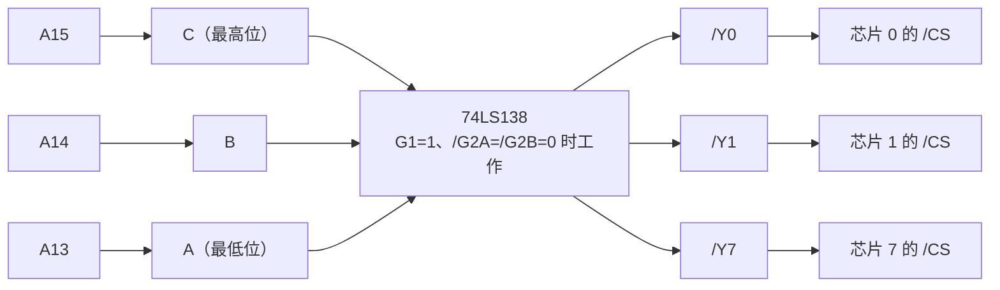

# 第05讲 IO 接口和总线（74LS138 译码）· 逐考点详解

## 本讲是什么 & 关键考点

**先从一个问题说起**：内存和外设都挂在同一组总线上，CPU 发出一个地址，怎么保证选中的是那颗芯片而不是别的？

数据总线、地址总线、控制总线是所有部件**共享**的——CPU 把地址往总线上一放，内存和各接口芯片**全都看得见**。
若每颗芯片都「听到地址就响应」，好几颗芯片会同时往数据线上驱电平，直接冲突。
所以系统必须回答：**这个地址归谁管？**

答案是把判断做成硬件：每颗芯片配一个片选端（/CS、/CE，低有效），只有片选有效的芯片才响应，其余保持高阻。
片选信号从哪来？——用**译码器**从地址线里「译」出来。

**74LS138 就是干这个的**：3 根高位地址线进 C、B、A，3 位二进制有 8 种组合，138 把每种组合译成一路输出——
8 路输出任意时刻**最多一路为低、其余全高**，天然互斥。于是 3 根地址线把地址空间**切成 8 份**，每份选中一颗芯片：



以 A15A14A13 接 CBA 为例：64KB 空间被切成 8 块、每块 2¹³ = 8KB，CBA 取哪个值，哪一路输出就为低、选中那颗芯片，其余全部沉默。
三个使能端（G1 高、/G2A /G2B 低）常接更高的地址线，相当于给这 8 块再套一层「总开关」——条目 100 的地址范围就是这么算出来的。

**关键考点**： 原文明示：**「后面几讲接口芯片译码都要用」**。
8255、8253、8259A、8251A 的端口地址都要按本讲套路从译码图里算出来——本讲是后续所有芯片的地址基础。

## 本讲学习目标

学完本讲，你应该能：

1. **分清总线与接口**：总线共享、接口点对点，本课程的芯片都是接口（条目 97）。
2. **背出 74LS138 的逻辑**：C 最高 A 最低、三使能端极性、8 输出低有效；给 CBA 立即说出哪路输出为低（条目 98、99）。
3. **走通地址范围四步套路**：读接线 → 定片选条件 → 高位固定值 → ×2ⁿ 加片内全 1，27128 / 2732 两例能重算（条目 100）。
4. **用 M/IŌ 判别存储器与 I/O**：=1 存储器、=0 I/O；说出独立编址下 I/O 空间 64KB、只用 A15~A0（条目 101、102）。
5. **判断 IN/OUT 合法性**：端口 ≤FFH 直接写、≥100H 必须经 DX，累加器只能 AL/AX（条目 103）。

> 对应总清单第 **97~103** 条，覆盖本讲全部 7 个考点。
> 重点要求：接口与总线基础「了解」、**74LS138 译码与地址范围计算必须掌握**
> （原话：「后面几讲接口芯片译码都要用」）。
>
> 作业映射：第5讲 2 题（已 100 分）。本讲真题少（仅 2 题），覆盖面偏薄，
> 但它是**后续四讲的地基**——8255/8253/8259/8251/ADC0809 的端口地址全都要用它算。
> 仓库内本题图的逐线分析见 `作业/作答记录/answers-56491609.md`，
> 题图在 `tools/shots/fig-q2-live.png`（全图）与 `tools/shots/fig-gate-big4.png`（A19/A18 门放大）。

## 本讲条目索引

| # | 考点 | 层级 | 来源 | 作业题 | 正文锚点 |
|---|---|---|---|---|---|
| 97 | 接口与总线基础概念 | 了解 | 纲+章 | — | §六 |
| 98 | 74LS138：3 输入 CBA + 3 使能（G1 高、G2A/G2B 低）→ 8 输出低有效 | 掌握 | 章+题 | 第5讲Q1/Q2 | §6.1 |
| 99 | CBA=011 → Ȳ3 输出低 | 掌握 | 题 | 第5讲Q1 | §6.1 |
| 100 | 地址范围计算套路：译码条件→高位固定+片内全 0~全 1（27128 / 2732 例） | 掌握 | 纲+章+题 | 第5讲Q2 | §6.1 |
| 101 | 存储器 vs IO 判别：看 M/IŌ（=1 侧是存储器） | 掌握 | 章+题 | 第5讲Q2 | §6.1 |
| 102 | 8086 独立编址：I/O 空间 64KB | 掌握 | 章+题 | — | §6.2 |
| 103 | IN/OUT：端口 ≤FFH 立即数直接写；≥100H 必须经 DX | 掌握 | 章+题 | 第3讲Q6/Q7 | §6.2 |

## 阅读约定

每个考点固定四段：**① 机理详解** ｜ **② 例题** ｜ **③ 易错提示** ｜ **④ 横向辨析**。

---

## 97. 接口与总线基础概念

**层级** 了解 ｜ **来源** `纲+章` ｜ **正文** §六

### ① 机理详解

「接口」与「总线」是微机系统的两个基本概念：

- **总线（Bus）**：**多个部件共享**的信息传输线，按传的内容分三类——
  **数据总线**（传数据，双向）、**地址总线**（传地址，CPU 发出，单向）、
  **控制总线**（传读写/中断/ DMA 等控制信号）。
  第1讲已考过「三大总线」的选择题。
- **接口（Interface）**：**两个具体部件之间**的「翻译层」。
  CPU 与外设的速度、电平、数据格式往往不匹配，接口负责转换与协调。

本课程学的五个可编程芯片都是**接口芯片**：

| 芯片 | 接口的哪一侧 | 用途 |
|---|---|---|
| **74LS138** | CPU 侧（地址译码） | 产生片选信号 |
| 8255A | 并行外设 | 开关/LED/键盘 |
| 8253 | 定时/计数 | 方波/分频 |
| 8251A | 串行外设 | 串口通信 |
| 8259A | 中断源管理 | 多级中断 |
| ADC0809/DAC0832 | 模拟世界 | A/D、D/A |

**总线 vs 接口的记忆法**：总线是「大家共用的马路」，接口是「某个门口的传达室」。
一个接口芯片通常只服务一类外设，而总线被所有部件共享。

### ② 例题

判断：74LS138 译码器属于「总线」还是「接口」？它出现在系统的哪一侧？

```
属于「接口」范畴（更准确地说是 CPU 与存储器/IO 芯片之间的**地址译码电路**）。
它不在数据/地址/控制总线上共享传输，而是**读入地址线、产生片选信号**，
位于 CPU 地址总线与各芯片片选端（/CE、/CS）之间。

→ 这正是本讲的核心作用：把 CPU 的地址线「翻译」成某个芯片的片选。
```

### ③ 易错提示

- 本条为了解级：能说清「总线共享、接口点对点」即可。
- **别把接口芯片说成总线**：总线是共享的物理线路，接口是转换/控制电路。
- 三大总线（数据/地址/控制）是第1讲考点，与本讲的「接口」不是同一层概念。

### ④ 横向辨析

| | 总线 | 接口 |
|---|---|---|
| 连接对象 | **多对多**（共享） | **点对点** |
| 本课程实例 | 数据/地址/控制总线 | 五个可编程芯片 + 74LS138 |
| 是否可编程 | 否 | **是**（芯片有控制字） |
| 是否占用地址 | 否 | **是**（要分配端口地址） |

---

## 98. 74LS138：3 输入 CBA + 3 使能（G1 高、G2A/G2B 低）→ 8 输出低有效

**层级** 掌握 ｜ **来源** `章+题` ｜ **作业题** 第5讲Q1/Q2 ｜ **正文** §6.1

### ① 机理详解

74LS138 是 **3-8 线译码器**，16 脚 DIP：

```
                    ┌─────────┐
    C（最高位） ───►│ 1     16│◄─── VCC
    B         ───► │ 2     15│ ◄── G1（高有效使能）
    A（最低位） ──► │ 3     14│ ◄── /G2A（低有效）
    /Y0 ◄──────────│ 4     13│ ◄── /G2B（低有效）
    /Y1 ◄──────────│ 5     12│ ◄── /Y7
    /Y2 ◄──────────│ 6     11│ ◄── /Y6
    /Y3 ◄──────────│ 7     10│ ◄── /Y5
    GND ───────────│ 8      9│ ◄── /Y4
                    └─────────┘
```

**输出逻辑**（真值表）：

| C | B | A | 输出为低的引脚 | 其余 7 个输出 |
|---|---|---|---|---|
| 0 | 0 | 0 | **/Y0** | 全高 |
| 0 | 0 | 1 | **/Y1** | 全高 |
| 0 | 1 | 0 | **/Y2** | 全高 |
| 0 | 1 | 1 | **/Y3** | 全高 |
| 1 | 0 | 0 | **/Y4** | 全高 |
| 1 | 0 | 1 | **/Y5** | 全高 |
| 1 | 1 | 0 | **/Y6** | 全高 |
| 1 | 1 | 1 | **/Y7** | 全高 |

**三个使能端**（「门控」）：

| 引脚 | 有效电平 | 作用 |
|---|---|---|
| **G1** | **高**（1） | 主使能，多数接高位地址线 |
| **/G2A** | **低**（0） | 辅助使能 1 |
| **/G2B** | **低**（0） | 辅助使能 2 |

**译码的前提**：`G1 = 1 且 /G2A = 0 且 /G2B = 0`。
三个条件不满足时，**所有 8 个输出全为高**（芯片「沉默」）。

**「低有效」的含义**：被选中的那一路输出 **0**，其余输出 **1**。
所以输出引脚写作 `/Y0 ~ /Y7`（带斜杠表示低有效）。
片选端（/CE、/CS）通常也是低有效，正好直接对接。

**为什么用 138 做片选**：一根片选线就能选中一个芯片，
而 138 用 3 根地址线（+ 使能）就能产生 8 个互斥的片选信号——
比用门电路逐个拼省得多，且不会出现两个芯片同时被选中的冲突。

### ② 例题

74LS138 的 C=1、B=0、A=1，且三个使能端都满足。问哪个输出为低，其余如何？

```
CBA = 101 = 5 → /Y5 输出低电平（0）
其余 /Y0~/Y4、/Y6、/Y7 全部输出高电平（1）
```

### ③ 易错提示

- **C 是最高位、A 是最低位**：CBA = 011 表示 3，不是 6。
- **输出低有效**：选中的那路是 0，不是 1。写「Y3=1」是错的，
  要写「/Y3=0」。
- **三个使能端缺一不可**：G1 要高、/G2A 与 /G2B 要低。
  任一不满足则 8 个输出全高（没有片选生效）。
- **「门控端」指的就是三个使能端**，不是 CBA 选择端——作业 Q2 第 2 问专门考这个。

### ④ 横向辨析

| | 74LS138 | 74LS139（双 2-4） | 三八/OCTAL |
|---|---|---|---|
| 选择端 | 3（CBA） | 2 | — |
| 输出数 | 8 | 4 × 2 组 | — |
| 使能端 | **3**（G1 高 + /G2A /G2B 低） | 1 组 1 个 | — |
| 输出极性 | 低有效 | 低有效 | — |

**74LS138 的「三个使能端」是它最特别的地方**——两个低有效 + 一个高有效，
可以灵活地用地址线的不同组合来「框定」一个地址段（见条目 100）。

---

## 99. CBA=011 → Ȳ3 输出低

**层级** 掌握 ｜ **来源** `题` ｜ **作业题** 第5讲Q1 ｜ **正文** §6.1

### ① 机理详解

**作业第5讲 Q1** 原题：若门控端引脚都已选中，C、B、A 输入为 `011`，
哪个引脚输出低电平？

```
C B A = 0 1 1
       ↑ ↑ ↑
       │ │ └── A = 1（最低位）
       │ └──── B = 1
       └────── C = 0（最高位）

二进制 011 = 十进制 3
→ 选中第 3 路 → /Y3 输出低电平

正确答案：F（Y3）✔
```

**验算**：138 的输出编号就是 CBA 的二进制值。
CBA = 000→Y0、001→Y1、010→Y2、**011→Y3**、100→Y4、101→Y5、110→Y6、111→Y7。

### ② 例题

若改为 CBA = 110，哪个输出为低？若 CBA = 111 呢？

```
CBA = 110 = 6 → /Y6 低
CBA = 111 = 7 → /Y7 低

速算法：把 CBA 当 3 位二进制数转十进制，几号输出就低。
```

### ③ 易错提示

- **C 是最高位**：把 011 读成「A=0,B=1,C=1」就会答成 Y6。
  顺序永远是 **C B A**，C 在左。
- **输出低有效**：答「Y3 输出低电平」✔，答「Y3 输出高电平」✗。
- 作业里 8 个选项 Y0~Y7 被打乱，**按内容选 Y3**（显示字母 F，提交值 D）。
- 前提是「门控端都已选中」——若没选中，8 个输出全高，没有一个是低的。

### ④ 横向辨析

| CBA | 低电平输出 | 十进制 |
|---|---|---|
| 000 | /Y0 | 0 |
| 001 | /Y1 | 1 |
| 010 | /Y2 | 2 |
| **011** | **/Y3** | **3** ← 作业 Q1 |
| 100 | /Y4 | 4 |
| 101 | /Y5 | 5 |
| 110 | /Y6 | 6 |
| 111 | /Y7 | 7 |

**速查**：CBA 的二进制值 = 输出编号，永远成立。

---

## 100. 地址范围计算套路：译码条件→高位固定+片内全 0~全 1（27128 / 2732 例）

**层级** 掌握 ｜ **来源** `纲+章+题` ｜ **作业题** 第5讲Q2 ｜ **正文** §6.1

### ① 机理详解

这是本讲的核心技能，也是后续四讲的地基。**四步套路**：

```
① 从题图读接线：哪些地址线接 138 的 C/B/A，哪些接使能端，哪些接芯片片内地址线
② 定「片选条件」：CBA 的选择码 + 三个使能端的电平要求
③ 得「高位地址固定值」：把片选条件反推成 A19~A? 的确定二进制
④ 算范围：高位固定值 × 2^(片内地址线数)  ~  + (片内全 1)
```

即：

$$\text{起始地址} = \text{高位固定值} \times 2^{n} \qquad
\text{结束地址} = \text{起始地址} + 2^{n} - 1$$

其中 n = 芯片片内地址线数。

**例题 1：27128（作业第5讲 Q2 的题图）**

接线（从题图读出，详见 `作业/作答记录/answers-56491609.md`）：

```
G1   ← A14                       （高有效，A14 必须为 1）
/G2A ← ¬(M/IŌ)                  （低有效，M/IŌ 必须为 1）
/G2B ← A19 ∨ A18                （低有效，A19、A18 必须都为 0）
C    ← A17
B    ← A16
A    ← A15
/Y3  → 27128 的 /CE
A13~A0 → 27128 地址线（片内 14 根）
```

逐步推演：

```
① 片选 /Y3 有效的条件：
   CBA = 011，即 A17 A16 A15 = 0 1 1
   且 G1=1 → A14 = 1
   且 /G2A=0 → M/IŌ = 1
   且 /G2B=0 → A19 = 0, A18 = 0

② 高位地址（A19~A14）固定为：
   A19 A18 A17 A16 A15 A14 = 0 0 0 1 1 1
                             = 000111B = 7

③ 片内地址线 A13~A0 共 14 根，2^14 = 16384 = 4000H

④ 地址范围：
   起始 = 7 × 4000H = 1C000H
   结束 = 1C000H + 3FFFH = 1FFFFH
   → 27128 的地址范围是 1C000H ~ 1FFFFH（共 16KB）✔
```

> 与主文档 §6.1 的口径一致：主文档写作「C,B,A=011 → 输出 Ȳ3，对应 1C000~1FFFFH」，
> 并注明「按题图为准」。本题图的 CBA 实际接 **A17/A16/A15**。

**例题 2：4 片 2732（课件例）**

```
2732 = 4K×8 EPROM，片内地址线 A11~A0 共 12 根，2^12 = 4096 = 1000H
接线：A19~A15 = XXX10（A16=1、A15=0）
      A14~A12 = 000~111 接 CBA（即 C←A14, B←A13, A←A12）
```

逐步推演（取前 4 片，CBA = 000~011）：

| 片 | CBA | A14 A13 A12 | A19~A12（设 X=000） | 起始 | 结束 |
|---|---|---|---|---|---|
| 1 | 000 | 0 0 0 | 0001 0000 = 10H | **10000H** | **10FFFH** |
| 2 | 001 | 0 0 1 | 0001 0001 = 11H | **11000H** | **11FFFH** |
| 3 | 010 | 0 1 0 | 0001 0010 = 12H | **12000H** | **12FFFH** |
| 4 | 011 | 0 1 1 | 0001 0011 = 13H | **13000H** | **13FFFH** |

每片容量 1000H，四片首尾相接不重叠（10000-10FFF、11000-11FFF、12000-12FFF、13000-13FFF）。

> 主文档 §6.1 记为「各片范围 10000H~10FFFH、11000H~11FFFH、12000H~12FFFH、13000H~13FFFH」，
> 与上表一致。

### ② 例题

**作业第5讲 Q2** 的三个空：

```
第 1 空：连接 27128 的是存储器还是 IO 设备？
  → M 存储器（27128 是 16K×8 EPROM）
  正确答案：A ✔

第 2 空：要使门控引脚正常工作，A19 A18 A14 必须为？
  → G1 高有效 ← A14 = 1
    /G2A 低有效 ← ¬(M/IŌ) = 0，即 M/IŌ = 1（不影响 A19/A18）
    /G2B 低有效 ← A19 ∨ A18 = 0，即 A19 = 0 且 A18 = 0
  → A19 A18 A14 = 0 0 1 = 001
  正确答案：F ✔

第 3 空：要使 /Y3 = 0，A17 A16 A15 必须为？
  → C B A = 0 1 1，而 C←A17、B←A16、A←A15
  → A17 A16 A15 = 0 1 1 = 011
  正确答案：C ✔
```

> ⚠ 关于第 2 空的一处图形歧义（已记录在 `作业/作答记录/answers-56491609.md`）：
> A19/A18 那个门若按「只有输入气泡、无输出气泡」读，则 `/G2B = ¬A19·¬A18`，
> 取低会有 (1,0)/(0,1)/(1,1) 三种组合，与题目只给一个空、四个候选值矛盾；
> 按「三气泡 = OR」读则唯一命中 `001`。放大图 `tools/shots/fig-gate-big4.png`
> 里输出端气泡清晰可见，故取 `001`。

### ③ 易错提示

- **高位固定 × 片内容量 = 起始地址**：乘法别忘。
  27128 例：7 × 4000H = 1C000H（不是 7000H）。
- **片内地址线要数对**：27128 是 16KB → 14 根（A13~A0）；
  2732 是 4KB → 12 根（A11~A0）。容量与地址线数的关系是 `容量 = 2^(线数)`。
- **M/IŌ = 1 是存储器周期**：作业 Q2 第 1 空靠这个佐证 27128 是存储器。
- **「XXX」的位要按题意取 0**：2732 例的 A19~A17 题目写 X，通常默认取 0。
- 138 的输出低有效 → 片选端也是低有效（/CE、/CS），**直接对接**；
  若芯片片选是高有效，中间要加非门。

### ④ 横向辨析

| | 27128 例 | 2732 例 |
|---|---|---|
| 芯片容量 | 16KB（2^14） | 4KB（2^12） |
| 片内地址线 | A13~A0（14 根） | A11~A0（12 根） |
| 选端接法 | C←A17, B←A16, A←A15 | C←A14, B←A13, A←A12 |
| 使能端 | G1←A14、/G2A←¬(M/IŌ)、/G2B←A19∨A18 | A19~A15 = XXX10 |
| 地址范围 | **1C000H~1FFFFH** | **10000H~10FFFH** 等四段 |

**两步通用的查错法**：
① 算完的范围大小必须等于芯片容量（16KB / 4KB）；
② 各芯片范围不能重叠。

---

## 101. 存储器 vs IO 判别：看 M/IŌ（=1 侧是存储器）

**层级** 掌握 ｜ **来源** `章+题` ｜ **作业题** 第5讲Q2 ｜ **正文** §6.1

### ① 机理详解

8086 采用**独立编址**：存储器与 I/O 各有自己的地址空间，
靠 **M/IŌ** 引脚区分：

| M/IŌ | 访问的空间 | 地址线 | 容量 |
|---|---|---|---|
| **1** | **存储器**（Memory） | A19~A0 | 1MB |
| **0** | **I/O 端口** | A15~A0 | 64KB |

**在译码电路里的体现**：M/IŌ 常接到 138 的某个使能端，用来「框定」地址段。

作业 Q2 题图的接法：

```
/G2A ← M/IŌ 经非门，即 /G2A = ¬(M/IŌ)
```

/G2A 要取低电平（0）才能使能 138 → `¬(M/IŌ) = 0` → **M/IŌ = 1** → **存储器周期**。

所以这条译码电路**只在访问存储器时生效**，
从电路结构本身就能断定 27128 是存储器芯片——这正是作业 Q2 第 1 问的判据。

**「接到 M/IŌ=1 侧就是存储器」**：这是本课程的判别口径。
看题图里哪个使能端接了 M/IŌ（或它的非），反推电平，就能定向。

### ② 例题

某译码电路把 138 的 /G2A 直接接 M/IŌ（不经过非门）。问这片译码服务的是
存储器还是 I/O 设备？端口范围受什么限制？

```
/G2A 低有效，要取 0 才能使能 → M/IŌ = 0 → I/O 周期
→ 服务的是 I/O 设备（不是存储器）。

限制：I/O 地址线只有 A15~A0（16 根），所以端口地址 ≤ FFFFH，
      且 IN/OUT 指令访问（第3讲 Q6/Q7 考过 >FFH 要用 DX）。
```

### ③ 易错提示

- **M/IŌ = 1 是存储器、= 0 是 I/O**——别记反。
- 题目可能把 M/IŌ **直接接**或**经非门接**使能端，两种情况结论相反，
  要看清楚有没有非门（气泡）。
- 第1讲已考「8086 内存 1MB / I/O 64KB」，与此处联动。
- 第2讲 Q7 的读写判断（WR̄=1、RD̄=0、M/IŌ=1 → 正在读内存）是同一根引脚的应用。

### ④ 横向辨析

| | 存储器空间 | I/O 空间 |
|---|---|---|
| M/IŌ | **1** | **0** |
| 地址线 | A19~A0（20 根） | A15~A0（16 根） |
| 容量 | **1MB** | **64KB** |
| 访问指令 | MOV | **IN / OUT** |
| 本题图 27128 | ✔（/G2A 经非门接 M/IŌ） | ✘ |

---

## 102. 8086 独立编址：I/O 空间 64KB

**层级** 掌握 ｜ **来源** `章+题` ｜ **正文** §6.2

### ① 机理详解

8086 的 I/O 采用**独立编址**（相对于「统一编址」即存储器映射 I/O）：

| 编址方式 | I/O 与存储器地址空间 | 访问指令 |
|---|---|---|
| **独立编址**（8086 用） | **分开**，各有 64KB / 1MB | IN / OUT（专用于 I/O） |
| 统一编址（存储器映射） | 共用，I/O 占一段存储器地址 | MOV |

**独立编址的特点**：

- I/O 空间 **64KB**，用 A15~A0 寻址（**A16~A19 不参与**）。
- 有专门的 **IN / OUT 指令**，不占用存储器地址。
- 译码电路只需考虑 16 根地址线，比存储器译码简单。
- 缺点：指令少，不如统一编址灵活。

**与实验箱的对应**：实验一/二里 8255、8253、8259 的 I/O 地址
（如 280H~287H、2B0H~2B7H、300H~306H）都在 64KB I/O 空间内，
靠 74LS138 对 A15~A0 译码产生片选。

### ② 例题

8086 的 I/O 端口地址范围是多少？为什么不是 1MB？

```
范围：0000H ~ FFFFH，共 64KB。
原因：独立编址下 I/O 只用 A15~A0 寻址，A16~A19 不参与 I/O 译码。
     而存储器用 A19~A0（20 根），所以是 1MB。
```

### ③ 易错提示

- **I/O 是 64KB，不是 1MB**：1MB 是存储器空间。
- **A16~A19 不用于 I/O**：所以 I/O 地址高位经常「无所谓」，
  但题目要求写规范值时仍写 4 位十六进制。
- 第1讲已考「8086 内存 1MB / I/O 64KB」，第2讲 Q3 也考过。
- IN/OUT 的寻址限制见条目 103。

### ④ 横向辨析

| | 8086 存储器 | 8086 I/O |
|---|---|---|
| 编址方式 | 独立 | **独立** |
| 地址线 | A19~A0 | **A15~A0** |
| 容量 | 1MB | 64KB |
| 指令 | MOV | **IN/OUT** |
| M/IŌ | 1 | **0** |

---

## 103. IN/OUT：端口 ≤FFH 直接写；≥100H 必须经 DX

**层级** 掌握 ｜ **来源** `章+题` ｜ **作业题** 第3讲Q6/Q7 ｜ **正文** §6.2

### ① 机理详解

8086 的 IN/OUT 有两种寻址形式：

| 端口地址 | 直接寻址 | 间接寻址 |
|---|---|---|
| **≤ FFH**（0~255） | `IN AL, 60H` / `OUT 61H, AL` | 也可 |
| **≥ 100H** | **非法** | **必须** `MOV DX, 端口; IN AL, DX` |

**为什么**：直接寻址的形式是「一个字节的端口地址」，最大只能表示 FFH。
超过 FFH 的端口必须把地址先放进 DX，用寄存器间接寻址。

**累加器限制**：IN/OUT 的累加器只能是 **AL（8 位）或 AX（16 位）**，
不能用其他寄存器：

```asm
IN   AL, 60H        ✔
IN   AX, 60H        ✔
IN   BL, 60H        ✘  累加器必须是 AL/AX
MOV  DX, 300H
IN   AL, DX         ✔
IN   CX, DX         ✘
```

### ② 例题

**作业第3讲 Q6/Q7** 的非法指令判断：

```
① IN AL, 100H        ✘ 非法：100H = 256 > FFH，必须用 DX

② OUT 0F2H, AX       ✔ 合法！0F2H = 242D ≤ 255D = FFH，可直接寻址
                           且 0F2H 已带前导 0，写法正确
                           （16 位输出写 F2H 与 F3H 两个端口）
   ⚠ 主文档 §6.2 曾把此条与 IN AL,100H 并列记为「非法」，但作业第3讲 Q7
     的标准答案把 OUT 0F2H,AX 判为**合法**（答案 BCD 不含 A）。
     根因是 0F2H = 242 并未超过 FFH = 255。以作业答案为准。

③ MOV DX, 300H
   IN AL, DX           ✔ 合法（间接寻址，端口可任意大）

④ MOV AL, 60H; IN AL, 60H   ✔（≤ FFH 可直接写）
```

**第3讲 Q6/Q7 的标准答案要点**（详见第03讲详解条目 123/125/126）：

```
Q6「下列指令错误的是」答案 ABCD：
  PUSH AL        ✘ 8086 只能压字
  IN AL, 100H    ✘ > FFH 须用 DX
  MOV [DI],[SI]  ✘ 两操作数不能同时为内存
  ADC BL, -255   ✘ 立即数超 8 位范围（8 位补码仅 −128~+127）

Q7「下列指令错误的是」答案 BCD：
  OUT 0F2H, AX        ✔ 合法（0F2H ≤ FFH）
  MOV DS, SEG String  ✘ 段寄存器不能←立即数（须经 AX）
  MOV AL, [BX][BP]    ✘ 两个基址寄存器不能组合
  SBB AL, 259         ✘ 立即数超 8 位
```

### ③ 易错提示

- **> FFH 必须用 DX**：这是 IN/OUT 最高频的错点，第3讲连考三题。
- **字母开头的十六进制要补 0**：如 `F2H` 要写成 `0F2H`（易错清单第 2 条）。
  但**补了 0 不等于就超范围**——`0F2H` = 242 仍 ≤ FFH，直接寻址合法。
  真正超范围的是 `100H`、`300H` 这类（作业 Q6/Q8 的错项）。
- **累加器只能 AL/AX**：`IN BL, DX` 非法。
- **DX 是唯一可用于 I/O 间接寻址的寄存器**（不像存储器可用 BX/BP/SI/DI）。
- 第3讲 Q1 的「I/O 端口寻址」也归到这里。

### ④ 横向辨析

| 指令 | 合法？ | 原因 |
|---|---|---|
| `IN AL, 60H` | ✔ | ≤ FFH，直接寻址 |
| `IN AX, 60H` | ✔ | ≤ FFH，16 位累加器 |
| `IN AL, 100H` | ✘ | **> FFH 须用 DX** |
| `OUT 0F2H, AX` | ✔ | **0F2H = 242 ≤ FFH**，可直接寻址（作业 Q7 判合法） |
| `MOV DX,300H; IN AL,DX` | ✔ | 间接寻址 |
| `IN BL, DX` | ✘ | **累加器必须 AL/AX** |

---

## 本讲自测清单

- [ ] 总线（共享）vs 接口（点对点）能区分；五个可编程芯片都是接口
- [ ] 74LS138 结构：C 最高 / A 最低，8 输出低有效，三个使能端极性（G1 高、/G2A /G2B 低）
- [ ] 译码前提「G1=1 且 /G2A=0 且 /G2B=0」，任一不满足则 8 输出全高
- [ ] **CBA 二进制值 = 低电平输出编号**：011→/Y3、110→/Y6、111→/Y7
- [ ] 地址范围四步套路能走通：读接线 → 定片选条件 → 高位固定值 → × 2^n 加片内全 1
- [ ] 27128 例（16KB）：高位 000111、范围 **1C000H~1FFFFH**，逐步重算
- [ ] 2732 例（4KB×4）：10000H~10FFFH / 11000H~11FFFH / 12000H~12FFFH / 13000H~13FFFH
- [ ] 算完自查：范围大小 = 芯片容量、各片不重叠
- [ ] **M/IŌ = 1 是存储器、= 0 是 I/O**；题图 /G2A 经非门 → 存储器
- [ ] 独立编址：存储器 1MB（A19~A0）、I/O 64KB（A15~A0）
- [ ] IN/OUT：≤FFH 直接写、>FFH 必须 DX；累加器只能 AL/AX
- [ ] 字母开头十六进制补 0（0FFH、0F2H）；但补 0 不等于超范围（0F2H=242 ≤ FFH，合法）
- [ ] 第5讲 Q1 答 Y3、Q2 三空答 A / 001 / 011 能闭眼复现
- [ ] 能说明本讲是后续四讲端口地址计算的地基

---

> **返回**：[复习资料总清单](../复习资料总清单.md) ｜ [期末知识点详尽整理](../汇编语言与微机接口技术_期末知识点详尽整理.md) §六
>
> **上一篇**：[第06讲 8259A 与中断系统](第06讲-8259A与中断系统.md)
> **下一篇**：[第04讲 汇编程序与 DOS 调用](第04讲-汇编程序与DOS调用.md)
