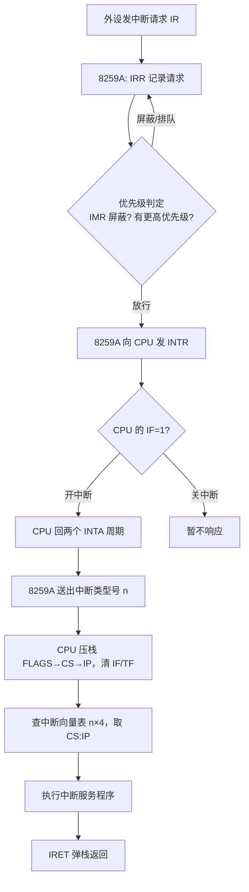
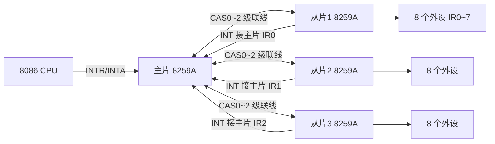

# 第06讲 可编程中断控制器 8259A 与中断系统 · 逐考点详解

## 本讲是什么 & 为什么考

**先从一个问题说起**：CPU 正在跑程序，外面一个设备（键盘、定时器）突然有急事要找它，
怎么办？

**办法一：CPU 主动问**（查询方式）——程序里写个循环，反复读设备的状态口：「好了没？」
「好了没？」……问题很明显：**CPU 被死循环拖住**，设备越多、问得越频，CPU 越累。

**办法二：设备主动喊**（中断方式）——CPU 专心跑自己的程序，设备有事发一个电信号
「打断」它。CPU 收到后**暂停当前、转去处理、处理完回来接着跑**。这就是中断，也是本讲的
核心。**8259A 则是「中断的调度员」**——8086 只有一根 INTR 中断请求线，却可能挂几十个设备，
8259A 负责：多路请求排队、按优先级选最重要的、把对应的中断类型号告诉 CPU。

**一个中断从发生到返回，数据这样流动**（这是全讲的骨架，后面每条都挂在这上面）：



**考试为什么考它？** 这是全课程的**难度顶峰**（老师也把它列为难点）。老师标「掌握」的
全是硬活：**压栈顺序、中断向量表、ICW/OCW 编程、级联优先级数**。尤其是向量表地址计算
（n×4）和 ICW2 的「类型码高 5 位」，是你在作业上真实丢过分的地方。本讲 27 条考点，
每一条都对应这张图上的某一步。

## 本讲学习目标

学完本讲，你应该能：

1. **顺出中断全过程**：从外设请求到 IRET 返回，说出每一步谁在干什么（上图）。
2. **算向量地址**：给类型号 n 会算 n×4，给表项内容会反推 CS:IP（条目 77~79）。
3. **写 ICW1~ICW4**：按初始化顺序写出四个字，尤其 ICW2 的高 5 位（条目 86~89）。
4. **算级联级数**：2 片 15 级、3 片 22 级、最多 9 片 64 级，记 7n+8 通式（条目 83）。
5. **分清 EOI 时机**：什么时候 CPU 自动清 ISR、什么时候要你手动发 OCW2（条目 93~95）。

> 对应总清单第 **70~96** 条，覆盖本讲全部 27 个考点。
> 老师标注：中断概念「了解」、**8086 中断处理压栈顺序「掌握」、中断向量/向量表「掌握」、
> 35H 读/25H 设置向量「掌握」、8259 内部结构「了解」、优先级数量「掌握」、
> ICW/OCW「掌握」（注意：试卷不附 8259 寄存器资料）、单片应用编程「掌握」、
> 两片级联初始化「理解」**。
>
> 作业映射：第6讲 6 题（未交但有官方答案已抄录）＋ 课堂练习 8259（5 题，**80 分——
> 我在 ICW2 上丢过 20 分**）。
> 实验映射：实验十三 8259 查询方式，仓库内有修正后的参考程序
> `tools/参考程序/I8259.ASM`（复制自实验报告库 assembly-language-labs 的实验二源文件）。

## 本讲条目索引

| # | 考点 | 层级 | 来源 | 作业题 | 正文锚点 |
|---|---|---|---|---|---|
| 70 | 硬件中断 / CPU 轮询 / DMA 区别 | 了解 | 师+章 | — | §5.1 |
| 71 | 8086 中断自动压栈顺序 FLAGS→CS→IP，随后清 IF、TF | 掌握·必背 | 师+章+题 | — | §5.1 |
| 72 | CALL 只压 CS→IP（段间）；中断返回必须 IRET、子程序返回用 RET | 掌握 | 章+网 | — | §5.1 |
| 73 | IF：STI 置 1 / CLI 清 0；NMI 不受 IF 控制（类型码 2） | 掌握 | 章+题 | 练习8259Q2 | §5.1 |
| 74 | 优先级：内部中断 > NMI(2) > INTR | 掌握 | 章+网 | — | §5.1 |
| 75 | INTR 响应需两个 INTA 总线周期（首周期冻结判定/ISR 置 1；次周期送类型码） | 理解 | 网 | — | §5.1 |
| 76 | 中断向量表位置 00000H~003FFH（最低 1KB）、256×4 字节 | 掌握 | 章+题 | 第6讲Q1 | §5.2 |
| 77 | 表项首地址 = 类型码 n×4（16H×4=58H，不是 64H） | 掌握·必考计算 | 师+章+题 | 第6讲Q1、老师样题 | §5.2 |
| 78 | 每项 4 字节小端：低 2 字节 = IP、高 2 字节 = CS | 掌握 | 章+题 | 第6讲Q1/Q4 | §5.2 |
| 79 | 反查类型码 = 向量地址 ÷ 4 | 掌握 | 题 | 第6讲Q4 | §5.2 |
| 80 | 读取向量 35H → ES:BX | 掌握 | 师+章+题 | 第6讲Q5 | §5.2 |
| 81 | 设置向量 25H（DS:DX、AL=类型号）/ 直接法 MOV [SI] | 掌握 | 师+章+题 | 第6讲Q5 | §5.2 |
| 82 | 一片 8 级中断源 IR0~IR7，默认 IR0 优先级最高 | 掌握 | 章+题 | 练习8259Q3 | §5.3 |
| 83 | 级联优先级数：2 片 15 级、3 片 22 级、最多 9 片（一主八从）64 级 | 掌握·真题 | 章+题 | 练习8259Q3/Q4 | §5.3 |
| 84 | IRR / ISR / IMR 三寄存器；IMR 1=屏蔽 | 掌握 | 章+题 | 第6讲Q3 | §5.3 |
| 85 | 端口：偶地址 = ICW1/OCW2/OCW3；奇地址 = ICW2/ICW3/ICW4/OCW1 | 掌握 | 章+题 | 第6讲Q3/Q6 | §5.3 |
| 86 | ICW1：D4=1 启动初始化、触发方式、单片/级联、是否要 ICW4 | 掌握·必背 | 师+章+题 | 第6讲Q6 | §5.4 |
| 87 | ICW2：中断类型码高 5 位（3BH → 38H） | 掌握·必背·个人错题 | 师+章+题 | 练习8259Q5、第6讲Q6 | §5.4 |
| 88 | ICW3：仅级联时写；主片 = 级联位图、从片 = 自身标识 | 掌握 | 章+题 | 第6讲Q6 | §5.4 |
| 89 | ICW4：µPM=1（8086 模式）、全嵌套/特殊全嵌套、AEOI | 掌握 | 师+章+题 | 第6讲Q6 | §5.4 |
| 90 | 级联初始化次序：主片 ICW1~ICW4 → 从片 ICW1~ICW4 | 理解 | 章+题 | 第6讲Q6 | §5.4 |
| 91 | 从片的类型码由从片自己的 ICW2 决定（主片 ICW2 只定主片 8 级） | 理解 | 网 | 第6讲Q6 | §5.4 |
| 92 | OCW1 屏蔽字构造：0 允许、1 屏蔽 | 掌握 | 章+题 | 第6讲Q3 | §5.5 |
| 93 | OCW2 EOI=20H；普通 EOI 清 ISR 中最高优先级的 1、特殊 EOI 指定位 | 掌握 | 师+章+题 | 第6讲Q2 | §5.5 |
| 94 | OCW3：读 IRR/ISR（0AH=读 IRR）、查询方式 | 掌握 | 章+网 | — | §5.5 |
| 95 | EOI 时机：在中断服务程序结束前发出 | 掌握 | 题 | 第6讲Q2 | §5.5 |
| 96 | 中断应用编程套路：主程序设向量→设次数→STI→OCW1→等待→4CH；服务程序处理→EOI→IRET | 掌握·老师点名综合题 | 师+章+网 | — | §5.6 |

## 阅读约定

每个考点固定四段：**① 机理详解** ｜ **② 例题** ｜ **③ 易错提示** ｜ **④ 横向辨析**。

---

## 70. 硬件中断 / CPU 轮询 / DMA 区别

**层级** 了解 ｜ **来源** `师+章` ｜ **正文** §5.1

### ① 机理详解

三种「外设与 CPU 交换数据」的方式，按 CPU 参与程度递减：

| 方式 | 谁主导 | CPU 开销 | 适用 |
|---|---|---|---|
| **程序查询（轮询）** | **CPU 主动问** | 高（全程循环等） | 简单、低速 |
| **中断** | **外设主动请求** | 中（响应一次跑一次服务程序） | 中速、随机事件 |
| **DMA** | **DMA 控制器直接搬** | 极低（只让出总线） | 高速、大批量 |

- **查询**：CPU 反复读状态位，外设没好就一直问。简单但浪费 CPU。
  本课程 ADC0809 查 EOC、8251A 查 TxRDY 都是这种。
- **中断**：外设准备好才发 INTR，CPU 响应后转去执行服务程序，
  干完再回来。CPU 可以同时干别的事。
- **DMA**：数据不经 CPU，由 DMAC 直接在外设与内存间搬运，CPU 只在一头一尾参与。
  适合磁盘、屏幕刷新这类高速场合。

**三者的本质差别是「谁等谁」**：查询是 CPU 等外设，中断是外设打断 CPU，
DMA 是两边都不等（DMAC 代劳）。

### ② 例题

一个系统每秒要从 A/D 采集 1000 个点并存入内存。选哪种方式，为什么？

```
选 DMA（或中断，视数据率而定）：
· 查询：每点都要循环等 EOC，1000 点/秒 × 100μs 转换 = 10% 时间还算可以，
        但加上显示/处理就紧张了；
· 中断：每点中断一次，1000 次/秒，可行；
· DMA：设定好基址与计数后整块搬完，CPU 只在开始和结束介入，最优。

判据：数据率越高、批量越大，越应该往「CPU 少参与」的方向走。
```

### ③ 易错提示

- 老师对本条只要求「了解」：能列表区分三者即可，不要深挖 DMA 控制器细节。
- **中断 ≠ DMA**：中断仍然由 CPU 执行服务程序搬数据，DMA 不用 CPU 搬。
- **查询不是「中断的一种」**：它是无条件/有条件主动轮询，没有「打断」语义。

### ④ 横向辨析

| | 程序查询 | 中断 | DMA |
|---|---|---|---|
| CPU 是否空转 | **是** | 否 | 否 |
| 需要中断向量表 | 否 | **是** | 否 |
| 数据经过 CPU | 是 | **是** | **否** |
| 本课程实例 | ADC0809 查 EOC、8251A 查 TxRDY | 8259 管理的中断 | 未展开 |

---

## 71. 8086 中断自动压栈顺序 FLAGS→CS→IP，随后清 IF、TF

**层级** 掌握·必背 ｜ **来源** `师+章+题` ｜ **正文** §5.1

### ① 机理详解

CPU 响应可屏蔽中断（INTR）时，**硬件自动**做三件事，顺序固定：

```
① 压 FLAGS      （栈顶最高）
② 压 CS
③ 压 IP         （栈顶最低）
④ 清 IF、清 TF  （防止嵌套干扰、便于单步调试）
⑤ 根据类型码从向量表取入口，转去执行
```

**栈的形态**（栈向下增长，后压的在低地址）：

```
压栈前：        SP →  [空]
压 FLAGS 后：   SP →  [FLAGS]
压 CS 后：      SP →  [CS]
                        [FLAGS]
压 IP 后：      SP →  [IP]        ← 栈顶是 IP
                        [CS]
                        [FLAGS]
```

**为什么必须先压 FLAGS**：因为第 ④ 步要清 IF/TF，
而中断返回时必须恢复**进入中断前**的 IF/TF 状态（可能原本是关中断的）。
所以 FLAGS 要在被修改之前先保存。

**清 IF 的后果**：中断服务程序执行期间，**默认不再响应其他可屏蔽中断**。
若服务程序里想允许更高优先级的中断嵌套，必须显式 `STI`。
**NMI 不受 IF 控制**，所以清 IF 挡不住 NMI。

### ② 例题

某程序 `STI` 后开中断，正在执行主程序时 INTR 到来。问：中断返回后 IF 是什么值？

```
进入中断前 IF = 1（因为 STI 过）
① 硬件压 FLAGS（含 IF=1）
② 硬件清 IF → 服务程序期间 IF = 0
③ 服务程序执行（若需嵌套则自己 STI）
④ 返回时 IRET 弹出 IP、CS、FLAGS → IF 恢复为 1

答：IF = 1（恢复进入前的值，与主程序 STI 与否一致）。
→ 这正是「必须先压 FLAGS 再清 IF」的原因。
```

### ③ 易错提示

- **顺序 FLAGS → CS → IP**，不能写成 CS → IP → FLAGS。
  记忆法：**「越重要的越先压」**——FLAGS 马上要被改，所以最先保存。
- 本讲易错第 5 条（主文档 §5.7）：**「中断压栈 FLAGS→CS→IP 与 CALL 压栈区别」**，
  简答常客。
- **清 IF 和 TF 都要答**，只答清 IF 不完整。
- **IRET 弹三个字**（IP、CS、FLAGS），RET 只弹 CS/IP（段间）或 IP（段内）。

### ④ 横向辨析

| | CALL 段间 | INT n（软件中断） | INTR（硬件中断） |
|---|---|---|---|
| 压栈内容 | **CS → IP** | **FLAGS → CS → IP** | **FLAGS → CS → IP** |
| 清 IF/TF | 否 | **是** | **是** |
| 返回指令 | RET | **IRET** | **IRET** |
| 类型码来源 | 无 | 指令第二字节 | **第二个 INTA 周期** |

**CALL 不压 FLAGS** 是它与中断的核心差别——所以子程序返回用 RET，
中断服务程序返回必须 IRET。

---

## 72. CALL 只压 CS→IP（段间）；中断返回必须 IRET、子程序返回用 RET

**层级** 掌握 ｜ **来源** `章+网` ｜ **正文** §5.1

### ① 机理详解

这一条把条目 71 落到「写程序」层面：

| | 子程序 | 中断服务程序 |
|---|---|---|
| 定义 | `PROC … RET … ENDP`（NEAR/FAR） | `PROC FAR … IRET … ENDP` |
| 压栈（CPU 自动） | CS → IP（段间） | **FLAGS → CS → IP** |
| 返回指令 | **RET** | **IRET** |
| 入口怎么来 | CALL 指令直接给 | **查中断向量表** |
| 是否需要设向量 | 否 | **是**（25H 或直接法） |
| 结束前是否发 EOI | 否 | **是**（`MOV AL,20H; OUT 20H,AL`） |

**写成 RET 的后果**：只弹 IP（和 CS），FLAGS 留在栈里——
栈少弹 2 字节，且 IF/TF 不恢复。轻则程序行为诡异，重则栈越界崩溃。

**IRET 的动作**（与压栈逆序）：

```
IRET：弹 IP → 弹 CS → 弹 FLAGS
```

### ② 例题

把下面的中断服务程序改对（假设其余部分正确）：

```asm
MYINT  PROC FAR
       PUSH AX
       PUSH DS
       MOV AL, 20H
       OUT 20H, AL        ; EOI
       POP DS
       POP AX
       RET                ; ← 错
MYINT  ENDP
```

```
错误：用了 RET，只弹 IP/CS，FLAGS 遗留在栈中。
改正：把 RET 改成 IRET。

正确版：
MYINT  PROC FAR
       PUSH AX
       PUSH DS
       ……                 ; 处理
       MOV AL, 20H
       OUT 20H, AL        ; EOI——不发则同级/低级中断永远进不来
       POP DS
       POP AX
       IRET               ; 弹 IP、CS、FLAGS 三字
MYINT  ENDP
```

### ③ 易错提示

- **IRET ≠ RET**：多弹一个 FLAGS。写错是最常见的汇编错误之一。
- **中断服务程序要声明 FAR**：因为入口地址是 CS:IP 完整形式。
- **EOI 与 IRET 缺一不可**（本讲易错第 4 条）：缺 EOI 则 ISR 不清，
  同级/低级中断被挡住；缺 IRET 则栈不平衡。
- **PUSH/POP 要配对**：服务程序里用了 AX/DS 就要在返回前恢复。

### ④ 横向辨析

| 指令 | 弹栈字数 | 用于 |
|---|---|---|
| **RET** | 1（段内）或 2（段间） | 子程序 |
| **RET n** | 1/2 + n | 带参数弹出的子程序 |
| **IRET** | **3**（IP、CS、FLAGS） | **中断服务程序** |

---

## 73. IF：STI 置 1 / CLI 清 0；NMI 不受 IF 控制（类型码 2）

**层级** 掌握 ｜ **来源** `章+题` ｜ **作业题** 练习8259Q2 ｜ **正文** §5.1

### ① 机理详解

**IF（Interrupt Flag）** 是 FLAGS 的 D9 位，只控制**可屏蔽中断 INTR**：

| 指令/状态 | IF | 效果 |
|---|---|---|
| **STI** | 置 1 | 开中断，允许 INTR |
| **CLI** | 清 0 | 关中断，禁止 INTR |
| 响应中断后（硬件自动） | **清 0** | 服务程序期间默认屏蔽 INTR |
| IRET 返回 | 恢复压栈值 | 还原进入前的 IF |

**两类不可屏蔽/特殊的入口**：

| 引脚 | 名称 | 受 IF 控制？ | 类型码 |
|---|---|---|---|
| **INTR** | 可屏蔽中断请求 | **是** | 由 8259 提供（ICW2 决定） |
| **NMI** | 非屏蔽中断请求 | **否** | **固定 2** |

**NMI 的特点**：边沿触发、不受 IF 控制、类型码固定为 2、优先级高于 INTR。
用于电源掉电、存储器校验错等「必须立即处理」的场合。

### ② 例题

**课堂练习 8259 Q2** 原题：8259A 向 8086 CPU 发出的中断请求信号是？

```
正确答案：B（INTR）

8259A 的输出引脚 INT 接到 CPU 的 INTR 引脚，
所以 8259 管理的是「可屏蔽中断」，受 IF 控制。
干扰项：A = NMI（不经过 8259）；C = INTA（是 CPU 发给 8259 的响应信号，方向相反）。
```

### ③ 易错提示

- **STI 不是「启动中断控制器」**：它只置 IF。8259 还要 ICW 初始化 + OCW1 开屏蔽，
  两件事都要做才真正能中断。
- **响应中断后 IF 自动清 0**：所以服务程序里若要嵌套必须自己 `STI`。
- **NMI 类型码固定为 2**，不由 8259 决定——8259 只管理 INTR。
- 老师样题常考「CLI/STI 的作用」，答「设置/清除 IF 位」即可。

### ④ 横向辨析

| | IF（FLAGS D9） | TF（FLAGS D8） | DF（FLAGS D10） |
|---|---|---|---|
| 控制对象 | 可屏蔽中断 INTR | 单步调试 | 串操作方向 |
| 置 1 指令 | STI | （无专门指令） | STD |
| 清 0 指令 | CLI | （无专门指令） | CLD |
| 中断时自动清 | **是** | **是** | 否 |

**TF 与 IF 都在中断响应时被自动清除**——这是条目 71 里「清 IF、TF」的由来。

---

## 74. 优先级：内部中断 > NMI(2) > INTR

**层级** 掌握 ｜ **来源** `章+网` ｜ **正文** §5.1

### ① 机理详解

8086 中断源的优先级从高到低：

```
内部中断（除法错 0、单步 1、NMI 2、断点 3、溢出 4、INT n）
        ↓
      NMI（类型码 2）
        ↓
      INTR（由 8259 在 IR0~IR7 中再排优先级）
```

- **内部中断优先级最高**：除法错、单步、断点、溢出、INT n 指令。
  它们不经过 8259，CPU 直接响应。
- **NMI 次之**：不可屏蔽，所以必须比 INTR 高。
- **INTR 最低**：可屏蔽，且 8259 内部还要再排一次
  （默认 IR0 最高、IR7 最低，可用 OCW2 设优先级循环）。

**两条独立的知识**：这条是「**8086 层面**」的优先级；
8259 内部 IR0~IR7 的优先级是「**8259 层面**」的。两者不冲突——
8259 只在多个 INTR 同时来时决定先送哪个。

### ② 例题

系统同时发生：① INTR（IR3）② NMI ③ 除法错。CPU 先响应哪个？

```
优先级：内部中断 > NMI > INTR
① INTR（IR3）→ 8259 管理的可屏蔽中断，最低
② NMI       → 非屏蔽，中间
③ 除法错    → 内部中断，最高

答：先响应除法错，然后 NMI，最后 INTR。
```

### ③ 易错提示

- **内部中断最高**，别答成「NMI 最高」（NMI 只是不可屏蔽，不是最高）。
- **INT n 软中断也算内部中断**，优先级同样高于 NMI。
- 别把「8086 层面优先级」和「8259 的 IR0~IR7 优先级」混为一谈。
- 老师对本条要求「掌握」，选择题可能直接问排序。

### ④ 横向辨析

| 中断源 | 类型码 | 优先级 | 经过 8259？ |
|---|---|---|---|
| 除法错 | 0 | 最高 | 否 |
| 单步 | 1 | 高 | 否 |
| **NMI** | **2** | 中 | 否 |
| 断点 | 3 | 高 | 否 |
| 溢出 | 4 | 高 | 否 |
| INT n | n | 高 | 否 |
| **INTR** | 由 ICW2 定 | **最低** | **是** |

---

## 75. INTR 响应需两个 INTA 总线周期（首周期冻结判定/ISR 置 1；次周期送类型码）

**层级** 理解 ｜ **来源** `网` ｜ **正文** §5.1

### ① 机理详解

可屏蔽中断的响应不是一次完成的，要**两个 INTA（Interrupt Acknowledge）周期**：

```
第 1 个 INTA：
  · CPU 通知 8259「我准备响应」
  · 8259 **冻结优先级判定**（此刻的胜者被定下，不再变）
  · 8259 把胜者的 **ISR 对应位置 1**、清对应 IRR 位
  · 准备送上类型码

第 2 个 INTA：
  · 8259 把**中断类型码送上数据总线**
  · CPU 读取类型码，据此查向量表
  · 此周期 M/IŌ、RD̄/WR̄ 均无效（可作识别特征）
```

**为什么 ISR 在第 1 个周期就置位**：ISR 记录「谁正在被服务」。
一旦置位，同级和更低优先级的请求会被挡住（全嵌套下），
直到服务程序发 EOI 清除——这就是条目 93 的意义。

**NMI 与内部中断没有这两个周期**：它们不经过 8259，类型码是固定的或指令自带的。

### ② 例题

判断题：「可屏蔽中断需要执行两个中断响应总线周期」。对还是错？

```
答：对。

只有 INTR（可屏蔽中断）需要两个 INTA 周期；
NMI 和内部中断没有 INTA 周期，CPU 直接取得类型码。
```

### ③ 易错提示

- **这是单一来源条目**（只有 `网` 源）。老师未明确要求，按「理解」准备。
- **第 1 个周期就置 ISR**，不是第 2 个——这是理解 EOI 必要性的关键。
- **查询方式下没有 INTA 周期**（由 IOR 充当，见条目 94 与实验十三），
  但 ISR 仍会被置 1，所以 EOI 仍不可省。
- 别答成「一个 INTA 周期」。

### ④ 横向辨析

| | INTR | NMI | INT n |
|---|---|---|---|
| INTA 周期数 | **2** | **0** | **0** |
| 类型码来源 | 8259 第 2 周期送 | 固定 2 | 指令第二字节 |
| ISR 置位 | 是 | 否 | 否 |
| 需 EOI | **是** | 否 | 否 |

---

## 76. 中断向量表位置 00000H~003FFH（最低 1KB）、256×4 字节

**层级** 掌握 ｜ **来源** `章+题` ｜ **作业题** 第6讲Q1 ｜ **正文** §5.2

### ① 机理详解

中断向量表固定在内存**最低 1KB**：

```
起始地址：00000H
结束地址：003FFH
表长    ：1KB = 1024 字节
项数    ：256 项（类型码 0 ~ 255）
每项长度：4 字节（一个完整入口地址 CS:IP）
```

**布局**：

```
00000H ┌─────────┐  类型码 0 的入口（IP 低、IP 高、CS 低、CS 高）
        │ 4 字节  │
00003H ├─────────┤  类型码 1
        │ 4 字节  │
00007H ├─────────┤  类型码 2
        │   …     │
003FBH ├─────────┤  类型码 255
        │ 4 字节  │
003FFH └─────────┘
```

**表项首地址公式**：

$$\text{首地址} = \text{类型码 } n \times 4$$

因为是 4 字节一项，256 项正好 1024 字节。这个公式是向量表所有计算的基础。

### ② 例题

**作业第6讲 Q1** 原题：中断类型号 n=4，入口地址 CS:IP = 0485:0016，
它在中断向量表中如何存放？

```
① 表项首地址 = 4 × 4 = 10H
② IP = 0016H → 小端存放：10H = 16H，11H = 00H
③ CS = 0485H → 小端存放：12H = 85H，13H = 04H

   地址   单元内容
   10H    16H      ← IP 低字节
   11H    00H      ← IP 高字节
   12H    85H      ← CS 低字节
   13H    04H      ← CS 高字节

正确答案：B ✔

干扰项 A 用了 16H 开头（把 4×4 算成 16 进制 16H 又当十进制加了 12H）
干扰项 C 把首地址算成 16H（把 4×4=16 直接当十六进制 16H）
```

### ③ 易错提示

- 本讲/本课程第一大易错：**「16H×4=58H，不是 64H」**（主文档 §11.5 第 2 条）。
  十六进制乘法要按十六进制算，不能套十进制惯性。
- **表在内存最低 1KB（00000H~003FFH）**，不是任意位置。
- **每项 4 字节**，别答成 2 字节或 8 字节。
- 老师样题（§0.4）原题：「8088 中 n=4 的中断入口地址存放于？」
  答案 **00010H~00013H**（选项 B）——注意别选「16H 开头」的干扰项。

### ④ 横向辨析

| 量 | 值 |
|---|---|
| 表起始 | **00000H** |
| 表结束 | **003FFH** |
| 表长 | **1KB**（1024 字节） |
| 项数 | **256** |
| 每项字节 | **4** |
| 首地址公式 | **n × 4** |
| 每项内容 | **低字 IP、高字 CS**（小端） |

---

## 77. 表项首地址 = 类型码 n×4（16H×4=58H，不是 64H）

**层级** 掌握·必考计算 ｜ **来源** `师+章+题` ｜ **作业题** 第6讲Q1、老师样题 ｜ **正文** §5.2

### ① 机理详解

这是全课程**最高频的计算错点**，老师专门写进「非常容易写错」清单。

核心：**n×4 是十六进制乘法**。

```
十六进制乘法规则：把乘数按位展开，每一位乘 4 相当于左移 2 位。

16H × 4：
  16H = 0001 0110B
  左移 2 位 = 0101 1000B = 58H  ✓

十进制惯性错误：
  16 × 4 = 64 → 错写成 64H  ✗
```

验算：16H = 22D，22 × 4 = 88D = **58H** ✓（88 = 5×16 + 8）

**几个必须练熟的例子**：

| 类型码 n | n×4 | 说明 |
|---|---|---|
| 4 | **10H** | 4×4=16=10H |
| 08H | **20H** | 8×4=32=20H |
| 10H | **40H** | 16×4=64=40H |
| **16H** | **58H** | **22×4=88=58H**（最常考） |
| 44H | **110H** | 68×4=272=110H |

**58H 的记忆钩子**：`INT 16H`（键盘中断，BIOS 用）的向量在 **00058H~0005BH**。
这是 IBM PC 的经典事实，可以顺手记住。

### ② 例题

求 INT 16H 的中断向量存放在哪些地址；n = 44H 时表项首地址是多少。

```
① INT 16H：
   16H × 4 = 58H
   → 向量在 00058H ~ 0005BH（4 字节）
   验算：16H = 22D，22 × 4 = 88D = 58H ✓

② n = 44H：
   44H = 68D
   68 × 4 = 272D
   272 = 1×256 + 16 = 110H
   → 表项首地址 = 00110H，占 00110H ~ 00113H

   （作业第6讲 Q5 正是这个题：MOV SI, 44H*4 → SI = 110H）
```

### ③ 易错提示

- 主文档 §11.5 第 2 条原文：**「16H×4=58H（≠64H）；INT 16H 向量在 00058H~0005BH」**。
- **十六进制乘法别套十进制**：凡是 n ≥ 10H 就要小心。
  快速算法：**n 左移 2 位**（二进制），或 `n×4 = n + n + n + n`（十六进制加法）。
- 别把「n×4」和「n×4H」混：n×4H 相当于 n×4（数值上），但写法上容易乱。
  作业答案写 `44H*4` 就是这个意思。
- **表项占 4 字节**：首地址之后还有 3 个字节。

### ④ 横向辨析

| 已知 | 求 | 公式 |
|---|---|---|
| 类型码 n | 表项首地址 | **n × 4** |
| 向量地址 A | 类型码 | **A ÷ 4** |
| 入口 CS:IP | 4 字节存放 | 低字 IP、高字 CS（小端） |
| 类型码 16H | 首地址 | **58H** |

---

## 78. 每项 4 字节小端：低 2 字节 = IP、高 2 字节 = CS

**层级** 掌握 ｜ **来源** `章+题` ｜ **作业题** 第6讲Q1/Q4 ｜ **正文** §5.2

### ① 机理详解

每个表项 4 字节的排列：

```
首地址 + 0：IP 的低字节
首地址 + 1：IP 的高字节
首地址 + 2：CS 的低字节
首地址 + 3：CS 的高字节
```

即 **「低字 = IP，高字 = CS」**，且每个字内部也是**小端**（低字节在低地址）。

> 注意与普通小端存储的关系：字 1234H 存于 10000H 时，10000H=34H、10001H=12H。
> 向量表把这个规则用在「IP 字」和「CS 字」上，两字之间也是低地址放 IP。

**「低字 IP、高字 CS」是 8086 的规定**，与「物理地址 = CS×16 + IP」的计算方向无关，
纯粹是存放约定。记住即可，不要试图从物理地址公式推导。

### ② 例题

**作业第6讲 Q4** 原题：向量表中 00040H 起存 240BH，00042H 起存 D169H。
求类型号与入口地址。

```
① 反查类型号：00040H ÷ 4 = 10H
② 低字（00040H）= IP = 240BH
③ 高字（00042H）= CS = D169H
④ 入口 CS:IP = D169:240BH

正确答案：B（n = 10H，CS = D169H，IP = 240BH）✔

干扰项 A：n = 16H（把 40H/4 算成 16 进制错误）、CS 与 IP 写反
```

### ③ 易错提示

- 本讲易错第 3 条（主文档 §5.7）：**「向量项低字 IP、高字 CS（小端）」**。
  写反是最常见错误。
- **Q4 的干扰项 A 正是把 CS/IP 写反**（答 CS=240BH、IP=0D169H）。
- 别把「低字 IP」和「小端」混为一谈：前者是两字之间谁在前，
  后者是字内字节谁在前。两者都遵循「低地址放低有效位/低字」。
- 物理地址 = D169H×16 + 240BH = D1690H + 240BH = **D6A3BH**（若题目追问）。

### ④ 横向辨析

| 地址 | 内容 | 来自 |
|---|---|---|
| 首 + 0 | IP 低字节 | CS:IP 的 IP |
| 首 + 1 | IP 高字节 | |
| 首 + 2 | CS 低字节 | CS:IP 的 CS |
| 首 + 3 | CS 高字节 | |

**口诀**：「**先 IP 后 CS，各字小端**」。

---

## 79. 反查类型码 = 向量地址 ÷ 4

**层级** 掌握 ｜ **来源** `题` ｜ **作业题** 第6讲Q4 ｜ **正文** §5.2

### ① 机理详解

正向（n → 地址）是 `n × 4`，反向（地址 → n）就是 `地址 ÷ 4`。

**注意这是十六进制除法**：

```
00040H ÷ 4：
  40H = 64D，64 ÷ 4 = 16D = 10H  ✓

00058H ÷ 4：
  58H = 88D，88 ÷ 4 = 22D = 16H  ✓
```

**题型特征**：题目给「某地址起存了什么」，问「对应哪个中断」。
解法：地址 ÷ 4 得类型码，再按低字 IP/高字 CS 拆出入口。

### ② 例题

若 000A0H 起存 1234H，000A2H 起存 5678H，求类型码与入口。

```
类型码 = 000A0H ÷ 4
  A0H = 160D，160 ÷ 4 = 40D = 28H
IP = 1234H（低字，在 A0H）
CS = 5678H（高字，在 A2H）
→ 类型码 28H，入口 CS:IP = 5678:1234H
```

### ③ 易错提示

- **这是单一来源条目**（只有 `题` 源），但作业 Q4 考过，必须会。
- **十六进制除法别套十进制**：A0H÷4 = 28H，不是「A0/4 = 25」。
- **反查前先确认地址是表项首地址**（即 4 的倍数）。非 4 倍数的地址不对应任何类型码。
- 拆入口时**低字是 IP**，别写成 CS。

### ④ 横向辨析

| 方向 | 公式 | 例题 |
|---|---|---|
| 类型码 → 首地址 | n × 4 | 16H → **58H** |
| 首地址 → 类型码 | 地址 ÷ 4 | 00040H → **10H** |
| 首地址 → 入口 | 低字 IP、高字 CS | 00040H 起 240BH/D169H → D169:240BH |

---

## 80. 读取向量 35H → ES:BX

**层级** 掌握 ｜ **来源** `师+章+题` ｜ **作业题** 第6讲Q5 ｜ **正文** §5.2

### ① 机理详解

**DOS 功能 35H：取中断向量**。

```
入口：AL = 中断类型号
      AH = 35H
出口：ES:BX = 该中断的服务程序入口地址
```

调用序列：

```asm
        MOV AL, n          ; 类型号
        MOV AH, 35H
        INT 21H            ; 返回后 ES:BX = 入口
```

**为什么出口是 ES:BX**：DOS 约定用「段:偏移」的完整形式返回，
段给 ES、偏移给 BX。**注意不是 DS:DX**——那是 25H 的入口形式。

**典型用途**：修改中断向量前先保存原向量（程序退出时恢复）。
保存时要把 ES:BX 两个寄存器都存起来。

### ② 例题

写出用 DOS 功能读取类型号 44H 中断向量的代码，并说明返回什么。

```asm
        MOV AL, 44H        ; 类型号
        MOV AH, 35H
        INT 21H
        ; 返回：ES = 入口段地址，BX = 入口偏移地址

        ; 若要保存到变量：
        MOV OLD_CS, ES
        MOV OLD_IP, BX
```

### ③ 易错提示

- **35H 出口是 ES:BX，不是 DS:DX**：这是与 25H 最容易混的地方。
- **AH 要设 35H，AL 设类型号**：两个寄存器都要赋值，别只设一个。
- **35H 是「读」**，25H 是「写」，功能号差 10H，别混。
- 老师把 35H/25H 都列为掌握级，且**试卷不附 DOS 功能表**（必背）。

### ④ 横向辨析

| 功能 | 方向 | 入口 | 出口 |
|---|---|---|---|
| **35H** | **读**向量 | AL = 类型号 | **ES:BX** = 入口 |
| **25H** | **写**向量 | DS:DX = 入口、AL = 类型号 | — |

**记忆法**：35H 读（拿出去），25H 写（放进去）。
读出来放 ES:BX，写进去从 DS:DX 取。

---

## 81. 设置向量 25H（DS:DX、AL=类型号）/ 直接法 MOV [SI]

**层级** 掌握 ｜ **来源** `师+章+题` ｜ **作业题** 第6讲Q5 ｜ **正文** §5.2

### ① 机理详解

设置中断向量有两种方法，作业第6讲 Q5 两问都考：

**方法一：DOS 功能 25H**

```
入口：DS:DX = 服务程序入口地址（段:偏移）
      AL    = 中断类型号
      AH    = 25H
```

```asm
        PUSH DS
        MOV AX, SEG INTRAD    ; 取服务程序段地址
        MOV DS, AX
        MOV DX, OFFSET INTRAD ; 取偏移地址
        MOV AL, n             ; 类型号
        MOV AH, 25H
        INT 21H
        POP DS                ; 恢复 DS
```

**为什么必须 PUSH/POP DS**：DS 原本指向程序数据段，
设向量时要临时改成服务程序所在段。不恢复的话，后面访问数据会出错。

**方法二：直接法（不用 DOS）**

```
向量表在 0000 段，所以先把 DS 清 0，
再用 SI 指向表项首地址（n×4），
分两次写入 IP 和 CS。
```

```asm
        MOV AX, 0000H
        MOV DS, AX            ; 向量表在 0000 段
        MOV SI, n*4           ; 表项首地址，如 44H*4 = 110H
        MOV AX, 3600H         ; IP
        MOV [SI], AX          ; 写低字（IP）
        MOV AX, 2000H         ; CS
        MOV [SI+2], AX        ; 写高字（CS）
```

### ② 例题

**作业第6讲 Q5** 原题：将类型号 n=44H、入口 CS:IP=2000:3600H 的向量设入向量表，
① 直接设置；② 调用 DOS 子功能。

```
① 直接法：
   MOV AX, 0000H
   MOV DS, AX
   MOV SI, 44H*4           ← 第一空 = E（44H*4）
   MOV AX, 3600H
   MOV [SI], AX            ; IP
   MOV AX, 2000H
   MOV [SI+2], AX          ← 第二空 = D（[SI+2]）
                            ; CS

② DOS 法：
   MOV AX, 2000H
   MOV DS, AX
   MOV DX, 3600H           ← 第三空 = H（DX）
   MOV AL, 44H
   MOV AH, 25H             ← 第四空 = F（25H）
   INT 21H

标准答案：第一空 E、第二空 D、第三空 H、第四空 F ✔
```

> 易错点（作业原文标注「蓝色加粗，历年易写错」）：
> - 直接法的 `MOV SI, 44H*4`——**不能写 110H 就算对**，要体现「n×4」；
> - `MOV [SI+2], AX` 写 CS——**不能写 [SI+4]**（那是下一个表项）；
> - DOS 法用 **DX** 存偏移（不是 BX，BX 是 35H 的出口）；
> - `MOV AH, 25H`——不是 35H。

### ③ 易错提示

- **DOS 法用 DX 存偏移，直接法用 [SI+2] 写 CS**：两问的寄存器/寻址方式不同，
  Q5 四个空正好把这四个点全考了。
- **直接法要先 `MOV DS, 0000H`**：向量表在 0000 段，DS 不是 0 就写错地方。
- **DOS 法要 PUSH/POP DS**：否则数据段被破坏。
- **`[SI+2]` 不是 `[SI+4]`**：CS 在表项内偏移 2，不是下一个表项。

### ④ 横向辨析

| | 直接法 | DOS 25H 法 |
|---|---|---|
| 是否依赖 DOS | 否 | **是** |
| 段寄存器 | DS = 0000H | DS = 服务程序段 |
| 偏移载体 | SI（首地址）+ [SI]/[SI+2] | **DX** |
| 代码长度 | 短 | 较长（要 PUSH/POP DS） |
| 适用 | 不经过 DOS 的场合 | 一般应用程序 |

---

## 82. 一片 8 级中断源 IR0~IR7，默认 IR0 优先级最高

**层级** 掌握 ｜ **来源** `章+题` ｜ **作业题** 练习8259Q3 ｜ **正文** §5.3

### ① 机理详解

一片 8259A 管理 **8 级可屏蔽中断**：

```
IR0、IR1、IR2、IR3、IR4、IR5、IR6、IR7
```

**默认优先级**：**IR0 最高，IR7 最低**。
这个顺序可以用 OCW2 的优先级循环位改变（D7 R 位），但默认就是 IR0 最高。

**三根级联线**：CAS0~CAS2，用于多片 8259 级联时主从通信。
**SP̄/EN̄**：主从设定（非缓冲方式下接高=主片、接低=从片）。

### ② 例题

课堂练习 8259 Q3：2 片 8259A 级联（1 主 1 从），最多可管理多少个可屏蔽中断源？

```
从片通过主片的一根 IR 接入，占用主片 1 级；
主片剩下 7 级 + 从片 8 级 = 7 + 8 = 15 级

正确答案：15 ✔
```

### ③ 易错提示

- **IR0 优先级最高**，别答成 IR7 最高。
- 「8 级」指**一片**，不是整个系统——多片级联可以到 64 级（见条目 83）。
- 优先级顺序可由 OCW2 改变，但**默认值**是 IR0 最高，考试问默认就答 IR0。
- 8259A 只管理**可屏蔽中断（INTR）**，NMI 不经过它。

### ④ 横向辨析

| 片数 | 可管理级数 | 计算 |
|---|---|---|
| 1 | 8 | 8 |
| 2 | **15** | 8×2 − 1（从片占主片 1 根 IR） |
| 3 | **22** | 8×3 − 2 |
| 9（一主八从） | **64** | 8×9 − 8 = 64 |

---

## 83. 级联优先级数：2 片 15 级、3 片 22 级、最多 9 片（一主八从）64 级

**层级** 掌握·真题 ｜ **来源** `章+题` ｜ **作业题** 练习8259Q3/Q4 ｜ **正文** §5.3

### ① 机理详解

级联时每片从片要占用主片的一根 IR 线，所以不是简单的「8×片数」。先看物理连接，
再推公式：



**关键点**：从片的 INT 不直接接 CPU，而是接到主片的一根 IR 上——它「借道」主片向
CPU 请求。所以每多一片从片，主片就**少一根**能直接接外设的 IR。

于是总级数公式是：

$$N = 8 \times k - (k-1) = 7k + 1$$

其中 k 为总片数（1 主 + (k−1) 从）。**8k 是理论上限，减去被从片占用的 (k−1) 根主片 IR**。

| 总片数 k | 级数 N = 7k+1 | 说明 |
|---|---|---|
| 1 | 8 | 单片 |
| **2** | **15** | 1 主 1 从 |
| **3** | **22** | 1 主 2 从 |
| … | … | |
| **9** | **64** | 1 主 8 从（最多） |

**为什么最多 9 片**：主片的 8 根 IR 中，最多 8 根接从片（留 0 根直接中断源），
所以「一主八从」。级联线 CAS0~2 只有 3 根，用编码选 8 个从片之一。

### ② 例题

**真题 1（课堂练习 8259 Q4）**：8259A 最多可使用 9 片级联（主片 1 个、从片 8 个），
管理多达多少个可屏蔽中断源？

```
N = 7×9 + 1 = 64
正确答案：64 ✔
```

**真题 2（课堂练习 8259 Q3）**：2 片级联最多管理多少个？

```
N = 7×2 + 1 = 15
正确答案：15 ✔
```

### ③ 易错提示

- **2 片是 15 不是 16**（从片占主片一根 IR）——课堂练习 Q3 原题。
- **9 片是 64 不是 72**（8×9）——课堂练习 Q4 原题。
  这两题是姐妹题，答案都不等于「8×片数」，正是考点所在。
- 记忆法：**N = 7k + 1**。或记「15、22、64」三个数。
- 主片至少留一根 IR 给自己？不——可以 8 根全接从片（此时主片无直接中断源）。

### ④ 横向辨析

| 问法 | 答案 |
|---|---|
| 1 片 | 8 |
| **2 片** | **15** |
| **3 片** | **22** |
| **9 片（最多）** | **64** |
| 公式 | **N = 7k + 1** |

---

## 84. IRR / ISR / IMR 三寄存器；IMR 1=屏蔽

**层级** 掌握 ｜ **来源** `章+题` ｜ **作业题** 第6讲Q3 ｜ **正文** §5.3

### ① 机理详解

8259A 内部三个关键寄存器（都可通过 OCW3 读，除了 IMR 直接读奇口）：

| 寄存器 | 全称 | 记录什么 | 读法 |
|---|---|---|---|
| **IRR** | Interrupt Request Register | **谁在请求**（已收到但未响应） | OCW3 = 0AH 后读偶口 |
| **ISR** | In-Service Register | **谁正在被服务** | OCW3 = 0BH 后读偶口 |
| **IMR** | Interrupt Mask Register | **谁被屏蔽** | 直接读奇口 21H |

**三者的转换链**：

```
IRR 置 1（请求到来）
   ↓ CPU 响应、第 1 个 INTA
ISR 对应位置 1、IRR 对应位清 0
   ↓ 服务程序结束前发 EOI
ISR 对应位清 0
   ↓ 该级可再次被响应
```

**IMR 的极性是反直觉的**：**1 = 屏蔽，0 = 允许**。
这与 8255A 的 INTE（1 = 允许）正好相反，是全课程最阴的极性坑之一。

### ② 例题

**作业第6讲 Q3** 第 2 问：只允许时钟 IR0、键盘 IR1、硬盘 IR5，写 OCW1。

```
允许的位写 0，屏蔽的位写 1：
  IR7 IR6 IR5 IR4 IR3 IR2 IR1 IR0
   1   1   0   1   1   1   0   0
  = 1101 1100B = DCH

        MOV AL, 11011100B
        OUT 21H, AL           ; OCW1 写奇地址

正确答案：11011100B（选项 B）✔
```

### ③ 易错提示

- **IMR 1=屏蔽**（本讲易错第 3 条）：构造屏蔽字时「允许的位写 0」。
- **OCW1 写奇地址（21H）、OCW2 写偶地址（20H）**，别写反。
- IRR/ISR 要通过 OCW3 指定才能读，**不能直接 IN**。
- 别把「ISR 正在服务」和「IMR 被屏蔽」混：前者是动态状态，后者是人为设置。

### ④ 横向辨析

| | 8259A IMR | 8255A INTE | 8251A 命令字 TxEN |
|---|---|---|---|
| 极性 | **1 = 屏蔽** | 1 = 允许 | 1 = 允许 |
| 设置手段 | OCW1 写奇口 | BSR 控制字 | 命令字 |
| 读法 | 直接读奇口 | 读 C 口（方式 1/2） | 读状态字 |

---

## 85. 端口：偶地址 = ICW1/OCW2/OCW3；奇地址 = ICW2/ICW3/ICW4/OCW1

**层级** 掌握 ｜ **来源** `章+题` ｜ **作业题** 第6讲Q3/Q6 ｜ **正文** §5.3

### ① 机理详解

8259A 只用**一根 A0** 分奇偶口（这与 8255A/8253 用 A1A0 不同）：

| A0 | 地址（PC 机经典 20H/21H） | 放哪些寄存器 |
|---|---|---|
| **0（偶）** | **20H** | **ICW1、OCW2、OCW3** |
| **1（奇）** | **21H** | **ICW2、ICW3、ICW4、OCW1** |

```
偶地址 20H： 写 ICW1（初始化第一个字）
             写 OCW2（EOI）
             写 OCW3（读 IRR/ISR、查询命令）
             读 IRR/ISR/查询字

奇地址 21H： 写 ICW2（类型码高 5 位）
             写 ICW3（级联）
             写 ICW4（µPM 等）
             写/读 OCW1（屏蔽字）
```

**奇口放四个 ICW 中的三个 + OCW1**：因为 ICW1~ICW4 是**按顺序**写的
（ICW1 在偶口，ICW2/3/4 依次在奇口），靠顺序区分；而 OCW1~OCW3 是**随时可写**的，
所以必须用奇偶口区分。

**判别技巧**（老师讲义常用）：D4D3 = 01 判为 ICW1/OCW2/OCW3 之一。

### ② 例题

**作业第6讲 Q3** 第 1 问：8259A 口地址 20H/21H，设类型号 08H~0FH，怎么写 ICW2？

```
ICW2 在**奇地址 21H**：
        MOV AL, 00001000B    ; 高 5 位 00001
        OUT 21H, AL          ; 注意是 21H 不是 20H

正确答案：OUT 21H,AL（选项 B/C 之一，B 的 OCW1 也对）
干扰项 C 把 ICW2 写到 20H（偶地址）——错
```

**作业第6讲 Q6**（主片 20H/21H、从片 A0H/A1H）也反复考这个：

```
主片：ICW1→OUT 20H；ICW2/ICW3/ICW4→OUT 21H
从片：ICW1→OUT 0A0H；ICW2/ICW3/ICW4→OUT 0A1H
```

### ③ 易错提示

- 本讲易错第 3 条（主文档 §5.7）：**「IMR 1=屏蔽；OCW1 奇地址、OCW2 偶地址」**。
- **ICW2 写奇口**：作业 Q3 的干扰项 C 就是把 ICW2 写到 20H。
- **EOI（OCW2）写偶口**：`MOV AL,20H; OUT 20H,AL`。
- 8259A **不受 CPU 数据线位数影响**（不像 8255A/8253 有 8086/8088 之别），
  永远奇偶成对。

### ④ 横向辨析

| 芯片 | 口选择 | 口数 |
|---|---|---|
| **8259A** | **A0**（1 位） | 2（偶/奇） |
| 8255A | A1A0（2 位） | 4 |
| 8253 | A1A0（2 位） | 4 |
| 8251A | C/D（1 位） | 2 |

**8259A 与 8251A 都只用 1 位**，但 8259A 靠「顺序」区分同口多寄存器，
8251A 靠「D7 之外的顺序+方向」——8259A 更依赖初始化次序。

---

## 86. ICW1：D4=1 启动初始化、触发方式、单片/级联、是否要 ICW4

**层级** 掌握·必背 ｜ **来源** `师+章+题` ｜ **作业题** 第6讲Q6 ｜ **正文** §5.4

### ① 机理详解

ICW1 是初始化序列的**第一个字**，写偶地址：

```
 D7 D6 D5 │ D4 │ D3 │ D2 │ D1 │ D0
    0 0 0 │ 1  │LTIM│ 0  │SNGL│IC4
```

| 位 | 名称 | 含义 |
|---|---|---|
| **D4** | — | **必须为 1**，ICW1 的标志位 |
| **D3** | **LTIM** | 中断请求输入方式：0 = **边沿触发**、1 = 电平触发 |
| **D2** | — | 8086 模式下不用（地址间隔） |
| **D1** | **SNGL** | 0 = **级联**（要写 ICW3）、1 = 单片（不写 ICW3） |
| **D0** | **IC4** | 1 = **后面要写 ICW4**、0 = 不写 |

**实验十三（I8259.ASM）的 ICW1 = 13H**：

```
13H = 0001 0011B
  D4 = 1    ICW1 标志 ✔
  D3 = 0    边沿触发
  D1 = 1    单片方式 → 不写 ICW3
  D0 = 1    后面要写 ICW4
```

**作业第6讲 Q6 的 ICW1 = 00010001B = 11H**（级联）：

```
11H = 0001 0001B
  D4 = 1    ICW1 标志
  D1 = 0    SNGL = 0 → 级联 → 后面要写 ICW3
  D0 = 1    要写 ICW4
```

**13H 与 11H 只差 D1（SNGL）**：单片 vs 级联。这一个位决定了要不要写 ICW3。

### ② 例题

作业第6讲 Q6 主片 ICW1 为 `00010001B`，注释写「SNGL（即 D1）= 0」。
这说明什么？后续要写哪些 ICW？

```
SNGL = 0 → 级联方式 → 必须写 ICW3。
后续序列：ICW1（偶口 20H）→ ICW2（奇口 21H）→ ICW3（奇口 21H）
          → ICW4（奇口 21H，因为 D0 = IC4 = 1）
```

### ③ 易错提示

- **D4 必须为 1**：这是 ICW1 的标志。写成 03H（D4=0）会被判为 OCW2。
- **D1（SNGL）= 0 表示级联、要写 ICW3**：单片（13H）不写 ICW3。
  实验十三踩过这个坑（指导书在单片方式下还写了 ICW3，见实验二 README）。
- **D0（IC4）= 1 表示要写 ICW4**；不写 ICW4 时 µPM 默认 0（8080/85 模式），
  8086 系统必须写 ICW4 = 01H。
- **D3（LTIM）**：边沿触发是常用值（0）。

### ④ 横向辨析

| ICW1 值 | 二进制 | 含义 |
|---|---|---|
| **13H** | 0001 0011 | 边沿、**单片**、要 ICW4（实验十三） |
| **11H** | 0001 0001 | 边沿、**级联**、要 ICW4（作业 Q6） |
| 1BH | 0001 1011 | 电平触发、单片、要 ICW4 |

---

## 87. ICW2：中断类型码高 5 位（3BH → 38H）

**层级** 掌握·必背·个人错题 ｜ **来源** `师+章+题` ｜ **作业题** 练习8259Q5、第6讲Q6 ｜ **正文** §5.4

### ① 机理详解

ICW2 写**奇地址**，决定本片 8 级中断的**类型码高 5 位**：

```
T7 T6 T5 T4 T3 │ D2 D1 D0
   高 5 位      │ 由 8259 按 IR 序号自动填入
```

所以 **ICW2 = 类型码高 5 位左移 3 位**（低 3 位写 0，由硬件填）。

**「3BH → 38H」的完整推演**：

```
题目：中断响应时 8259 发出 3BH 的类型号，初始化时 ICW2 = ?
3BH = 0011 1011B
高 5 位 T7~T3 = 00111
低 3 位 101 = IR5（由硬件自动填，程序员不用管）

ICW2 = 00111 000B = 0011 1000B = 38H

验证：IR0 → 00111 000 = 38H
      IR1 → 00111 001 = 39H
      …
      IR5 → 00111 101 = 3BH  ✔
      IR7 → 00111 111 = 3FH
```

**规律**：ICW2 一定是**8 的倍数**（低 3 位为 0）。
如果算出来的 ICW2 不是 8 的倍数，一定算错了。

**通用公式**：

$$\text{ICW2} = \lfloor \text{类型码} / 8 \rfloor \times 8 = \text{类型码} \,\&\, 0\text{F8H}$$

**几个例子**：

| 类型码范围 | ICW2 | 说明 |
|---|---|---|
| 08H~0FH | **08H** | PC 机主片经典 |
| 70H~77H | **70H** | PC 机从片经典 |
| 0B0H~0B7H | **0B0H** | 实验十三 |
| 3BH（单级） | **38H** | 课堂练习 Q5 |

### ② 例题

**真题（课堂练习 8259 Q5）**：ICW2 是 8259 中决定中断类型号的控制字，
如果中断响应时 8259 发出 3BH 的类型号，则初始化时 ICW2 的内容是？

```
3BH = 0011 1011B
高 5 位 = 00111
ICW2 = 00111 000B = 38H

正确答案：38H

⚠ 我的答案：07H —— 错！得 0 分（本题 20 分）
错因：把「高 5 位」当成了「低 5 位」，或者只取了 3BH 的高 5 位 00111 = 07H
     而忘了要**左移 3 位**补上硬件自动填的低 3 位。
正解：00111 左移 3 位 = 00111000B = 38H
```

**作业第6讲 Q6**（主片类型号 08H~0FH、从片 70H~77H）：

```
主片 ICW2：高 5 位 = 00001 → 00001 000B = 08H
  → 第一空 = 00001000B（选项 D）✔
从片 ICW2：高 5 位 = 01110 → 01110 000B = 70H
  → 第三空 = 01110000B（选项 A）✔
```

### ③ 易错提示

- **本课程我最贵的错题**：课堂练习 8259 答 07H，丢 20 分。
  根因是「高 5 位」取对了但**没有左移 3 位**。
- **ICW2 必须是 8 的倍数**（低 3 位为 0）——算完先检查这一条。
- **从片的类型码由从片自己的 ICW2 决定**（条目 91），不是主片 ICW2。
- **实验十三的 ICW2 = 0B0H**：IR0~IR7 → 0B0H~0B7H。
  指导书把 0B0H 误注为 ICW4，已修正（见实验二 README）。

### ④ 横向辨析

| 已知 | 求 ICW2 | 结果 |
|---|---|---|
| 3BH | 00111 << 3 | **38H** |
| 08H | 00001 << 3 | **08H** |
| 70H | 01110 << 3 | **70H** |
| 0B0H | 10110 << 3 | **0B0H** |

**速算**：把类型码的**低 3 位清零**即可（`& 0F8H`）。

---

## 88. ICW3：仅级联时写；主片 = 级联位图、从片 = 自身标识

**层级** 掌握 ｜ **来源** `章+题` ｜ **作业题** 第6讲Q6 ｜ **正文** §5.4

### ① 机理详解

**ICW3 只在级联时写**（ICW1 的 SNGL=0）。写奇地址。
主片与从片的 ICW3 **含义完全不同**：

| | ICW3 内容 | 示例（从片接主片 IR2） |
|---|---|---|
| **主片** | **级联位图**：哪根 IR 接了从片，对应位置 1 | 0000 0100B = **04H** |
| **从片** | **自身标识**：本从片接在主片哪根 IR 上 | 0000 0010B = **02H** |

推导：

```
从片接主片 IR2：
· 主片 ICW3：IR2 对应位（bit2）置 1 → 00000100B = 04H
· 从片 ICW3：标识 = 2 → 00000010B = 02H
```

**两者必须对应**：主片位图说「IR2 有从片」，从片标识说「我是 IR2 上的」。
对不上则级联失效。

### ② 例题

**作业第6讲 Q6**：从片 INT 接主片 IR2，主片口 20H/21H、从片口 A0H/A1H。
求两片的 ICW3。

```
主片 ICW3（写 21H）：IR2 位置 1
        MOV AL, 00000100B    ; = 04H
        OUT 21H, AL
  → 第二空 = 00000100B（选项 B）✔

从片 ICW3（写 0A1H）：自身标识 = 2
        MOV AL, 00000010B    ; = 02H
        OUT 0A1H, AL
  → 第四空 = 00000010B（选项 C）✔
```

### ③ 易错提示

- **单片方式不写 ICW3**（ICW1 SNGL=1）。实验十三就是单片，
  指导书却写了 ICW3，导致后续字节全部错位——这是实验二 README 记录的修正点。
- **主片是位图、从片是标识**，两者数值不同（04H vs 02H），别写同一个值。
- **ICW3 写奇地址**。
- 主片位图与从片标识**必须对应**（IR2 ↔ 2）。

### ④ 横向辨析

| | 主片 ICW3 | 从片 ICW3 |
|---|---|---|
| 语义 | 位图（哪些 IR 有从片） | 编号（我是几号） |
| 从片接 IR2 的值 | **04H** | **02H** |
| 从片接 IR5 的值 | 20H | 05H |
| 何时写 | 仅级联 | 仅级联 |

---

## 89. ICW4：µPM=1（8086 模式）、全嵌套/特殊全嵌套、AEOI

**层级** 掌握 ｜ **来源** `师+章+题` ｜ **作业题** 第6讲Q6 ｜ **正文** §5.4

### ① 机理详解

ICW4 写奇地址，位布局：

```
 D7 D6 D5 │ D4 │ D3 │ D2 │ D1 │ D0
  0 0 0   │SFNM│BUF│M/S│AEOI│µPM
```

| 位 | 名称 | 含义 |
|---|---|---|
| **D0** | **µPM** | **1 = 8086/8088 模式**、0 = 8080/8085 模式 |
| **D1** | **AEOI** | 1 = 自动结束中断（不发 EOI 也自动清 ISR） |
| D2/D3 | M/S、BUF | 缓冲方式（主从选择） |
| **D4** | **SFNM** | 0 = 普通全嵌套、**1 = 特殊全嵌套** |

**8086 系统 µPM 必须为 1**：否则 8259 按 8080 模式送类型码，
8086 取到的字节数不对，中断完全错乱。

**特殊全嵌套（SFNM=1）**：用于**主片级联**场合。
它允许「同一从片内更高优先级的请求」再次进入（普通全嵌套下会被 ISR 挡住）。

**AEOI**：自动结束。设了就不用在服务程序里发 EOI，
但会失去「用 EOI 精确控制 ISR」的能力，一般不推荐。

### ② 例题

**作业第6讲 Q6** 的 ICW4：

```
主片：MOV AL, 00011101B   ; 注释「SNFM 特殊全嵌套方式(即 D4)=1」
       00011101B = 1DH：
         D0 = 1  → µPM = 1（8086 模式）✔
         D3 = 1  → 缓冲方式
         D4 = 1  → SFNM = 1 特殊全嵌套（级联主片用）✔

从片：MOV AL, 00001001B   ; 注释「SNFM(即 D4)=0」
       00001001B = 09H：
         D0 = 1  → µPM = 1 ✔
         D4 = 0  → 普通全嵌套（从片用）✔
```

**实验十三（I8259.ASM）的 ICW4 = 01H**：

```
01H = 0000 0001B
  D0 = 1  → µPM = 1（8086/8088 模式）✔
  D1 = 0  → 非自动结束（要手发 EOI）
  D4 = 0  → 普通全嵌套（单片）✔
```

### ③ 易错提示

- **µPM 必须为 1**（8086 系统）。指导书实验十四把 ICW4 写成 00H，
  等于 8080 模式，已修正为 01H（实验二 README 记录的第三处修正）。
- **主片级联用特殊全嵌套（D4=1），从片用普通全嵌套（D4=0）**——作业 Q6 两片正好对比。
- **ICW4 只在 ICW1 的 D0（IC4）=1 时才写**。
- 别把 ICW4 与 ICW2 混：ICW2 定类型码，ICW4 定模式。

### ④ 横向辨析

| 值 | 二进制 | 场景 |
|---|---|---|
| **01H** | 0000 0001 | 单片、8086 模式（实验十三） |
| **09H** | 0000 1001 | 缓冲方式、8086（作业 Q6 从片） |
| **1DH** | 0001 1101 | 缓冲 + 特殊全嵌套 + 8086（作业 Q6 主片） |
| 00H | 0000 0000 | 8080 模式 —— 8086 下**错** |

---

## 90. 级联初始化次序：主片 ICW1~ICW4 → 从片 ICW1~ICW4

**层级** 理解 ｜ **来源** `章+题` ｜ **作业题** 第6讲Q6 ｜ **正文** §5.4

### ① 机理详解

级联时**先初始化主片，再初始化从片**，各自按 ICW1→ICW2→ICW3→ICW4 顺序：

```
① 主片 ICW1  → OUT 20H   （偶口）
② 主片 ICW2  → OUT 21H   （奇口）类型码高 5 位
③ 主片 ICW3  → OUT 21H   （奇口）级联位图
④ 主片 ICW4  → OUT 21H   （奇口）µPM 等
⑤ 从片 ICW1  → OUT 0A0H  （偶口）
⑥ 从片 ICW2  → OUT 0A1H  （奇口）类型码高 5 位
⑦ 从片 ICW3  → OUT 0A1H  （奇口）自身标识
⑧ 从片 ICW4  → OUT 0A1H  （奇口）µPM 等
```

**为什么先主后从**：主片未初始化完时，从片的中断请求无法被正确识别。
先让主片「知道」自己有从片（ICW3），再配从片。

**作业第6讲 Q6 完整答案**：

```
主片（20H/21H，类型号 08H~0FH）：
        MOV AL, 00010001B    ; ICW1：级联、要 ICW4
        OUT 20H, AL
        MOV AL, 00001000B    ; ICW2 = 08H ← 第一空
        OUT 21H, AL
        MOV AL, 00000100B    ; ICW3 = 04H ← 第二空（IR2 有从片）
        OUT 21H, AL
        MOV AL, 00011101B    ; ICW4 = 1DH
        OUT 21H, AL

从片（A0H/A1H，类型号 70H~77H）：
        MOV AL, 00010001B    ; ICW1：级联、要 ICW4
        OUT 0A0H, AL
        MOV AL, 01110000B    ; ICW2 = 70H ← 第三空
        OUT 0A1H, AL
        MOV AL, 00000010B    ; ICW3 = 02H ← 第四空（我是 IR2 上的）
        OUT 0A1H, AL
        MOV AL, 00001001B    ; ICW4 = 09H
        OUT 0A1H, AL

标准答案：第一空 D、第二空 B、第三空 A、第四空 C ✔
```

### ② 例题

若把主片和从片的初始化顺序颠倒（先写从片），可能发生什么？

```
从片初始化时其 INT 输出已可能有效，但主片尚未初始化（ICW3 未写），
主片不知道该根 IR 上挂着从片 → 从片请求无法被正确识别和响应，
级联失效。
所以必须「先主后从」。
```

### ③ 易错提示

- **先主后从**，顺序反了级联失效。
- **每片内部 ICW1→ICW2→ICW3→ICW4 的顺序也不能乱**（8259A 与 8251A 一样靠顺序）。
- **ICW1 偶口、ICW2/3/4 奇口**：Q6 的参考代码每行都标了口地址，
  照着写就不会错。
- **SNGL=0 才写 ICW3**：漏写 ICW3 会让 ICW4 被当成 ICW3，后续全错位
  （实验十三踩过的坑）。

### ④ 横向辨析

| | 单片初始化 | 级联初始化 |
|---|---|---|
| ICW 个数 | **3 个**（ICW1/2/4） | **4 个**（ICW1/2/3/4） |
| 片数 | 1 | 2（或更多） |
| 顺序 | ICW1→ICW2→ICW4 | 主片 ICW1~4 → 从片 ICW1~4 |
| 口 | 偶 + 奇 | 主片 20H/21H、从片 A0H/A1H |

---

## 91. 从片的类型码由从片自己的 ICW2 决定（主片 ICW2 只定主片 8 级）

**层级** 理解 ｜ **来源** `网` ｜ **作业题** 第6讲Q6 ｜ **正文** §5.4

### ① 机理详解

常见误解：「级联时从片的类型码由主片 ICW2 派生」。**错**。

```
每片 8259 都有自己的 ICW2，各自决定自己 8 级的类型码高 5 位：

主片 ICW2 = 08H → 主片 IR0~IR7 的类型码为 08H~0FH
从片 ICW2 = 70H → 从片 IR0~IR7 的类型码为 70H~77H
```

PC/AT 机的经典配置正是如此：主片 08H~0FH，从片 70H~77H。

**级联线 CAS0~CAS2 传的是「从片编号」**，与类型码无关。
主片收到从片请求后，通过级联线问「是哪个从片」，
从片把自己的 ICW2 低 3 位对应的类型码送出来。

**主片 ICW3 位图与从片标识必须对应**（IR2 ↔ ID=2），
但这管的是「哪根 IR 接了哪个从片」，不是类型码。

### ② 例题

作业第6讲 Q6 中，主片 ICW2 = 08H、从片 ICW2 = 70H。
问从片 IR3 响应的类型码是多少？

```
从片的类型码由从片自己的 ICW2 = 70H 决定：
  IR0 → 70H
  IR1 → 71H
  IR2 → 72H
  IR3 → 73H    ← 答案

（主片 ICW2 = 08H 只决定主片 IR0~IR7 的 08H~0FH，与从片无关）
```

### ③ 易错提示

- **这是单一来源条目**（只有 `网` 源）。老师未明确要求，按「理解」准备。
- **每片都要写自己的 ICW2**：Q6 两片都写了，别只写主片。
- 别用主片 ICW2 推从片类型码——两片的 ICW2 完全独立。
- 主片 ICW3 位图与从片标识的「对应」是接线关系，不是类型码关系。

### ④ 横向辨析

| | 主片 | 从片 |
|---|---|---|
| ICW2 | 08H（作业 Q6） | 70H（作业 Q6） |
| 类型码范围 | 08H~0FH | 70H~77H |
| ICW3 | 位图 04H | 标识 02H |
| 口 | 20H/21H | A0H/A1H |

---

## 92. OCW1 屏蔽字构造：0 允许、1 屏蔽

**层级** 掌握 ｜ **来源** `章+题` ｜ **作业题** 第6讲Q3 ｜ **正文** §5.5

### ① 机理详解

OCW1 写**奇地址**，就是 IMR（中断屏蔽寄存器）：

```
 D7 │ D6 │ D5 │ D4 │ D3 │ D2 │ D1 │ D0
IR7 │IR6 │IR5 │IR4 │IR3 │IR2 │IR1 │IR0
 1 = 屏蔽，0 = 允许
```

**构造方法**：把「要允许」的位写 0，「要屏蔽」的位写 1。

**作业第6讲 Q3 第 2 问**（只允许 IR0、IR1、IR5）：

```
IR7 IR6 IR5 IR4 IR3 IR2 IR1 IR0
 1   1   0   1   1   1   0   0
 = 1101 1100B = DCH

        MOV AL, 11011100B
        OUT 21H, AL
```

**也可用指令构造**（不用手写二进制）：

```asm
        MOV AL, 0FFH        ; 先全屏蔽
        AND AL, 10000011B   ; 清掉 IR0、IR1、IR5 三位 → 11000011B？不对
```
更可靠的写法：

```asm
        MOV AL, 0FFH
        AND AL, NOT 00000001B   ; 允许 IR0
        AND AL, NOT 00000010B   ; 允许 IR1
        AND AL, NOT 00100000B   ; 允许 IR5
        OUT 21H, AL             ; 结果 11011100B = DCH
```

**读 IMR**：直接 `IN AL, 21H`（不需要 OCW3）。

### ② 例题

若系统要「只允许 IR2 和 IR6」，写 OCW1。

```
IR7 IR6 IR5 IR4 IR3 IR2 IR1 IR0
 1   0   1   1   1   0   1   1
 = 1011 1011B = BBH

        MOV AL, 10111011B
        OUT 21H, AL
```

### ③ 易错提示

- **1 = 屏蔽、0 = 允许**（极性反直觉，且与 8255A 的 INTE 相反）。
- **OCW1 写奇口 21H**，不是偶口。
- 屏蔽字要**按位对应 IR 号**：IR5 是 D5，不是 D6。
- 作业 Q3 的干扰项 A 用了 `00100011B`（把 IR5 写成 D5=0 但 IR0/IR1 也搞错了），
  且 ICW2 写对了但 OCW1 错。

### ④ 横向辨析

| | 8259A OCW1 | 8255A INTE（BSR） | 8251A 命令字 |
|---|---|---|---|
| 极性 | **1 = 屏蔽** | 1 = 允许 | 1 = 允许 |
| 口 | 奇 21H | 控制口 | 控制口 |
| 粒度 | 8 位一次 | 一位一次 | 8 位一次 |

---

## 93. OCW2 EOI=20H；普通 EOI 清 ISR 中最高优先级的 1、特殊 EOI 指定位

**层级** 掌握 ｜ **来源** `师+章+题` ｜ **作业题** 第6讲Q2 ｜ **正文** §5.5

### ① 机理详解

OCW2 写**偶地址**，位布局：

```
 D7 │ D6 │ D5 │ D4 D3 │ D2 D1 D0
 R  │ SL │EOI │ 0 0  │  指定 IR 号
```

| 位 | 名称 | 含义 |
|---|---|---|
| **D5** | **EOI** | 1 = 这是一个中断结束命令 |
| **D6** | **SL** | 1 = D2~D0 的指定有效（特殊 EOI） |
| **D7** | **R** | 1 = 优先级循环 |
| D2~D0 | — | 特殊 EOI 时要清除的 IR 号 |

**普通 EOI（20H）**：

```
20H = 0010 0000B：D5=1、D6=0
→ 清除 ISR 中优先级最高的那个「1」
→ 只适用于全嵌套方式（正在服务的确实是最高优先级）
```

**特殊 EOI（如 63H）**：

```
01100011B = 63H：D6=1、D5=1、D2~D0=011
→ 明确清除 ISR 的 IR3 位
→ 用于嵌套结构可能被破坏时（优先级被循环打乱后）
```

**EOI 的必要性**：ISR 记录「谁正在服务」。
不清 ISR，则该级及其后续的同级/低级请求会被永久挡住——
**下次中断永远进不来**。

### ② 例题

**作业第6讲 Q2** 原题：

```
（1）MOV AL, 20H; 即 00100000B → OUT 20H, AL
（2）MOV AL, 01100011B → OUT 20H, AL
分别完成什么功能？
```

```
（1）20H = 0010 0000B：D5=1（EOI）、D6=0（非特殊）
    → 普通 EOI：清除 ISR 中所有「1」里优先级最高的那一位

（2）63H = 0110 0011B：D6=1（SL）、D5=1（EOI）、D2~D0=011
    → 特殊 EOI：清除 ISR 中指定位（IR3）的那一位

时机：两者都在**中断服务程序结束前**发出。

正确答案：C ✔
（干扰项 A/B/D 都把 EOI 时机说成「结束后」或「任何位置」）
```

**老师强调**：「作业中只需选择，考试中需要回答和解释」——
即考试要能写出「清 ISR 哪一位 + 为什么」。

### ③ 易错提示

- **EOI 在「中断服务程序结束前」发**，不是结束后（本讲易错第 4 条、作业 Q2 答案 C）。
  发晚了（IRET 之后）则 ISR 还没清，同级/低级中断仍被挡住。
- **普通 EOI = 20H，特殊 EOI 要指定位**（D6=1）。
- **OCW2 写偶地址 20H**，不是 21H。
- 实验十三（查询方式）**也要发 EOI**：因为查询命令会把 ISR 对应位置 1。
  见实验二 README 的说明。

### ④ 横向辨析

| 命令 | 值 | 清哪一位 |
|---|---|---|
| **普通 EOI** | **20H** | ISR 中**优先级最高**的 1 |
| **特殊 EOI** | 60H + IR 号 | ISR 中**指定**的 IR 位 |
| 优先级循环 | 80H + … | 改变优先级顺序 |

**速记**：`20H` 就是「最普通的 EOI」，永远记这个值。

---

## 94. OCW3：读 IRR/ISR（0AH=读 IRR）、查询方式

**层级** 掌握 ｜ **来源** `章+网` ｜ **正文** §5.5

### ① 机理详解

OCW3 写**偶地址**，位布局：

```
 D7 │ D6 │ D5 │ D4 │ D3 │ D2 │ D1 │ D0
 0  │ 0  │ESMM│SMM│ 0  │ P  │RR │RIS
```

| 位 | 组合 | 功能 |
|---|---|---|
| D4D3 | **01** | 判为 OCW3（而非 ICW1/OCW2）的标志 |
| **D0（RIS）** | D1=0, D0=1 | 下一次读偶口 = **读 ISR** |
| **D1（RR）** | D1=1, D0=0 | 下一次读偶口 = **读 IRR** |
| **D2（P）** | 1 | **查询命令**（Poll） |

三个经典值：

| OCW3 | 二进制 | 功能 |
|---|---|---|
| **0AH** | 0000 1010 | 发后读偶口 → **读 IRR** |
| 0BH | 0000 1011 | 发后读偶口 → **读 ISR** |
| **0CH** | 0000 1100 | **查询命令**（实验十三用） |

**查询方式（P=1）的工作原理**（实验十三）：

```
① 向偶地址写 OCW3 = 0CH（D2=1 查询命令）
② 对偶地址执行一次「读」——这次 IOR 相当于一次中断响应周期
③ 8259 回送「查询字」：
     D7    = 1 → 有中断请求在等待
     D2~D0 = 当前优先级最高的中断源序号（IR0~IR7）
④ 同时 8259 会把 ISR 对应位置 1
⑤ 处理完仍必须发 EOI（20H）清 ISR
```

**查询方式 vs 真正中断方式**：

| | 查询方式 | 中断方式 |
|---|---|---|
| 设中断向量 | **不需要** | 需要（25H/直接法） |
| STI | **不需要**（IF 不影响轮询） | 需要 |
| INTA | 无（IOR 充当） | **两个 INTA 周期** |
| 返回 | **JMP** 回主程序 | **IRET** |
| EOI | **仍必须** | 必须 |

### ② 例题

实验十三（I8259.ASM）查询主循环的核心三行，说明每行作用：

```asm
        mov  dx, I8259_A0    ; 偶地址
        mov  al, 0ch         ; OCW3：D4D3=01 判为 OCW3，D2=1 查询命令
        out  dx, al
        in   al, dx          ; 读查询字：本次 IOR 充当中断响应周期
        test al, 80h         ; D7 = 1？
        jz   query           ; 无请求，继续查询
        and  al, 07h         ; D2~D0 = 当前最高优先级中断源序号
```

```
① OUT 0CH：发查询命令
② IN：读查询字（IOR 当中断响应用）
③ TEST 80H：判断有无请求
④ AND 07H：取出 IR 序号，供软件分发
⑤ 处理完发 20H EOI（代码后半段）
```

### ③ 易错提示

- **0AH 读 IRR、0BH 读 ISR、0CH 查询**：三个值都要记。
- **读之前必须先写 OCW3**：不指定就直接 IN 读到的是 OCW3 寄存器内容，无意义。
- **查询方式也要发 EOI**：因为查询命令会把 ISR 对应位置 1
  （davmac.org i8259 参考：*"Since 'polling' an IRQ sets its ISR bit,
  an EOI must be issued as usual"*）。
- **查询方式用 JMP 返回不用 IRET**，也**不需要 STI**——这是它与中断方式最大的行为差异。

### ④ 横向辨析

| OCW3 值 | 作用 | 后续操作 |
|---|---|---|
| **0AH** | 读 IRR | `IN AL, 20H` |
| **0BH** | 读 ISR | `IN AL, 20H` |
| **0CH** | 查询命令 | `IN AL, 20H` 得查询字 |
| 08H/09H | 复位 SM/SMM（不用） | — |

---

## 95. EOI 时机：在中断服务程序结束前发出

**层级** 掌握 ｜ **来源** `题` ｜ **作业题** 第6讲Q2 ｜ **正文** §5.5

### ① 机理详解

**EOI 必须在中断服务程序结束前、IRET 之前发出**。

正确顺序：

```
服务程序开始
   ↓
PUSH 现场
   ↓
处理事务（显示、读数据等）
   ↓
MOV AL, 20H ; OUT 20H, AL     ← EOI（清 ISR）
   ↓
POP 现场
   ↓
IRET                          ← 返回
```

**为什么必须「结束前」**：

- EOI 的作用是清 ISR，让该级及更低优先级的中断能再次被响应。
- 如果放到 IRET **之后**，那么在 IRET 之前 ISR 仍未清——
  若在这期间有同级/低级中断请求，仍会被「正在服务」挡住。
- 更糟：EOI 写在 IRET 之后根本执行不到（IRET 已经转移了控制权）。

**实验十三的查询方式同样如此**：查询命令置了 ISR，
所以显示完提示串后、`JMP query` 之前要发 EOI。

### ② 例题

**作业第6讲 Q2** 的四个选项都在考「EOI 时机」。正确答案 C 的表述是：

```
（1）在中断服务程序结束前，发一个普通 EOI 命令。
    使得 ISR 中所有「1」中对应中断优先级最高的那一位清零。
（2）在中断服务程序结束前，发一个特殊 EOI 命令。
    使得 ISR 中所有「1」中指定位清零。由控制字中后三位指定。
```

判据：**「结束前」才对，「结束后」和「任何位置」都错**。

### ③ 易错提示

- **这是单一来源条目**（只有 `题` 源），但作业 Q2 考过，必须会。
- 「结束前」= **IRET 之前**、现场恢复前后均可，但不能晚于 IRET。
- 常见错法：把 EOI 写在服务程序最开头（此时还没处理完，若处理中又来同级请求会被挡）
  或写在 IRET 之后（执行不到）。
- 标准位置：**处理事务之后、POP 现场之前或之后、IRET 之前**。

### ④ 横向辨析

| 位置 | 是否可行 |
|---|---|
| 服务程序最开头 | 不推荐（处理期间同级请求仍被挡） |
| **处理完、POP 前** | **推荐** |
| **POP 后、IRET 前** | **可以** |
| IRET 之后 | **错**（执行不到，且 ISR 未清） |

---

## 96. 中断应用编程套路：主程序设向量→设次数→STI→OCW1→等待→4CH；服务程序处理→EOI→IRET

**层级** 掌握·老师点名综合题 ｜ **来源** `师+章+网` ｜ **正文** §5.6

### ① 机理详解

这是老师点名的**综合题**模板，主程序与服务程序各有一套：

**主程序**：

```
① 设置中断向量（25H 或直接法）
② 设置循环次数（让中断发生 N 次后退出，避免死循环）
③ STI                  ← 开中断
④ 设置 OCW1 屏蔽字     ← 允许目标 IR
⑤ 等待 / 干正事
⑥ MOV AH, 4CH; INT 21H ← 返回 DOS
```

**服务程序**：

```
① PUSH 现场（AX、DS 等）
② 处理（显示提示 09H、读数据等）
③ MOV AL, 20H; OUT 20H, AL   ← EOI
④ POP 现场
⑤ IRET                        ← 必须 IRET
```

标准代码（主文档 §5.6）：

```asm
MYINT  PROC FAR
        PUSH AX
        PUSH DS
        ……                  ; 处理
        MOV AL, 20H
        OUT 20H, AL         ; EOI——不发则同级/低级中断永远进不来
        POP DS
        POP AX
        IRET                ; 不能写成 RET！
MYINT  ENDP
```

**实验十三的对照**（查询方式，无中断向量/无 STI/用 JMP）：

```asm
query:
        mov  ah, 1
        int  16h             ; 查键盘，无键不等待
        jnz  quit            ; 有键退出
        mov  dx, I8259_A0
        mov  al, 0ch         ; 查询命令
        out  dx, al
        in   al, dx          ; 读查询字
        test al, 80h
        jz   query
        and  al, 07h         ; IR 序号
        ; …软件分发到 isr0~isr7，显示 mess1~mess8（09H）…
        mov  dx, I8259_A0
        mov  al, 20h         ; EOI 仍不可省
        out  dx, al
        jmp  query
```

### ② 例题

写一个完整的中断应用：每按一次单脉冲（接 IR0），屏幕显示一行 "HELLO"，
按 10 次后退出。设 8259 口 20H/21H，类型码 08H。

```asm
DATA    SEGMENT
MSG     DB 'HELLO', 0DH, 0AH, '$'
COUNT   DB 10
DATA    ENDS
CODE    SEGMENT
        ASSUME CS:CODE, DS:DATA
START:  MOV AX, DATA
        MOV DS, AX

        ; ── 8259 初始化 ──
        MOV AL, 13H          ; ICW1：边沿、单片、要 ICW4
        OUT 20H, AL
        MOV AL, 08H          ; ICW2：类型码高 5 位 = 00001
        OUT 21H, AL
        MOV AL, 01H          ; ICW4：8086 模式
        OUT 21H, AL
        MOV AL, 0FEH         ; OCW1：只允许 IR0（D0=0）
        OUT 21H, AL

        ; ── 设置中断向量（直接法）──
        MOV AX, 0000H
        MOV DS, AX
        MOV SI, 08H*4        ; 类型码 08H × 4 = 20H
        MOV AX, OFFSET MYINT
        MOV [SI], AX         ; IP
        MOV AX, SEG MYINT
        MOV [SI+2], AX       ; CS

        MOV AX, DATA         ; 恢复 DS
        MOV DS, AX

        STI                  ; 开中断

WAIT:   CMP COUNT, 0
        JNE WAIT             ; 等 10 次中断

        MOV AH, 4CH
        INT 21H

; ── 服务程序 ──
MYINT  PROC FAR
        PUSH AX
        PUSH DS
        MOV AX, DATA
        MOV DS, AX
        LEA DX, MSG
        MOV AH, 09H          ; 显示字符串
        INT 21H
        DEC COUNT
        MOV AL, 20H          ; EOI
        OUT 20H, AL
        POP DS
        POP AX
        IRET
MYINT  ENDP
CODE    ENDS
        END START
```

### ③ 易错提示

- **STI 不能漏**：不开中断则 INTR 永远不被响应（IF=0）。
- **OCW1 要允许目标 IR**：全 1（全屏蔽）等于没开。
- **服务程序里要重设 DS**：因为入口可能从 0000 段进来，DS 是主程序的数据段。
  （直接法设向量后 DS 仍是主程序的，但服务程序若用了数据段变量就要确认。）
- **EOI + IRET 缺一不可**（本讲易错第 4 条）。
- **要设循环次数**：否则程序永远退不出（综合题常见疏漏）。
- **查询方式下不需要向量、不需要 STI、用 JMP 不用 IRET，但 EOI 仍要发**。

### ④ 横向辨析

| 步骤 | 中断方式 | 查询方式（实验十三） |
|---|---|---|
| 设向量 | **需要** | 不需要 |
| STI | **需要** | 不需要 |
| OCW1 允许 IR | 需要 | 需要（00H 全允许） |
| 取类型码方式 | 第二个 INTA | 查询字 D2~D0 |
| 分发手段 | 向量表硬件跳转 | **软件 CMP/JE 分支** |
| EOI | 需要 | **需要** |
| 返回 | **IRET** | **JMP** |

---

## 本讲自测清单

- [ ] 程序查询 / 中断 / DMA 三者区别能列表说清
- [ ] **中断压栈顺序 FLAGS→CS→IP**，随后清 IF、TF，能画栈图
- [ ] CALL 只压 CS→IP；中断返回 IRET、子程序 RET，能改错
- [ ] STI/CLI 作用；NMI 不受 IF 控制、类型码固定 2
- [ ] 优先级：内部中断 > NMI(2) > INTR，能排序
- [ ] INTR 响应两个 INTA 周期各做什么；第 1 周期就置 ISR
- [ ] 向量表 00000H~003FFH、1KB、256 项、每项 4 字节
- [ ] **n×4 十六进制乘法**：16H→58H（不是 64H）、44H→110H
- [ ] 每项「低字 IP、高字 CS」，小端；Q1/Q4 能闭眼答
- [ ] 反查类型码 = 地址 ÷ 4
- [ ] 35H 读向量 → ES:BX；25H 写向量 ← DS:DX + AL=类型号
- [ ] Q5 四空能闭眼答：44H*4 / [SI+2] / DX / 25H
- [ ] 一片 8 级，IR0 最高；级联 2 片 15、3 片 22、9 片 64（N=7k+1）
- [ ] IRR/ISR/IMR 三寄存器分工；**IMR 1=屏蔽**
- [ ] 偶口 = ICW1/OCW2/OCW3；奇口 = ICW2/ICW3/ICW4/OCW1
- [ ] ICW1 各位：D4=1 标志、D1 SNGL、D0 IC4；13H 单片 / 11H 级联
- [ ] **ICW2 = 类型码高 5 位左移 3 位**；3BH→38H；算完检查是 8 的倍数
- [ ] ICW3 主片位图 04H / 从片标识 02H；单片不写
- [ ] ICW4 µPM=1（8086）；主片特殊全嵌套 1DH、从片 09H；实验十三 01H
- [ ] 级联次序：先主后从，各片 ICW1→2→3→4
- [ ] 从片类型码由从片自己的 ICW2 决定
- [ ] OCW1 构造：允许的位写 0；Q3 的 11011100B 能推
- [ ] **OCW2 EOI=20H 普通 / 特殊 EOI 要指定位**；写偶口
- [ ] OCW3：0AH 读 IRR、0BH 读 ISR、0CH 查询
- [ ] **EOI 在中断服务程序结束前发**（Q2 答案 C）
- [ ] 中断应用编程套路能完整写（主程序 6 步 + 服务程序 5 步）
- [ ] 查询方式：无向量、无 STI、JMP 返回、**EOI 仍要发**
- [ ] 本讲 6 条易错（主文档 §5.7）能逐条复述，尤其是 ICW2 我丢过 20 分

---

> **返回**：[复习资料总清单](../复习资料总清单.md) ｜ [期末知识点详尽整理](../汇编语言与微机接口技术_期末知识点详尽整理.md) §五
>
> **上一篇**：[第07讲 8253 计数定时](第07讲-8253计数定时.md)
> **下一篇**：[第05讲 IO 接口与总线](第05讲-IO接口与总线.md)
