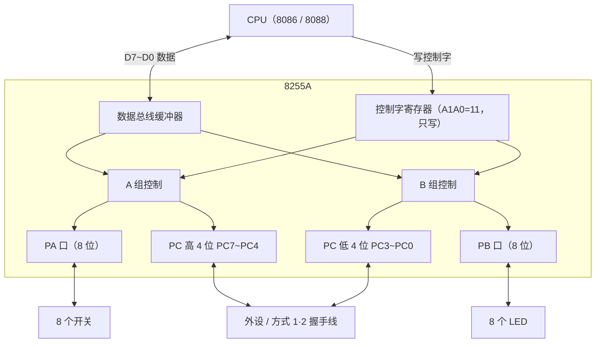

# 第08讲 可编程并行接口芯片 8255A · 逐考点详解

## 本讲是什么 & 为什么考

**先从一个问题说起**：实验台上要读 8 个开关、点亮 8 个灯，CPU 一次怎么跟这 16 条线打交道？

CPU 的数据总线一次只传一个字节，同一时刻不是读就是写；8 个开关是 8 根**输入**线、
8 个灯是 8 根**输出**线，方向不同，没法裸接在同一条总线上。而且外设还会换——
下次可能是「4 个开关 + 1 个数码管」。每换一种外设就重做一次电路，接口就失去了意义。

**8255A 就是为解决这个问题而生的可编程并行接口**：线的分工交给软件。它给
**3 个 8 位数据口**（PA、PB 是主力口，PC 是辅助口）加 **1 个控制口**——CPU 先向
控制口写一个「方式字」指定各口的方向与方式，之后用普通 `IN`/`OUT` 读写数据口，
一条指令搬动 8 根线。

**为什么 C 口拆成两半？** 并行传送分两类：开关、LED 这类「随时 ready」的设备直接
读写就行（方式 0）；打印机这类「有快慢」的设备还要配**握手线**（「数据放好了」
「数据取走了」）。握手线由 C 口兼差：**PC 高 4 位归 A 组**（服务 PA）、
**PC 低 4 位归 B 组**（服务 PB），方式字也按组编排（A 组 D6D5/D4/D3，
B 组 D2/D1/D0）。方式 0 下 C 口不兼差，两半各自定向，一个 C 口当两个 4 位口用。

数据流一句话：**CPU → 数据总线缓冲器 → 组控制 → PA/PB/PC**，控制字寄存器单列指挥：



**考试为什么考它？** 老师把**端口地址 A1A0、方式 0、控制字、编程例**全标成
「掌握」——给你基地址和「读开关点灯」的需求，就要能算出 4 个端口地址、逐位推出
控制字、写出「写控制口 → 循环 IN/OUT」的完整程序。

## 本讲学习目标

学完本讲，你应该能：

1. **算端口地址**：先判 CPU——8088 连续 B~B+3、8086 间隔 2，写出四个端口地址（条目 36、37）。
2. **说清结构与分组**：三个数据口、没有 PD；A 组 = PA + PC 高 4 位、B 组 = PB + PC 低 4 位；方式 2 仅 A 口（条目 35、38、40）。
3. **推两个控制字**：方式字逐位会算（方向位 1=输入，推出 90H/82H/80H/9BH），BSR 会对 PC 某位发正脉冲（条目 43~47）。
4. **写编程例**：按「算控制字 → 写控制口 → 数据口 IN/OUT」三步完成开关→LED（含 NOT 取反）与 4 开关→七段码（条目 49~51）。

> 对应总清单第 **35~52** 条，覆盖本讲全部 18 个考点。
> 老师标注：内部结构「了解」、**端口地址 A1A0「掌握」、三种方式「掌握（方式 0）/ 了解（1、2）」、
> 控制字「掌握」、编程例「掌握」**（开关→LED、4 开关→七段码；4×4 键盘「了解」）。
>
> 作业映射：课堂练习 8255（5 题）＋ 第8讲作业（2 编程连线，已 100 分）。
> **本讲是我作业全对的讲次，稳住即可。**
>
> ⚠ 本仓库没有 8255 的参考 `.ASM`（实验报告库 assembly-language-labs 的实验二源文件只有 8254/8259 的），
> 因此本文代码的对齐依据是**作业第8讲 Q1/Q2 与课堂练习 8255 Q1/Q3 的标准答案**。

## 本讲条目索引

| # | 考点 | 层级 | 来源 | 作业题 | 正文锚点 |
|---|---|---|---|---|---|
| 35 | 结构：PA/PB/PC + 控制口，无 PD；A 组=A 口+C 高 4 位、B 组=B 口+C 低 4 位 | 掌握 | 章+题 | 练习8255Q5 | §3.1 |
| 36 | A1A0 端口选择：00 A 口 / 01 B 口 / 10 C 口 / 11 控制口 | 掌握 | 章+题 | 练习8255Q1/Q3 | §3.1 |
| 37 | 端口地址：8088 连续 B~B+3；8086 间隔 2（B/B+2/B+4/B+6） | 掌握·高频陷阱 | 题+师 | 练习8255Q1/Q3、老师样题 | §3.1 |
| 38 | 三种工作方式：0 基本 IO / 1 选通 / 2 双向（仅 A 口） | 掌握 | 章+网 | 第8讲Q2 | §3.2 |
| 39 | 方式 1/2 握手线精确分布（A 组占 PC3~7、INTR 恒 PC3；B 组占 PC2~0、INTR 恒 PC0） | 理解 | 网 | — | §3.2 |
| 40 | "PB 没有方式 2"——方式 2 仅 A 口 | 掌握 | 章+题 | 第8讲Q2 | §3.2 |
| 41 | 锁存行为：方式 1 输入/输出均可锁存；方式 0 输出锁存、输入不锁存 | 理解 | 网 | — | §3.2 |
| 42 | 中断允许位 INTE 由 BSR 控制字设置 | 了解 | 网 | — | §3.2 |
| 43 | 两个控制字写同一控制口，靠 D7 区分（1=方式选择字、0=BSR） | 掌握 | 章+题 | 练习8255Q2 | §3.3 |
| 44 | 方式字各位：D6D5 A 组方式、D4 PA 方向、D3 PC 高 4 位、D2 B 组方式、D1 PB 方向、D0 PC 低 4 位；方向位 1=输入 | 掌握·考卷附格式 | 师+章+题 | 第8讲Q1 | §3.3 |
| 45 | 方式字参考值：9BH 全入 / 80H 全出 / 82H PA出PB入 / 90H PA入PB出 | 掌握 | 师+章+题 | 第8讲Q1、老师样题 | §3.3 |
| 46 | BSR：D3D2D1 选 PC 位、D0 置/清、一次只能一位、写控制口 | 掌握 | 章+题 | 练习8255Q2、第8讲Q1 | §3.3 |
| 47 | PC6 正脉冲模板：0CH → 0DH → 0CH | 掌握 | 题 | 第8讲Q1 | §3.3 |
| 48 | 状态字：方式 1/2 下读 C 口得 IBF/OBF/INTR；方式 0 读 C 口得数据 | 了解 | 章+网 | — | §3.3 |
| 49 | 编程三步：算控制字 → 写控制口 → 数据口 IN/OUT | 掌握 | 章+题 | 第8讲Q2 | §3.4 |
| 50 | 开关→LED（含 NOT 取反、"开关断开时灯亮"） | 掌握·老师样题 | 师+章+题 | 第8讲Q2、老师样题 | §3.4 |
| 51 | 4 开关→七段码：AND AL,0FH → XLAT → NOT | 掌握 | 章+网 | — | §3.4 |
| 52 | 4×4 键盘行列扫描 | 了解 | 师 | — | §3.4 |

## 阅读约定

每个考点固定四段：**① 机理详解** ｜ **② 例题** ｜ **③ 易错提示** ｜ **④ 横向辨析**。

---

## 35. 结构：PA/PB/PC + 控制口，无 PD；A 组=A 口+C 高 4 位、B 组=B 口+C 低 4 位

**层级** 掌握 ｜ **来源** `章+题` ｜ **作业题** 练习8255Q5 ｜ **正文** §3.1

### ① 机理详解

8255A 有三个 **8 位数据口**加一个控制口：

```
                    ┌─────────────────────┐
        D7~D0 ◄────►│   数据总线缓冲器    │
                    └──────────┬──────────┘
                               │
        A1A0 ─────►┌───────────┴───────────┐
                  │                       │
            ┌─────┴─────┐           ┌─────┴─────┐
            │  A 组     │           │  B 组     │
            │ ┌───────┐ │           │ ┌───────┐ │
            │ │  PA   │◄┼──────────►│ │  PB   │ │  8 位数据口
            │ └───────┘ │           │ └───────┘ │
            │ ┌───────┐ │           │           │
            │ │ PC7~4 │ │           │           │
            │ └───────┘ │           │           │
            └───────────┘           └───────────┘
                  │                       │
            ┌─────┴───────────────────────┴─────┐
            │      PC3~PC0（归 B 组）            │
            └───────────────────────────────────┘
```

分组规则：

- **A 组** = PA 口（8 位）+ PC 口**高 4 位**（PC7~PC4）
- **B 组** = PB 口（8 位）+ PC 口**低 4 位**（PC3~PC0）
- **控制口**不是数据口，只写不读（读控制口在 8255A 中非法/无意义）

**为什么没有 PD 口**：8255A 的设计就是「A、B 两个主数据口 + C 一个辅助口」。
C 口的价值在于它可以**拆成两半**分别服务 A 组和 B 组，兼作握手线——
这正是它比「三个独立口」更灵活的地方。

### ② 例题

课堂练习 8255 Q5 原题：Intel 8255A 芯片一共包含哪些端口？

```
正确答案：PA、PB、PC（选项 ACD）
干扰项：PD —— 不存在。

陷阱：8251A 也没有 PD，8253 是「3 个计数器 + 1 个控制字寄存器」。
      「送分题」年年考，别手滑选 PD。
```

### ③ 易错提示

- **PC 口的高 4 位归 A 组、低 4 位归 B 组**——这是理解方式 1/2 握手线分布（条目 39）的前提。
- **控制口不是数据口**：不能 `IN AL, 控制口` 读状态。8255A 的「状态」是在方式 1/2 下
  **读 C 口**得到的（条目 48）。
- 别把「三个口」和「四个寄存器」混：A1A0 = 11 选中的是**控制寄存器**，它也是 4 个
  A1A0 组合之一，但不属于数据口。

### ④ 横向辨析

| 芯片 | 数据口 | 控制/寄存器选择 | 口选择位数 |
|---|---|---|---|
| **8255A** | **3 个**（PA/PB/PC） | 控制口（A1A0=11） | **A1A0**（2 位） |
| 8251A | **1 个**（收发共用） | 控制/状态口（C/D=1） | **C/D**（1 位） |
| 8253 | 3 个计数器口 | 控制字寄存器（A1A0=11） | **A1A0**（2 位） |
| 8259A | 无数据口 | 4 个 ICW + 3 个 OCW | **A0**（1 位）+ 顺序 |
| ADC0809 | 1 个（D7~D0） | 通道地址 C/B/A | **3 位**（选通道） |

**8255A 与 8253 的端口选择机制完全相同**（A1A0：00/01/10 = 数据，11 = 控制），
学一个就懂两个。8251A 只用一个 C/D 位，8259A 更麻烦（靠顺序）。

---

## 36. A1A0 端口选择：00 A 口 / 01 B 口 / 10 C 口 / 11 控制口

**层级** 掌握 ｜ **来源** `章+题` ｜ **作业题** 练习8255Q1/Q3 ｜ **正文** §3.1

### ① 机理详解

A1A0 两根地址线接到芯片的 A1、A0 引脚，选通内部 4 个寄存器之一：

| A1 | A0 | 选中 | 读/写 |
|---|---|---|---|
| 0 | 0 | **PA 口** | 可读可写 |
| 0 | 1 | **PB 口** | 可读可写 |
| 1 | 0 | **PC 口** | 可读可写 |
| 1 | 1 | **控制口** | **只写** |

注意顺序：**A1 是高一位，A0 是最低位**。
A1A0 = 10 → A1=1, A0=0 → 选 C 口。别读反成「10 选 B 口」。

这 4 个组合加上片选与基地址，就决定了 4 个端口的完整地址（见条目 37）。

### ② 例题

某 8255A 基地址为 300H，A1A0 分别接 CPU 的 A1、A0。写出四个端口的地址
（假设 CPU 为 8088）。

```
8088 → 端口地址连续：
  A1A0 = 00 → PA   = 300H
  A1A0 = 01 → PB   = 301H
  A1A0 = 10 → PC   = 302H
  A1A0 = 11 → 控制 = 303H
```

### ③ 易错提示

- **A1A0=10 是 C 口不是 B 口**：二进制 10 = 2，C 口是第 3 个（序号 2）。
- **控制口只写不读**：想读 C 口状态要 `A1A0=10`，不是 `11`。
- 与 8253 的 A1A0 对照：8253 是 00/01/10 = CNT0/1/2，11 = 控制口。
  **两者都是「11 = 控制口」，但前三个的含义不同**（8255 是 A/B/C 口，8253 是三个计数器）。

### ④ 横向辨析

| A1A0 | 8255A | 8253 |
|---|---|---|
| 00 | PA 口 | 计数器 0 |
| 01 | PB 口 | 计数器 1 |
| 10 | PC 口 | 计数器 2 |
| 11 | **控制口** | **控制口** |

**「11 = 控制口」是两个芯片共同的捷径**，值得记；但 8255A 的三个数据口是
**三种不同性质的口**（A/B/C），8253 的三个口是**三个同质的计数器**。

---

## 37. 端口地址：8088 连续 B~B+3；8086 间隔 2（B/B+2/B+4/B+6）

**层级** 掌握·高频陷阱 ｜ **来源** `题+师` ｜ **作业题** 练习8255Q1/Q3、老师样题 ｜ **正文** §3.1

### ① 机理详解

这是本讲**最容易丢分**的一处，两道真题专门对比考。

根源在于**数据线怎么接**：

```
8088（8 位数据线）：
  CPU 的 D7~D0  ──►  芯片的 D7~D0
  CPU 的 A1     ──►  芯片的 A1
  CPU 的 A0     ──►  芯片的 A0
  → 芯片 A0 与 CPU A0 直接对应 → 端口地址**连续**

8086（16 位数据线）：
  CPU 的 D15~D8 ──►  芯片的 D7~D0      （接高 8 位！）
  CPU 的 A2     ──►  芯片的 A1
  CPU 的 A1     ──►  芯片的 A0
  → 芯片 A0 实际接的是 CPU 的 A1 → 地址**整体左移一位 → 间隔 2**
```

口诀：**8086 数据总线 16 位，低 8 位（D7~D0）被占用，芯片 A0 只能接 CPU 的 A1，
地址就翻倍。**

结果：

| CPU | PA | PB | PC | 控制口 |
|---|---|---|---|---|
| **8088**（基址 B） | B | **B+1** | B+2 | B+3 |
| **8086**（基址 B） | B | **B+2** | B+4 | B+6 |

### ② 例题

**真题 1（课堂练习 8255 Q1）**：8255 与 16 位的 8086 相连，基地址 80H，
求 PA/PB/PC/控制口地址。

```
8086 → 间隔 2：
  PA = 80H, PB = 82H, PC = 84H, 控制口 = 86H
  我的答案 D（80H,82H,84H,86H）✔  正确答案 D ✔

干扰项 A = 81H,83H,85H,87H（间隔 2 但起点错了 1）
干扰项 B = 81H,82H,83H,84H（连续 + 起点错）
干扰项 C = 80H,81H,82H,83H（这是 8088 的答案！）
```

**真题 2（课堂练习 8255 Q3）**：同一基址 80H，但换成准 16 位的 8088。

```
8088 → 连续：
  PA = 80H, PB = 81H, PC = 82H, 控制口 = 83H
  我的答案 D（80H,81H,82H,83H）✔  正确答案 D ✔

→ 两题基址相同、CPU 不同，答案完全不同。这就是「高频陷阱」的考法。
```

**老师样题**：8255A 基地址 68H 接 8088 → 68H/69H/6AH/6BH；
若接 8086 → 68H/6AH/6CH/6EH。

### ③ 易错提示

- 本讲易错第 1 条（主文档 §3.5）：**「8086/8088 端口间隔（两道对比真题，必拿分）」**。
- **判断顺序**：先看 CPU 是 8086 还是 8088，再定连续还是间隔 2。
  看到「8086」「16 位」→ 间隔 2；看到「8088」「准 16 位」→ 连续。
- **第8讲 Q1 的答案 86H 就是这条的陷阱**：控制口是 86H 而不是 84H——
  因为写 BSR 控制字必须写**控制口**，而很多人顺手填了 C 口地址 84H（见条目 47）。
- **十六进制间隔 2 不是「加 2 就好」这么简单**：80H+2=82H ✓，但要注意
  9H+2 = BH、0FH+2=11H 这种进位（参考 8253 的 59H+1=5AH 易错）。

### ④ 横向辨析

| | 8086 | 8088 |
|---|---|---|
| 数据线 | **16 根** | **8 根** |
| 8255 端口地址 | **间隔 2** | **连续** |
| 8253 端口地址 | 间隔 2 | 连续 |
| 8259 端口地址 | 偶/奇（A0） | 偶/奇（A0） |

**8253 与 8255 遵循同一规律**（都受数据线位数影响）；**8259A 不受**——
它只用一根 A0 分奇偶口，所以永远是「偶地址 / 奇地址」成对出现。
这是三者的重要差别。

---

## 38. 三种工作方式：0 基本 IO / 1 选通 / 2 双向（仅 A 口）

**层级** 掌握 ｜ **来源** `章+网` ｜ **作业题** 第8讲Q2 ｜ **正文** §3.2

### ① 机理详解

| 方式 | 名称 | 端口 | 握手 | 要点 |
|---|---|---|---|---|
| **方式 0** | 基本输入输出 | A、B、C（高低 4 位各自独立定向） | **无** | 最简单，最常用 |
| **方式 1** | 选通输入输出 | A、B | **有** | C 口各位自动变握手线；INTR 可接 8259 |
| **方式 2** | 双向总线 | **仅 A 口** | **有** | C 口 5 位作握手；**PB 无方式 2** |

三者的本质区别是「**要不要握手**」：

- **方式 0**：无条件传送。CPU 想读就 `IN`、想写就 `OUT`，不管外设 ready 没有。
  适合「外设永远 ready」的场合（开关、LED、七段码）。
- **方式 1**：查询/中断传送。C 口自动提供 STB̄（外设来了）、IBF（输入缓冲器满）、
  OBF̄（输出缓冲器空）、ACK̄（外设取走了）、INTR（可中断）。
  适合「外设有快慢、需要同步」的场合（打印机、A/D）。
- **方式 2**：A 口同时能收能发（双向总线），像全双工。需要 5 根握手线，
  只有 A 组能提供（PC7~PC3），所以**仅 A 口有方式 2**。

**C 口在方式 0 下的灵活性**：PC 口高 4 位与低 4 位可以**分别设定方向**，
所以一个 C 口能当两个 4 位口用。

### ② 例题

第8讲 Q2 用 8255 做「8 开关 → 8 LED」，控制字为 90H。问这是哪种工作方式，
为什么不需要握手。

```
90H = 1001 0000：
  D7    = 1   → 方式选择字
  D6D5  = 00  → A 组方式 0
  D4    = 1   → PA 输入
  D2    = 0   → B 组方式 0
  D1    = 0   → PB 输出
→ A、B 两组都是方式 0，无握手。

原因：开关和 LED 都是「随时 ready」的简单外设——
      读开关不需要等（电平一直在），写 LED 不需要确认（锁存后一直亮）。
      所以用方式 0 无条件传送最省事。
```

### ③ 易错提示

- **方式 2 只有 A 口有**。本讲易错第 5 条（主文档 §3.5）：「"PB 方式 2"非法」。
- **方式 1/2 会「征用」C 口**：设了方式 1 后，C 口的某些位不再是通用 IO，
  而是固定功能的握手线（条目 39）。方式 0 不征用。
- 老师只要求方式 0 掌握、方式 1/2 了解——但**握手线分布是选择/判断题高频**，
  别完全放过（见下条）。

### ④ 横向辨析

| | 方式 0 | 方式 1 | 方式 2 |
|---|---|---|---|
| 握手线 | 无 | 有（PC3~7 或 PC0~2） | 有（PC3~7） |
| 可用端口 | A/B/C | A/B | **仅 A** |
| INTR | 无 | 有（可接 8259） | 有 |
| 老师层级 | **掌握** | 了解 | 了解 |
| 典型应用 | 开关/LED/七段码 | 打印机/A-D | 双向总线 |

---

## 39. 方式 1/2 握手线精确分布（A 组占 PC3~7、INTR 恒 PC3；B 组占 PC2~0、INTR 恒 PC0）

**层级** 理解 ｜ **来源** `网` ｜ **正文** §3.2

### ① 机理详解

方式 1/2 下 C 口被「征用」为握手线，**引脚分配是固定的**：

| 配置 | PC7 | PC6 | PC5 | PC4 | PC3 | PC2 | PC1 | PC0 |
|---|---|---|---|---|---|---|---|---|
| **A 口方式 1 输入** | I/O | I/O | **IBF_A** | **STB̄_A** | **INTR_A** | — | — | — |
| **A 口方式 1 输出** | **OBF̄_A** | **ACK̄_A** | I/O | I/O | **INTR_A** | — | — | — |
| **B 口方式 1 输入** | — | — | — | — | — | **STB̄_B** | **IBF_B** | **INTR_B** |
| **B 口方式 1 输出** | — | — | — | — | — | **ACK̄_B** | **OBF̄_B** | **INTR_B** |
| **A 口方式 2** | **OBF̄_A** | **ACK̄_A** | **IBF_A** | **STB̄_A** | **INTR_A** | （PC2~0 供 B 口） | | |

规律（背这两句就够）：

1. **A 组握手固定占 PC3~PC7**，其中 **INTR_A 恒为 PC3**；
2. **B 组握手固定占 PC2~PC0**，其中 **INTR_B 恒为 PC0**；
3. **输入**用 STB̄ / IBF，**输出**用 OBF̄ / ACK̄（成对出现）；
4. 没被征用的位（表中 I/O）仍可作普通 IO。

各握手信号的含义：

| 信号 | 方向 | 含义 |
|---|---|---|
| **STB̄**（Strobe） | 输入 | 外设的选通：外设把数据放好了，通知 8255 锁入 |
| **IBF**（Input Buffer Full） | 输出 | 输入缓冲器已满，通知外设「别再送」 |
| **OBF̄**（Output Buffer Full） | 输出 | 输出缓冲器有数据，通知外设「来取」 |
| **ACK̄**（Acknowledge） | 输入 | 外设取走数据的应答 |
| **INTR** | 输出 | 中断请求，可接 8259 的某级 IR |

输入流程：外设置 STB̄ → 8255 锁数据并置 IBF → 数据被读走后清 IBF、可发 INTR。
输出流程：CPU 写数据 → 8255 置 OBF̄ → 外设取走并回 ACK̄ → 8255 清 OBF̄、可发 INTR。

### ② 例题

8255A 的 A 口工作于方式 1 **输入**，问 PC4 和 PC5 分别是什么信号，PC3 是什么？

```
查表（A 口方式 1 输入行）：
  PC5 = IBF_A   （输入缓冲器满）
  PC4 = STB̄_A  （外设选通，低有效）
  PC3 = INTR_A  （中断请求，A 组 INTR 恒为 PC3）
```

### ③ 易错提示

- **这是单一来源条目**（只有 `网` 源），四源中无老师 PDF / 笔记 / 真题佐证。
  老师对方式 1/2 只要求「了解」，本表按「理解」准备即可。
- **INTR_A 恒为 PC3、INTR_B 恒为 PC0**——这两个「锚点」最值得记，其余可推导。
- **输入/输出的握手线不同**：输入是 STB̄+IBF，输出是 OBF̄+ACK̄，别混。
- **方式 2 时 PC2~0 仍可归 B 口用**，不是全被 A 口占用。

### ④ 横向辨析

| | 方式 1 输入 | 方式 1 输出 | 方式 2 |
|---|---|---|---|
| 占用 PC 位 | PC5/PC4/PC3 | PC7/PC6/PC3 | **PC7~PC3 全部** |
| INTR 位置 | PC3 | PC3 | PC3 |
| 握手信号 | STB̄ + IBF | OBF̄ + ACK̄ | 两者都有 |

**与 8259 的衔接**：INTR 可接 8259 的某级 IR，于是一串外设都能用中断方式，
由 8259 统一管理优先级——这是「方式 1/2」与第6讲的联结点。

---

## 40. "PB 没有方式 2"——方式 2 仅 A 口

**层级** 掌握 ｜ **来源** `章+题` ｜ **作业题** 第8讲Q2 ｜ **正文** §3.2

### ① 机理详解

方式 2（双向总线）要求**同一个口既能输入又能输出**，为此需要 5 根握手线
（OBF̄、ACK̄、IBF、STB̄、INTR）。

8255A 的 C 口只有 8 位，A 组占 PC7~PC3 恰好 5 根，B 组只有 PC2~PC0 三根——
**不够**。所以：

- **A 口**：可以方式 2（5 根握手线够）
- **B 口**：**不能方式 2**（只有 3 根可用）

B 口最高只能到方式 1。这是硬件结构决定的，不是软件限制。

### ② 例题

若把方式字写成「A 口方式 2、B 口方式 2」，会发生什么？

```
B 组方式位（D2）只有 1 位，只能表示 0 或 1：
  D2 = 0 → B 组方式 0
  D2 = 1 → B 组方式 1
→ **硬件上无法表达「B 口方式 2」**，D2=1 就是方式 1。

所以「PB 方式 2」这个说法本身不合法，写出来必然被当成方式 1，
实际行为与预期不符（缺双向能力）。
```

### ③ 易错提示

- 本讲易错第 5 条（主文档 §3.5）：**「"PB 方式 2"非法；方式 2 仅 A 口」**。
- 选择题问「下列说法错误的是」，「PB 口可以工作于方式 2」就是标准错误选项。
- 方式 2 时 PC2~PC0 仍可归 B 口作方式 0/1，但 B 组本身到不了方式 2。

### ④ 横向辨析

| 端口 | 支持的方式 |
|---|---|
| **A 口** | 0、1、**2** |
| **B 口** | 0、1 |
| **C 口** | 不独立设方式（随 A/B 组，或方式 0 下按位定向） |

**记忆钩子**：「**A 口是老大，方式最多**」。方式 2 这个「双向总线」能力是 A 口独有的。

---

## 41. 锁存行为：方式 1 输入/输出均可锁存；方式 0 输出锁存、输入不锁存

**层级** 理解 ｜ **来源** `网` ｜ **正文** §3.2

### ① 机理详解

「锁存」与「缓冲」是两种不同的电路行为：

| 行为 | 含义 | 电路 |
|---|---|---|
| **锁存（Latch）** | 数据被**保持住**，直到下次写入 | 触发器 |
| **缓冲（Buffer）** | 只负责隔离/驱动，**不保持** | 三态门 |

8255A 各口在各方式下的行为：

| 方式 | 输入 | 输出 |
|---|---|---|
| **方式 0** | **不锁存**（三态缓冲） | **锁存** |
| **方式 1** | **锁存** | **锁存** |
| **方式 2** | 锁存 | 锁存 |

**为什么方式 0 输入不锁存**：方式 0 是「无条件传送」，CPU `IN` 的瞬间读的就是
外设当前的电平。如果外设电平在读之前变了，读到的就是新值——这符合「无条件」的语义
（外设保证随时 ready，不需要保持）。

**为什么方式 1 输入要锁存**：方式 1 有 STB̄ 选通，外设可能「突然」把数据放上来。
8255 必须在 STB̄ 有效时**锁住**这一刻的数据，否则外设撤走数据后 CPU 还没读就丢了。

### ② 例题

方式 0 下从 PA 口读一个开关状态，读到一半开关被拨动，会怎样？方式 1 下呢？

```
方式 0：读到的可能是拨动过程中的中间值（甚至抖动脉冲）——
        因为输入不锁存，IN 指令采样的是执行瞬间的电平。
        所以方式 0 接机械开关要软件防抖（DELAY_20MS）。

方式 1：数据在 STB̄ 有效沿被锁存，之后的拨动不影响已锁存的值，
        CPU 读到的是稳定的那一帧。
```

### ③ 易错提示

- **这是单一来源条目**（只有 `网` 源）。老师未明确要求，按「理解」准备。
- 别把「方式 0 输出锁存」忘掉：写 LED 时 `OUT` 之后 LED 一直亮，
  就是因为输出锁存住了——这是方式 0 输出与输入的不对称之处。
- 与 DAC0832 的「两级锁存」区分：那是为了多路同步（见第10讲条目 4/5），
  这里是「要不要保持数据」，动机不同。

### ④ 横向辨析

| | 8255A 方式 0 输入 | 8255A 方式 0 输出 | DAC0832 输入寄存器 |
|---|---|---|---|
| 电路 | 三态缓冲（不保持） | 锁存器（保持） | 锁存器（保持） |
| 目的 | 随时反映当前电平 | 让 LED 稳定显示 | 多路同步更新 |

---

## 42. 中断允许位 INTE 由 BSR 控制字设置

**层级** 了解 ｜ **来源** `网` ｜ **正文** §3.2

### ① 机理详解

方式 1/2 下，INTR 中断请求不是无条件发出的，要受 **INTE（Interrupt Enable）** 位控制。
而 8255A **没有专门的 INTE 设置命令**——它是靠 **C 口置位/复位（BSR）控制字**来设置的：

| 组 / 方向 | INTE 所在 PC 位 | BSR 置 1（允许中断） | BSR 清 0（禁止中断） |
|---|---|---|---|
| A 组方式 1 **输入** | PC4 | `00001001B` = 09H | `00001000B` = 08H |
| A 组方式 1 **输出** | PC6 | `00001101B` = 0DH | `00001100B` = 0CH |
| B 组方式 1 **输入** | PC2 | `00000101B` = 05H | `00000100B` = 04H |
| B 组方式 1 **输出** | PC2 | `00000101B` = 05H | `00000100B` = 04H |

推导示例（A 组方式 1 输入的 INTE 在 PC4）：

```
BSR 格式：D7=0, D3D2D1 = 位号, D0 = 置/清
PC4 → D3D2D1 = 100
置 1（允许中断）→ 0000 1 001B = 09H
清 0（禁止中断）→ 0000 1 000B = 08H
```

**为什么这样设计**：方式 1 下 PC4/PC6/PC2 这些位已经不是通用 IO 而是握手线，
但它们仍可通过 BSR 写入——这给了程序员一个「不占用额外寄存器」的控制手段。
这也是**同一个 PC 位在不同方式下含义完全不同**的典型例子（条目 46 的伏笔）。

### ② 例题

A 口方式 1 输入，想开放 A 组中断，写出 BSR 控制字。

```
A 组方式 1 输入的 INTE 在 PC4。
置 1 → D3D2D1 = 100, D0 = 1, D7 = 0
      → 0000 1001B = 09H

MOV DX, 控制口
MOV AL, 09H
OUT DX, AL
```

### ③ 易错提示

- **这是单一来源条目**（只有 `网` 源）。老师未明确要求，按「了解」准备。
- **INTE 的位置随方式与方向而变**：A 口输入在 PC4、A 口输出在 PC6、B 组在 PC2。
- **BSR 控制字写的是控制口**，不是 C 口数据口——这条对所有 BSR 操作都成立。
- 别和「OCW1 屏蔽字」（8259）混：那个是用 AND/OR 指令构造后写奇口，
  8255A 这里是靠 BSR 逐位置位。

### ④ 横向辨析

| | 8255A INTE | 8259A OCW1 屏蔽 |
|---|---|---|
| 设置手段 | **BSR 控制字**（逐位） | 直接写整个字节 |
| 控制粒度 | 一位一次 | 8 位一次 |
| 极性 | 1 = 允许中断 | **1 = 屏蔽**（相反！） |
| 写哪个口 | 控制口（A1A0=11） | 奇口（A0=1） |

**极性相反是最阴的坑**：8255A 的 INTE 置 1 是「允许」，8259A 的 IMR 置 1 是「屏蔽」。

---

## 43. 两个控制字写同一控制口，靠 D7 区分（1=方式选择字、0=BSR）

**层级** 掌握 ｜ **来源** `章+题` ｜ **作业题** 练习8255Q2 ｜ **正文** §3.3

### ① 机理详解

8255A 只有一个控制口（A1A0=11），但要写两种控制字。区分手段是 **D7**：

```
写入控制口的字节：
        D7 = 1  ──►  方式选择控制字（方式字）
        D7 = 0  ──►  C 口置位/复位控制字（BSR）
```

这是 8255A 与 8251A 的关键差别：

| | 8255A | 8251A |
|---|---|---|
| 区分手段 | **D7 标志位** | **先后顺序** |
| 优点 | 任何时候都能明确判断 | 不需要额外位 |
| 缺点 | 占用一个特征位 | 顺序错则全错且无报错 |

**为什么 8255A 能用 D7**：因为方式字的最高位**恰好**没有别的用途
（方式 2 也只有 D6D5 两位表示方式号，D7 空着）。
而 BSR 只需要 D3D2D1 选位、D0 置清，D4~D6 都空着——于是 D7 被「征用」为标志位。

### ② 例题

课堂练习 8255 Q2 原题：关于 8255A 的 C 口按位置位/复位（BSR）功能，下列说法**错误**的是？

```
正确答案：A「一次能设置 C 口的所有引脚电平」

理由：
  · BSR 的 D3D2D1 只有 3 位，只能选中 PC0~PC7 中的一个 → **一次只能操作一位**
  · 选项 B「可以设置 C 口任何引脚为高电平」✔（D0=1）
  · 选项 C「可以设置 C 口任何引脚为低电平」✔（D0=0）
  · 选项 D「一次只能设置 C 口的其中一个引脚电平」✔
  → 唯一错误的是 A

我的答案 A ✔  正确答案 A ✔
```

### ③ 易错提示

- 本讲易错第 4 条（主文档 §3.5）：**「方式字 D7 忘置 1 → 被当成 BSR」**。
  若把 90H 写成 10H（漏了 D7），芯片会把它解释成 BSR：D3D2D1=000 选 PC0，D0=0 清 PC0——
  **方式根本没设，且误操作了 PC0**。
- 本讲易错第 3 条：**「BSR 一次一位、写的是控制口不是 C 口数据口」**。
- 想让 PC 口多位同时变化，方式 0 下应**直接写 C 口数据口**（一次 8 位），
  方式 1/2 下那些位是握手线，只能用 BSR 动 INTE。

### ④ 横向辨析

| 控制字 | D7 | 作用对象 | 粒度 |
|---|---|---|---|
| **方式选择字** | **1** | A/B 组方式 + 各口方向 | 一次设定全部 |
| **BSR** | **0** | C 口单个位 | **一次一位** |

**两个控制字都写控制口**，靠 D7 分流。这与 8251A「三字共用一个口靠顺序」形成对比，
也与 8253「控制字只有一种」更不同。

---

## 44. 方式字各位：D6D5 A 组方式、D4 PA 方向、D3 PC 高 4 位、D2 B 组方式、D1 PB 方向、D0 PC 低 4 位；方向位 1=输入

**层级** 掌握·考卷附格式 ｜ **来源** `师+章+题` ｜ **作业题** 第8讲Q1 ｜ **正文** §3.3

### ① 机理详解

方式字位布局（**考卷会附格式图，但值要会算**）：

```
 D7 │ D6 D5 │ D4 │ D3 │ D2 │ D1 │ D0
 1  │ A组方式│ PA │PC高│B组 │ PB │PC低
    │       │方向│4位 │方式│方向│4位
```

| 位 | 含义 | 取值 |
|---|---|---|
| **D7** | 特征位 | **固定 1** |
| **D6D5** | A 组方式 | 00=方式0、01=方式1、1×=方式2 |
| **D4** | PA 方向 | **1 = 输入**、0 = 输出 |
| **D3** | PC 高 4 位方向 | 1 = 输入、0 = 输出 |
| **D2** | B 组方式 | 0=方式0、1=方式1 |
| **D1** | PB 方向 | **1 = 输入**、0 = 输出 |
| **D0** | PC 低 4 位方向 | 1 = 输入、0 = 输出 |

**方向位 1=输入是反直觉的**（本讲易错第 2 条）——多数人直觉是「1=有效=输出」。
记忆法：**「1 = in = 进」**。

### ② 例题

作业第8讲 Q2：A 口接 8 个开关（输入），B 口接 8 个 LED（输出），
且 8255 口地址为 0F0H~0F6H。求控制字。

```
逐位确定：
  D7   = 1             特征位
  D6D5 = 00            A 组方式 0
  D4   = 1             PA 输入（接开关）
  D3   = 0             PC 高 4 位输出（未用，默认 0）
  D2   = 0             B 组方式 0
  D1   = 0             PB 输出（接 LED）
  D0   = 0             PC 低 4 位输出（未用）
  ────────────────────────────────
  1 00 1 0 0 0 0 = 1001 0000B = 90H

作业标准答案：第二空 = E（10010000B）✔
干扰项 F = 10010001B（91H）→ D0=1，PC 低 4 位设成输入，与题意不合
```

### ③ 易错提示

- **D7 必须为 1**，否则被当成 BSR（见条目 43）。
- **方向位 1=输入**：90H 是「PA 入 PB 出」，82H 是「PA 出 PB 入」，
  两者只差 D4/D1 两位，极易记反。
- **PC 高低 4 位方向也要设**：题目没提 PC 时习惯上设为输出（0），
  但若 PC 要接输入设备必须置 1。
- 方式 1/2 下 PC 的相应位被征用为握手线，**方式字里它们的方向位无意义**。

### ④ 横向辨析

| 位 | 8255A 方式字 | 8253 控制字 | 8259 ICW2 |
|---|---|---|---|
| 最高位 | D7 = 1（特征） | D7D6 选计数器 | D7~D3 = 类型码高 5 位 |
| 中间 | 方式号 + 方向 | D5D4 读写、D3~D1 方式 | — |
| 最低 | PC 方向 | D0 二进制/BCD | D2~D0 自动填 IR 号 |

**8255A 的 D7 是「字类型」标志，8253 的 D7D6 是「选计数器」**——
同样是最高位，用途完全不同，别串。

---

## 45. 方式字参考值：9BH 全入 / 80H 全出 / 82H PA出PB入 / 90H PA入PB出

**层级** 掌握 ｜ **来源** `师+章+题` ｜ **作业题** 第8讲Q1、老师样题 ｜ **正文** §3.3

### ① 机理详解

四个经典值，全部可逐位推出（以方式 0 为例）：

| 值 | 二进制 | A 组 | PA | PC高 | B 组 | PB | PC低 | 场景 |
|---|---|---|---|---|---|---|---|---|
| **80H** | 1000 0000 | 0 | 出 | 出 | 0 | 出 | 出 | **全输出** |
| **9BH** | 1001 1011 | 0 | **入** | **入** | 0 | **入** | **入** | **全输入** |
| **82H** | 1000 0010 | 0 | **出** | 出 | 0 | **入** | 出 | **PA 出 PB 入** |
| **90H** | 1001 0000 | 0 | **入** | 出 | 0 | **出** | 出 | **PA 入 PB 出** |

**推导 90H（PA 入 PB 出）**：

```
D7=1（特征） D6D5=00（A组方式0） D4=1（PA入） D3=0（PC高出）
D2=0（B组方式0） D1=0（PB出） D0=0（PC低出）
→ 1 00 1 0 0 0 0 = 10010000B = 90H
```

**推导 82H（PA 出 PB 入）**：把 90H 的 D4 改 0、D1 改 1：

```
→ 1 00 0 0 0 1 0 = 10000010B = 82H
```

**推导 9BH（全输入）**：四个方向位全置 1：

```
→ 1 00 1 1 0 1 1 = 10011011B = 9BH
```

### ② 例题

老师样题（综合设计）：8255A 基地址 68H 接 8088，读开关驱动 LED，
要求「**开关断开时灯亮**」。写出初始化与循环代码。

```
① 端口地址（8088 → 连续）：
   PA = 68H, PB = 69H, PC = 6AH, 控制口 = 6BH

② 控制字：PA 输入、PB 输出 → 90H

③ 代码：
        MOV DX, 6BH
        MOV AL, 90H        ; PA 入、PB 出（方式 0）
        OUT DX, AL
READ:   MOV DX, 68H
        IN  AL, DX         ; 读开关：闭合=1，断开=0
        NOT AL             ; 「开关断开时灯亮」→ 断开(0)要变成 1
        MOV DX, 69H
        OUT DX, AL         ; 驱动 LED
        JMP READ

关键：NOT AL 实现「断开→亮」的极性反转。漏了 NOT 就变成「闭合时灯亮」。
```

### ③ 易错提示

- **90H 与 82H 只差 D4/D1**，是「PA 入 PB 出」与「PA 出 PB 入」的一对，
  考试最爱混。记法：**9 > 8，所以 9 打头的 PA 是输入**（90H/91H/9BH 都是 PA 入）。
- 老师样题的 **NOT AL** 是得分点：题目说「开关断开时灯亮」就必须取反。
- 主文档 §3.5 易错第 2 条：**「方向位 1=输入（直觉反）」**。

### ④ 横向辨析

| 需求 | 控制字 |
|---|---|
| 全输出 | 80H |
| 全输入 | 9BH |
| PA 入 / PB 出 | **90H**（最常见） |
| PA 出 / PB 入 | 82H |
| PA 入 / PB 出 / PC 低入 | 91H |

**91H 是 90H 的干扰项**（作业第8讲 Q2 的选项 F）：只在 PC 低 4 位方向不同。
若题目说 PC 未用，答案就是 90H 不是 91H。

---

## 46. BSR：D3D2D1 选 PC 位、D0 置/清、一次只能一位、写控制口

**层级** 掌握 ｜ **来源** `章+题` ｜ **作业题** 练习8255Q2、第8讲Q1 ｜ **正文** §3.3

### ① 机理详解

BSR（Bit Set/Reset）控制字位布局：

```
 D7 │ D6 D5 D4 │ D3 D2 D1 │ D0
 0  │   000    │  位号    │ 置/清
（特征位）      │ 000=PC0  │ 1=置1
               │ ...      │ 0=清0
               │ 111=PC7  │
```

| 位 | 含义 |
|---|---|
| **D7** | **0**（BSR 标志，与方式字的 1 相对） |
| D6 D5 D4 | 固定 **000**（无意义，写 0） |
| **D3D2D1** | 选中的 PC 位号：000=PC0 … 111=PC7 |
| **D0** | **1 = 该位置 1**，**0 = 该位清 0** |

PC 位号对照表：

| D3D2D1 | 位 | 置 1 | 清 0 |
|---|---|---|---|
| 000 | PC0 | 01H | 00H |
| 001 | PC1 | 03H | 02H |
| 010 | PC2 | 05H | 04H |
| 011 | PC3 | 07H | 06H |
| 100 | PC4 | 09H | 08H |
| 101 | PC5 | 0BH | 0AH |
| 110 | PC6 | **0DH** | **0CH** |
| 111 | PC7 | 0FH | 0EH |

**规律**：置 1 = 位号 × 2 + 1；清 0 = 位号 × 2。所以 PC6 → 6×2+1 = 13 = 0DH，6×2 = 12 = 0CH。

### ② 例题

推导 PC5 发一个正脉冲的 BSR 序列（控制口 63H）。

```
PC5 → 位号 5 → D3D2D1 = 101
  置 1 → 0000 1011B = 0BH
  清 0 → 0000 1010B = 0AH

        MOV DX, 63H
        MOV AL, 0AH        ; PC5 = 0
        OUT DX, AL
        MOV AL, 0BH        ; PC5 = 1
        OUT DX, AL
        MOV AL, 0AH        ; PC5 = 0  → 形成一个正脉冲
        OUT DX, AL
```

### ③ 易错提示

- **一次只能一位**（练习8255Q2 的答案 A 就是这个说法的否定）。
- **写控制口，不是 C 口数据口**：第8讲 Q1 第一空答案是 **86H（控制口）**，
  干扰项 84H 就是 C 口地址。填 84H 会把这几个字节写进 C 口**数据**寄存器，
  完全不起控制作用。
- **D7 必须是 0**：写成 8DH 会被当成方式字。
- **置 1 / 清 0 的次序**：正脉冲是「先 0 后 1 再 0」，
  别写成「先 1 后 0」（那是负脉冲）。

### ④ 横向辨析

| | BSR（8255A） | 直接写 C 口（方式 0） |
|---|---|---|
| 粒度 | **1 位** | 8 位 |
| 影响其他位 | 否 | **是**（会覆盖整个 C 口） |
| 写哪个口 | 控制口 | C 口数据口 |
| 适用 | 方式 1/2 下动握手/INTE 位 | 方式 0 下批量输出 |

**关键差异**：BSR 是「读-改-写」的位操作，不影响其他位；
直接写 C 口是整体覆盖。方式 0 下想只改一位又不想影响其他位，也必须用 BSR。

---

## 47. PC6 正脉冲模板：0CH → 0DH → 0CH

**层级** 掌握 ｜ **来源** `题` ｜ **作业题** 第8讲Q1 ｜ **正文** §3.3

### ① 机理详解

这是作业第8讲 Q1 的原题，标准答案：

| 空 | 答案 | 内容 |
|---|---|---|
| 第一空 | **86H**（选项 D） | **控制口**地址（基址 80H 接 8086） |
| 第二空 | **00001101B = 0DH**（选项 F） | PC6 置 1（高电平） |

完整程序：

```asm
CODE SEGMENT
START:
        MOV DX, 86H          ; 第一空 = 控制口
        MOV AL, 00001100B    ; PC6 输出低电平（BSR 清 PC6）
        OUT DX, AL
        MOV AL, 00001101B    ; 第二空 = PC6 置 1（高电平）
        OUT DX, AL
        MOV AL, 00001100B    ; PC6 再清 0 → 完成一个正脉冲
        OUT DX, AL
CODE ENDS
END START
```

**逐位展开第二空 0DH**：

```
0DH = 0000 1101B
  D7    = 0        → BSR 控制字 ✔
  D6D5D4 = 000     → 固定 000 ✔
  D3D2D1 = 110     → 位号 6 = PC6 ✔
  D0    = 1        → 置 1（高电平）✔
```

**第一空为什么是 86H 而不是 84H**：

```
基地址 80H，接 8086 → 端口间隔 2：
  PA = 80H, PB = 82H, PC = 84H, 控制口 = 86H
写的是 BSR 控制字 → 必须写控制口 = 86H。

干扰项 84H 是 C 口数据口地址——很多人看到「C 口引脚 PC6」就填 84H，
这是本题最大的陷阱。
```

**正脉冲的三段式**：低 → 高 → 低。缺最后一段就只是一个电平跳变，不成「脉冲」。

### ② 例题

第8讲 Q1 原题重做：已知 8255A 基地址 80H 与 8086 连接，让 C 口 PC6 输出一个正脉冲。

```
第一空：86H     （控制口，不是 84H）
第二空：00001101B = 0DH   （PC6 置 1）

我的答案：1→D, 2→F  ✔
正确答案：1→D, 2→F  ✔
```

> 题目原文把第一个 BSR 印成 `000001100B`（7 位，漏一个 0），
> 标准答案的第三行已给修正值 `00001100B`。按 0CH/0DH/0CH 三段记忆。

### ③ 易错提示

- **第一空填控制口**（86H）不是 C 口（84H）——本题 50 分的第一陷阱。
- **第二空是 0DH 不是 0CH**：题目注释写「PC6 输出高电平」，高电平要 D0=1。
- **三段不能省**：低 → 高 → 低。只写两句得不到脉冲。
- **基址接 8086 所以间隔 2**：若题目改成 8088，第一空就变成 **83H**。
  **先判 CPU 再定地址**，这条对所有 8255 题都成立。

### ④ 横向辨析

| 位 | 置 1（高） | 清 0（低） |
|---|---|---|
| PC6 | **0DH** = 0000 1101 | **0CH** = 0000 1100 |
| PC5 | 0BH | 0AH |
| PC4 | 09H | 08H |
| PC7 | 0FH | 0EH |

**老师课件例（PC5 发脉冲，控制口 63H）**：`0AH → 0BH → 0AH`。
作业真题（PC6，控制口 86H）：`0CH → 0DH → 0CH`。
**模板完全一致，只是位号与控制口地址不同**——掌握模板即可通杀。

---

## 48. 状态字：方式 1/2 下读 C 口得 IBF/OBF/INTR；方式 0 读 C 口得数据

**层级** 了解 ｜ **来源** `章+网` ｜ **正文** §3.3

### ① 机理详解

8255A **没有独立的状态寄存器**，「状态」就是**读 C 口**（A1A0 = 10）：

| 方式 | 读 C 口得到什么 |
|---|---|
| **方式 0** | **C 口的输入数据**（C 口作通用输入口用） |
| **方式 1** | **握手线状态**：IBF、OBF̄、INTR、INTE 等 |
| **方式 2** | A 口的握手线状态 |

方式 1 输入时读 C 口的典型布局（A 组）：

```
PC7 PC6 PC5   PC4    PC3
I/O I/O IBF_A STB̄_A INTR_A
```

方式 1 输出时：

```
PC7     PC6     PC5 PC4 PC3
OBF̄_A   ACK̄_A   I/O I/O INTR_A
```

**查询编程的用法**：方式 1 输入时，CPU 可以轮询 `PC5`（IBF_A）是否为 1，
为 1 说明数据已锁好，可以 `IN AL, PA口`。

### ② 例题

A 口方式 1 输入，写出查询方式读取一个字节的程序框架。

```asm
        MOV DX, 控制口
        MOV AL, 10110001B    ; A 组方式 1 输入、PB 方式 0 输出、PC 高出
        OUT DX, AL
        MOV AL, 09H          ; BSR：PC4 置 1 → 允许 A 组中断（若用中断方式）
        OUT DX, AL
POLL:   MOV DX, PC口          ; A1A0 = 10
        IN  AL, DX           ; 读 C 口得状态
        TEST AL, 20H         ; 测 PC5 = IBF_A（输入缓冲器满）
        JZ  POLL             ; 未满 → 继续等
        MOV DX, PA口
        IN  AL, DX           ; 读走数据（IBF 自动清）
```

### ③ 易错提示

- **读 C 口是 A1A0 = 10**，不是控制口（11）。控制口只写不读。
- **方式 0 下读 C 口读的是数据不是状态**——同一个口两种语义，靠方式字区分。
- **INTE 位也能从 C 口读出**（方式 1 下），所以查询/调试时可确认中断是否开放。
- 老师对本条只要求「了解」：能说出「方式 0 读数据、方式 1/2 读握手状态」即可。

### ④ 横向辨析

| | 8255A「状态」 | 8251A 状态字 | 8259A 状态 |
|---|---|---|---|
| 载体 | **读 C 口** | **读控制口** | 读 IRR/ISR（OCW3 控制） |
| 方式 0 下 | C 口**数据** | 收发/错误状态 | — |
| 是否需要先写命令 | 否 | 否 | **需要 OCW3 指定读哪个** |

**8259A 最麻烦**：读 IRR 和读 ISR 要用不同的 OCW3（0AH 读 IRR、0BH 读 ISR），
而 8255A 和 8251A 都是「直接读就有」。

---

## 49. 编程三步：算控制字 → 写控制口 → 数据口 IN/OUT

**层级** 掌握 ｜ **来源** `章+题` ｜ **作业题** 第8讲Q2 ｜ **正文** §3.4

### ① 机理详解

所有 8255A 程序的固定骨架，三步：

```
① 算控制字       → 根据「谁输入谁输出、什么方式」逐位定出（条目 44/45）
② 写控制口       → MOV DX, 控制口; MOV AL, 控制字; OUT DX, AL
③ 数据口 IN/OUT  → 读输入口 / 写输出口，通常套一个循环
```

第8讲 Q2 的完整答案（口地址 0F0H~0F6H，A 口 8 开关输入、B 口 8 LED 输出）：

| 空 | 答案 | 内容 |
|---|---|---|
| 第一空 | **0F6H**（D） | 控制口 |
| 第二空 | **10010000B = 90H**（E） | PA 入 PB 出 |
| 第三空 | **0F0H**（A） | A 口（读开关） |
| 第四空 | **0F2H**（B） | B 口（写 LED） |
| 第五空 | **JMP**（H） | 无条件循环回 LOOP1 |

```asm
CODE SEGMENT
START:
        MOV DX, 0F6H          ; 第一空 = 控制口
        MOV AL, 10010000B     ; 第二空 = 90H，A 口输入、B 口输出
        OUT DX, AL
LOOP1:
        MOV DX, 0F0H          ; 第三空 = A 口
        IN  AL, DX            ; 从 A 口读入开关状态
        MOV DX, 0F2H          ; 第四空 = B 口
        OUT DX, AL            ; B 口输出控制 LED 灯
        JMP LOOP1             ; 第五空 = JMP（不是 LOOP）
CODE ENDS
END START
```

**第五空为什么是 JMP 不是 LOOP**：

```
LOOP 指令依赖 CX 寄存器：LOOP 会把 CX 减 1，CX≠0 才跳转。
本题没有初始化 CX，CX 的值不确定：
  · CX 恰为 0 → LOOP 先减成 0FFFFH，跳转（碰巧能循环）
  · CX 非 0  → 会递减，最终减到 0 时退出
→ 行为不可预期，必须用无条件 JMP 才能保证持续循环。
```

### ② 例题

按三步骨架重做第8讲 Q2，并说明每个空为什么这么填。

```
① 算控制字：
   8 开关 → PA 输入 → D4 = 1
   8 LED  → PB 输出 → D1 = 0
   均方式 0 → D6D5 = 00, D2 = 0
   → 10010000B = 90H

② 端口地址（口地址 0F0H~0F6H，间隔 2 → 接 8086）：
   0F0H = PA, 0F2H = PB, 0F4H = PC, 0F6H = 控制口

③ 填空：
   第一空 0F6H（写控制字必须写控制口）
   第二空 10010000B
   第三空 0F0H（读 A 口）
   第四空 0F2H（写 B 口）
   第五空 JMP（无 CX 初始化，不能用 LOOP）

我的答案：D, E, A, B, H  ✔   正确答案：D, E, A, B, H  ✔
```

### ③ 易错提示

- **写控制字一定写控制口**：Q2 第一空是 0F6H，不是 0F4H（PC 口）也不是 0F0H。
- **JMP 与 LOOP 的选择**：没有 CX 初始化就用 JMP。
  这是 Q2 第五空的陷阱（选项 G = LOOP 是干扰项）。
- **顺序不能反**：必须先写控制字再动数据口。反过来数据口的方向还没设，
  `IN`/`OUT` 行为不确定。
- **0F0H~0F6H 这个范围本身就说明间隔 2**（四个地址占 8 个字节跨度）——
  看到这种写法就该反应过来是 8086。

### ④ 横向辨析

| 芯片 | 初始化步数 | 数据操作 |
|---|---|---|
| **8255A** | **1 步**（写控制字） | IN/OUT 数据口 |
| 8251A | **4~5 步**（3×00H + 40H + 方式字 + 命令字） | IN 状态口 / OUT 数据口 |
| 8253 | 2 步（控制字 + 初值） | OUT 计数器口 |
| 8259A | 2~4 步（ICW1~ICW4） | OUT 偶口/奇口 |

**8255A 是五个芯片里初始化最简单的**——只有一个控制字。这也是它适合做
基础实验的原因。

---

## 50. 开关→LED（含 NOT 取反、"开关断开时灯亮"）

**层级** 掌握·老师样题 ｜ **来源** `师+章+题` ｜ **作业题** 第8讲Q2、老师样题 ｜ **正文** §3.4

### ① 机理详解

本讲最核心的应用，两种问法：

**问法 A**：「开关闭合时相应 LED 点亮」→ **直接传送**，`IN` 完就 `OUT`。
**问法 B**：「开关**断开**时灯亮」→ **要取反**，`NOT AL` 后再 `OUT`。

极性分析：

```
开关闭合 → 逻辑 1；开关断开 → 逻辑 0
LED 逻辑 1 点亮

问法 A（闭合→亮）：1 → 1，直接传        IN AL,PA → OUT PB,AL
问法 B（断开→亮）：0 → 1，需取反        IN AL,PA → NOT AL → OUT PB,AL
```

**主文档 §3.4 的标准模板**（PA 入 PB 出，8088 端口 60H 起）：

```asm
        MOV DX, 63H          ; 控制口（60H+3）
        MOV AL, 90H          ; PA 入、PB 出（方式 0）
        OUT DX, AL
READ:   MOV DX, 60H          ; PA 口
        IN  AL, DX           ; 读开关（含机械抖动 → 调 DELAY_20MS 防抖）
        NOT AL               ; LED 极性相反时取反
        MOV DX, 61H          ; PB 口
        OUT DX, AL
        JMP READ
```

**机械抖动**：机械开关在闭合/断开瞬间会有几毫秒的抖动，
方式 0 输入不锁存（条目 41），所以可能读到多个 0/1 跳变。
解决办法是**软件延时消抖**（DELAY_20MS 后再读一次）。

### ② 例题

老师样题（综合设计题）：8255A 基地址 68H 接 **8088**，读开关驱动 LED，
要求「开关断开时灯亮」，写出完整程序。

```asm
CODE    SEGMENT
        ASSUME CS:CODE
START:  MOV AX, ...           ; 段初始化按需
        MOV DX, 6BH           ; 控制口（68H/69H/6AH/6BH，8088 连续）
        MOV AL, 90H           ; PA 输入、PB 输出、方式 0
        OUT DX, AL
READ:   MOV DX, 68H           ; PA 口
        IN  AL, DX            ; 读开关：闭合=1，断开=0
        NOT AL                ; 断开(0) → 1，点亮 LED
        MOV DX, 69H           ; PB 口
        OUT DX, AL
        JMP READ
CODE    ENDS
        END START
```

得分点 checklist：

| 要点 | 分值意义 |
|---|---|
| 控制口地址 6BH（8088 连续） | 考地址计算 |
| 控制字 90H | 考方向位 |
| **NOT AL** | 考极性理解（「断开时灯亮」） |
| JMP 循环 | 考持续刷新 |

### ③ 易错提示

- **NOT AL 是最易漏的一步**：题目说「断开时灯亮」必须取反；说「闭合时灯亮」不要取反。
  **逐字读题**。
- **端口地址先判 CPU**：68H 接 8088 → 6BH 是控制口；接 8086 → 控制口是 6EH。
- **读的是 PA、写的是 PB**，别把 DX 搞反。
- **机械开关要防抖**：不加延时可能 LED 闪烁。

### ④ 横向辨析

| 问法 | 需要的处理 |
|---|---|
| 闭合 → 亮 | 直接 `IN` → `OUT` |
| **断开 → 亮** | `IN` → **`NOT`** → `OUT` |
| 闭合 → 灭 | 直接 `IN` → `OUT`（LED 低电平亮） |
| 断开 → 灭 | `IN` → `NOT` → `OUT` |

**判据**：比较「开关状态的逻辑值」与「点亮所需的逻辑值」是否一致。
一致就直接传，不一致就 NOT。

---

## 51. 4 开关→七段码：AND AL,0FH → XLAT → NOT

**层级** 掌握 ｜ **来源** `章+网` ｜ **正文** §3.4

### ① 机理详解

把「4 个开关」变成「七段数码管的段码」，链路是：

```
读 PA 口 ──► AND AL, 0FH ──► XLAT ──► NOT ──► OUT PB 口 ──► 七段码
            （取低 4 位）  （查表）   （极性）  （驱动）
```

各步的作用：

1. **`AND AL, 0FH`**：只保留低 4 位。4 个开关接 PA0~PA3，
   高 4 位悬空/无用，必须屏蔽掉，否则查表会越界或错位。
2. **`XLAT`**：`AL ← DS:[BX + AL]`。BX 先指向段码表首址，
   AL 既作索引又作结果——所以表必须定义在当前数据段。
3. **`NOT`**：七段数码管有**共阴/共阳**两种：
   - **共阴**：段码 1 点亮 → 不需取反
   - **共阳**：段码 0 点亮 → 需取反
   老师示例按共阳处理，所以有 NOT。
4. **`OUT PB 口`**：段码接 PB0~PB7。

典型数据段：

```asm
DATA    SEGMENT
TABLE   DB 3FH, 06H, 5BH, 4FH, 66H, 6DH, 7DH, 07H   ; 0~7 共阴段码
        DB 7FH, 6FH, 77H, 7CH, 39H, 5EH, 79H, 71H   ; 8~F
DATA    ENDS
```

### ② 例题

4 个开关接 PA0~PA3，当前读入 AL = 10110100B。问应该显示什么，写出处理链。

```
① AND AL, 0FH：
   10110100B AND 00001111B = 00000100B = 4
   → 开关状态表示数字 4（高 4 位 1011 被屏蔽）

② XLAT（BX = TABLE）：
   AL ← DS:[BX + 4] = TABLE[4] = 66H   （数字 4 的共阴段码）

③ NOT（共阳）：
   NOT 66H = 99H

④ OUT PB 口：
   七段码显示「4」
```

### ③ 易错提示

- **AND AL,0FH 不能省**：不屏蔽高 4 位，索引会变成 0B4H，远超 16 项表长。
- **XLAT 要求表在当前数据段**，且 BX 必须先 `LEA BX, TABLE`。
- **NOT 取决于共阴/共阳**：题目说共阴就不取反，共阳才取反。
- 本讲易错第 2 条相关的方向位：PB 要设输出（D1=0）。

### ④ 横向辨析

| | 4 开关→七段码 | 作业 4.12 键入 0~9 查七段码 |
|---|---|---|
| 索引来源 | 开关（并行走 PA） | 键盘（01H → SUB AL,30H） |
| 查表指令 | **XLAT** | **XLAT** |
| 输出 | PB 口（并行） | 存 DL / 显示 |
| 前置处理 | AND AL,0FH | SUB AL,30H |

**两者都用 XLAT**，差别只在「索引怎么来」：一个来自并口读入+屏蔽，
一个来自键盘字符转数值。XLAT 是本课程最高频的查表指令，必须熟练。

---

## 52. 4×4 键盘行列扫描

**层级** 了解 ｜ **来源** `师` ｜ **正文** §3.4

### ① 机理详解

4×4 矩阵键盘用 8 根线（4 行 + 4 列）驱动 16 个按键，比独立接法省 8 根线。
接法：**行接 PA 口（输出，逐行拉低）**，**列接 PC 口（输入，读列电平）**。

扫描原理：

```
① 全输出：PA 全写 0 → 所有行都是低电平
② 逐行扫描：每次只让一行输出 0，其余行输出 1
③ 读列：如果该行有键按下，对应列被拉低 → 读到 0
④ 判断：行号 + 列号 → 唯一的键号
⑤ 消抖 + 等释放，再查表得到键值
```

行/列与键号的对应（行 i、列 j → 键号 = i×4 + j）：

| | 列0 | 列1 | 列2 | 列3 |
|---|---|---|---|---|
| **行0** | 0 | 1 | 2 | 3 |
| **行1** | 4 | 5 | 6 | 7 |
| **行2** | 8 | 9 | 10 | 11 |
| **行3** | 12 | 13 | 14 | 15 |

### ② 例题

写出 4×4 键盘扫描的主循环框架（行接 PA0~PA3 输出，列接 PC0~PC3 输入）。

```asm
        MOV DX, 控制口
        MOV AL, 10001000B    ; PA 低 4 位输出、PB 未用；PC 低 4 位输入
                             ; 实际按接线调整：行输出需 PA0~3=0（D4~D7 无关）
        OUT DX, AL
SCAN:   MOV AL, 0FH          ; 四行全输出 0（行在 PA0~PA3）
        MOV DX, PA口
        OUT DX, AL
        MOV DX, PC口
        IN  AL, DX           ; 读四列
        AND AL, 0FH
        CMP AL, 0FH          ; 四列全高 → 无键按下
        JE  SCAN             ; 继续等

        ; 有键按下：逐行定位
        MOV BL, 0FEH         ; 1110B，只让行 0 为低
NEXTROW:MOV AL, BL
        MOV DX, PA口
        OUT DX, AL
        MOV DX, PC口
        IN  AL, DX
        AND AL, 0FH
        CMP AL, 0FH
        JNE GOTKEY           ; 该行有键 → 处理
        ROL BL, 1            ; 下一行
        JMP NEXTROW
GOTKEY: ; 由 BL（行）与 AL（列）算出键号 → 查表得键值
        CALL DELAY_20MS      ; 消抖
        CALL WAIT_RELEASE    ; 等键释放
        JMP SCAN
```

> 控制字需按实际接线确定（哪些位是行输出、哪些是列输入），
> 上面 `10001000B` 仅为示意。**老师对本条只要求「了解」**，掌握扫描思想即可。

### ③ 易错提示

- **这是单一来源条目**（只有 `师` 源，且只要求「了解」）。
  准备时记住「逐行拉低 + 读列 + 行列定位」的思想即可，不必背完整代码。
- **必须消抖和等释放**：否则一次按键会被扫成多次。
- **行输出 0、列读入**：行的极性是「该行为低」，别写成输出 1。
- 行列式键盘**不能同时按多键**（会误判），需要多键同擒要用其他方案。

### ④ 横向辨析

| | 独立接法键盘 | 4×4 矩阵键盘 |
|---|---|---|
| 占用线 | 16 根 | **8 根** |
| 接法 | 每键一个输入位 | 行输出 + 列输入 |
| 识别方式 | 直接读位 | **行列扫描** |
| 8255 用法 | PA 全输入 | PA 输出 + PC 输入 |

**矩阵键盘是「用软件换硬件」的典型**：省 8 根线，代价是要写扫描程序。
这与「DAC 软件送数换 8253 硬件定时」是同一类权衡。

---

## 本讲自测清单

- [ ] 8255A 三个数据口 + 控制口，**无 PD**；A 组 = PA + PC7~4、B 组 = PB + PC3~0
- [ ] A1A0：00 PA / 01 PB / 10 PC / 11 控制口（**控制口只写不读**）
- [ ] **8086 间隔 2、8088 连续**的推导（数据线位数 → 芯片 A0 接哪根地址线）能讲清
- [ ] 练习8255 Q1/Q3 两道对比题能闭眼答（80H：8086→80/82/84/86，8088→80/81/82/83）
- [ ] 三种方式的区别（有无握手、哪些端口、方式 2 仅 A 口）
- [ ] 握手线分布表能背两个锚点：**INTR_A = PC3、INTR_B = PC0**
- [ ] 「PB 无方式 2」的原因（B 组只有 3 根握手线，不够 5 根）
- [ ] 锁存行为：方式 0 输出锁存、输入不锁存；方式 1/2 都锁存
- [ ] INTE 靠 BSR 设置；**INTE 1=允许，与 8259 的 IMR 1=屏蔽极性相反**
- [ ] 两个控制字靠 **D7** 区分（1=方式字、0=BSR）；一次只能动一位
- [ ] 方式字位定义能背，四个方向位 **1=输入**
- [ ] 四个经典控制字能推：80H / 9BH / 82H / 90H；知道 91H 是 90H 的干扰项
- [ ] BSR 位号表能推（置 1 = 位号×2+1），PC6 → 0DH/0CH
- [ ] **第8讲 Q1 五空能闭眼答**：86H / 0DH，并说清为何不是 84H / 0CH
- [ ] 第8讲 Q2 五空能闭眼答：0F6H / 90H / 0F0H / 0F2H / **JMP**（为何不是 LOOP）
- [ ] 读 C 口：方式 0 读数据、方式 1/2 读握手状态
- [ ] 编程三步骨架：算控制字 → 写控制口 → 数据口 IN/OUT
- [ ] 老师样题「68H 接 8088 + 开关断开灯亮」能完整写出，**NOT AL 不漏**
- [ ] 4 开关→七段码：AND AL,0FH → XLAT → NOT（共阳）
- [ ] 4×4 键盘「逐行拉低 + 读列」的扫描思想能描述
- [ ] 本讲 5 条易错（主文档 §3.5）能逐条复述

---

> **返回**：[复习资料总清单](../复习资料总清单.md) ｜ [期末知识点详尽整理](../汇编语言与微机接口技术_期末知识点详尽整理.md) §三
>
> **上一篇**：[第09讲 8251A 串行通信](第09讲-8251A串行通信.md)
> **下一篇**：[第07讲 8253 计数定时](第07讲-8253计数定时.md)
